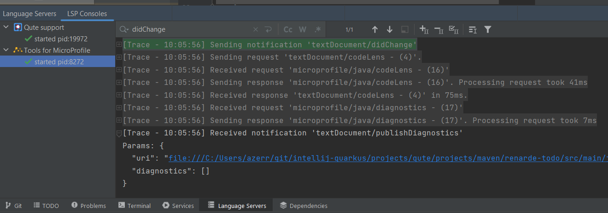
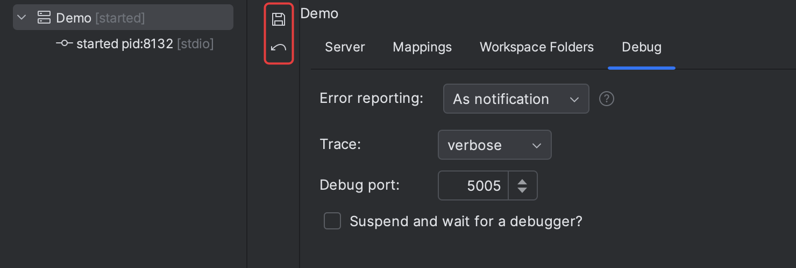
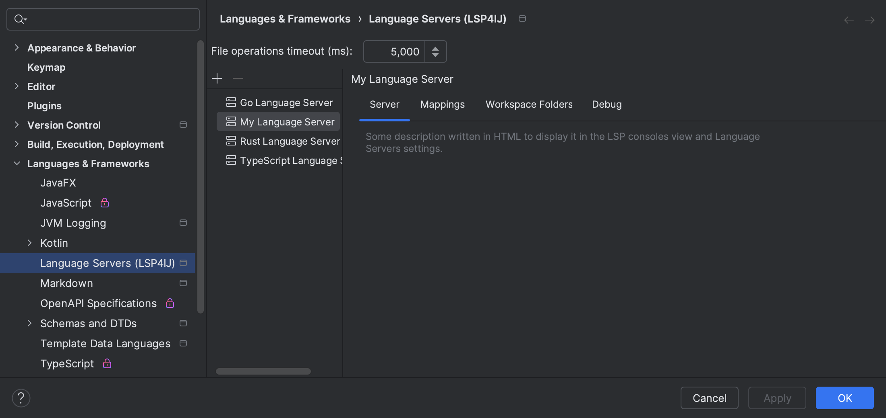
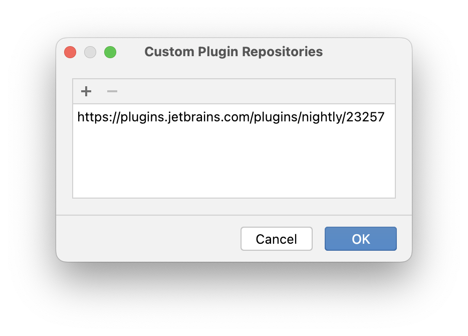
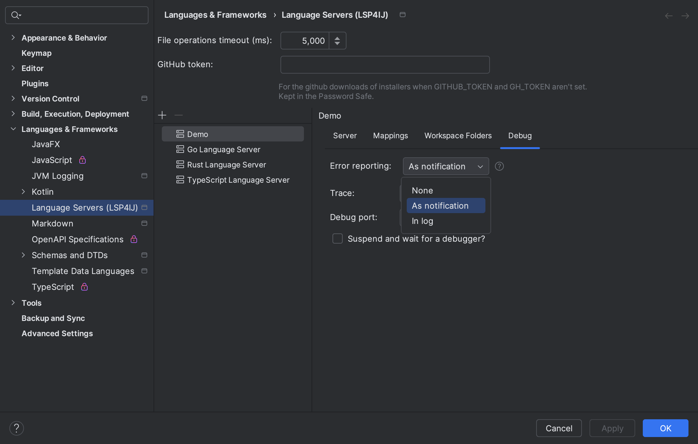
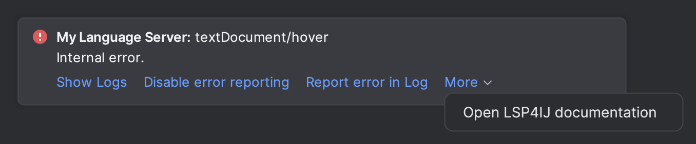
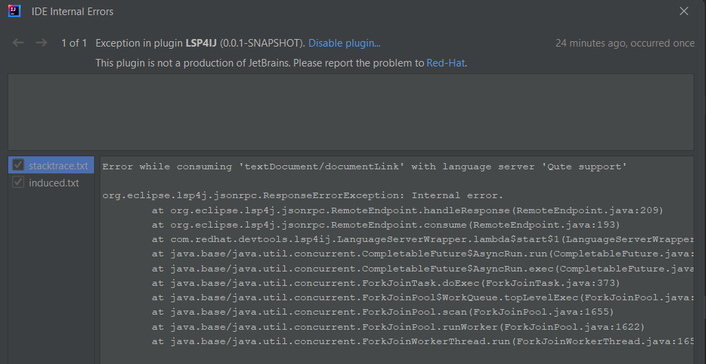
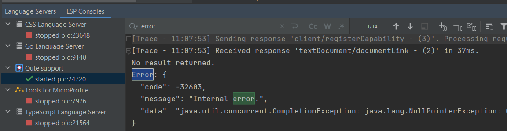

# LSP4IJ

[plugin-repo]: https://plugins.jetbrains.com/plugin/23257-lsp4ij
[plugin-version-svg]: https://img.shields.io/jetbrains/plugin/v/23257-lsp4ij.svg
[plugin-downloads-svg]: https://img.shields.io/jetbrains/plugin/d/23257-lsp4ij.svg
[plugin-rating-svg]: https://img.shields.io/jetbrains/plugin/r/rating/23257


[![JetBrains plugins][plugin-version-svg]][plugin-repo]
[![JetBrains Plugin Rating][plugin-rating-svg]][plugin-repo]
[![JetBrains plugins][plugin-downloads-svg]][plugin-repo]

## Description
<!-- Plugin description -->

LSP4IJ is a free and open-source 

 * [Language Server protocol (LSP)](https://microsoft.github.io/language-server-protocol/) client compatible with all flavours of IntelliJ.
 * [Debug Adapter Protocol](https://microsoft.github.io/debug-adapter-protocol/) support with [Debug Adapter Protocol Run/Debug configuration](./docs/dap/UserGuide.md).

It allows you to integrate any `language server` that communicates with its client via `stdio`, or over a TCP socket
(see [SocketStreamConnectionProvider](./docs/DeveloperGuide.md#socketstreamconnectionprovider) and the
[transport of a user-defined language server](./docs/UserDefinedLanguageServer.md#transport)):

* by `developing an IntelliJ plugin` with LSP `extension points`:
  * [com.redhat.devtools.lsp4ij.server](./docs/DeveloperGuide.md#extension-point-declaration) extension point to define a language server.
  * [com.redhat.devtools.lsp4ij.languageMapping](./docs/DeveloperGuide.md#declare-file-mappings) to associate an IntelliJ language with a language server definition.
* by manually adding [language server definitions](./docs/UserDefinedLanguageServer.md), 
supporting custom server settings. This approach doesn't require developing a specific IntelliJ plugin.

LSP4IJ also provides:

* an [LSP Consoles view](./docs/UserGuide.md#lsp-console) to tracks LSP requests, responses and notifications in a console:



If you select the language server node, you can configure it the same way as in the [Language Servers preferences page](./docs/UserGuide.md#language-servers-preferences)



and use the left toolbar to `Apply` or `Reset` the settings.

* a [Language Servers preferences page](./docs/UserGuide.md#language-servers-preferences) to configure the LSP trace level, the debug port to use to debug language server:



You can find more documentation in:

 * [the developer guide](./docs/DeveloperGuide.md), providing step-by-step instructions on how to integrate a language server in LSP4J in an external IntelliJ plugin.
 * [the User-defined language server documentation](./docs/UserDefinedLanguageServer.md), explaining how to integrate a language server in LSP4J with few settings. 
 * [the user guide](./docs/UserGuide.md), which explains how to use LSP console and Language Server preferences.
 * [the LSP Support overview](./docs/LSPSupport.md), describing which LSP features are implemented, and how.

<!-- Plugin description end -->

## Articles

 * [Meet LSP4IJ, a new LSP Client for JetBrains-based IDEs](https://github.com/redhat-developer/idetools.dev/blob/main/blog/2024-06-20-lsp4ij-announcement.md)
 * [Meet LSP4IJ, a new Debug Adapter Protocol for JetBrains-based IDEs](https://github.com/redhat-developer/idetools.dev/blob/main/blog/2025-03-10-lsp4ij-dap-annoucement.md)

## Who is using LSP4IJ?

Here are some projects that use LSP4IJ:

 * [Adamantium AUML](https://github.com/AdamantiumStudio/AdamantiumUI/tree/main/editors/rider-auml)
 * [aer Local Apex Debugger](https://www.octoberswimmer.com/tools/aer/docs/intellij-debugging/)
 * [agentic-security](https://github.com/Clear-Capabilities/agentic-security/tree/main/ide/jetbrains)
 * [agnix](https://github.com/agent-sh/agnix)
 * [Aktion](https://github.com/asfand-dev/aktion/tree/main/editors/jetbrains)
 * [alint](https://github.com/asamarts/alint/tree/main/editors/jetbrains)
 * [AngelScript Language Server for IntelliJ](https://github.com/sashi0034/angel-intellij)
 * [AngelScript Support](https://github.com/westquote/intellij-angelscript)
 * [Ansible LSP](https://github.com/JulianVennen/ij-ansible-lsp)
 * [Ansible Studio](https://plugins.jetbrains.com/plugin/35443-ansible-studio)
 * [ARO Programming Language](https://github.com/arolang/aro)
 * [Astro Pro](https://plugins.jetbrains.com/plugin/30290-astro-pro)
 * [Aurora Language Support](https://github.com/aurora-language/aurora-language/tree/main/aurora-intellij)
 * [Azure Templates Navigator](https://github.com/qSharpy/azure-templates-navigator/tree/main/clients/intellij)
 * [BAML JetBrains Plugin](https://github.com/BoundaryML/baml/tree/canary/jetbrains)
 * [BBj Language Support for IntelliJ](https://github.com/BBx-Kitchen/bbj-language-server)
 * [Big O Lens](https://plugins.jetbrains.com/plugin/34624-big-o-lens)
 * [Bloc Linter Support for IntelliJ](https://github.com/felangel/bloc/tree/master/extensions/intellij)
 * [Blok Workflow Support](https://github.com/well-prado/blok/tree/main/packages/intellij-plugin)
 * [C/C++ Project (LSP)](https://github.com/Ant-ON/intellij-c-cpp-lsp)
 * [Cadastre](https://github.com/Jbbouille/cadastre/tree/master/editors/intellij)
 * [Candela](https://github.com/lumen-fx/candela/tree/main/editors/jetbrains)
 * [Carve](https://github.com/markup-carve/intellij-carve)
 * [CD4Analysis](https://github.com/MontiCore/cd4analysis/tree/dev/language-server/cd4a-intellij-plugin)
 * [CIMNotebook](https://github.com/SOPTIM/OpenCGMES/tree/main/cimnotebook/intellij)
 * [Clojure LSP IntelliJ](https://github.com/clojure-lsp/clojure-lsp-intellij)
 * [COBOL](https://plugins.jetbrains.com/plugin/32642-cobol)
 * [Cobolwise: COBOL & Copybooks](https://plugins.jetbrains.com/plugin/34973-cobolwise-cobol--copybooks)
 * [CodeGraph AI](https://github.com/codegraph-ai/CodeGraph/tree/main/jetbrains)
 * [CodeQL](https://plugins.jetbrains.com/plugin/24958-codeql)
 * [Concord DX](https://github.com/ConcordDev/concord-cognitive-engine/tree/main/concord-jetbrains)
 * [ContextMapper](https://github.com/ContextMapper/context-mapper-intellij-plugin)
 * [Cosmoteer Language Server](https://github.com/Cosmoteer-Modding-Tools/cosmoteer-lsp/tree/master/jetbrains)
 * [CP Lang](https://github.com/ryanbai1412/cp-lang/tree/main/editors/jetbrains)
 * [Defold Support](https://github.com/aridclown/Intellij-Defold)
 * [Desi Language](https://github.com/desilang/desi/tree/main/editors/intellij)
 * [Deslop](https://github.com/Nimblesite/Deslop/tree/main/clients/jetbrains/deslop-lsp4ij)
 * [Develop for Pebble](https://github.com/dtretyakov/idea-pebble)
 * [Dinowise: Deno](https://plugins.jetbrains.com/plugin/35114-dinowise-deno)
 * [DixScript (.mdix)](https://github.com/Mid-D-Man/DixScript-Rust/tree/master/mdix-intellij)
 * [Dmf-plugin](https://github.com/Winnetoe24/DMF/tree/master/intellijPlugin)
 * [doit Language](https://github.com/tobyn/doit/tree/main/editors/jetbrains)
 * [Dotprompt](https://github.com/google/dotprompt/tree/main/packages/jetbrains)
 * [DryGuard](https://github.com/bobrowsse-tech/dryguard/tree/main/packages/jetbrains-plugin)
 * [Ecko](https://plugins.jetbrains.com/plugin/33867-ecko)
 * [Ecstasy Language Support](https://plugins.jetbrains.com/plugin/31202-ecstasy-language-support)
 * [Elemenx](https://github.com/Qybercom/Elemenx/tree/main/editors/intellij)
 * [Eliot](https://github.com/eliotlang/eliot/tree/master/ide/intellij)
 * [Elixir Pro](https://plugins.jetbrains.com/plugin/32247-elixir-pro)
 * [Ens](https://github.com/AlexDicy/Ens/tree/main/tools/intellij)
 * [EnvForge - AI-Safe Environment Manager](https://github.com/EmreErinc/envforge/tree/main/editors/intellij)
 * [EO (LSP)](https://github.com/GeorgySabaev/eo-intellij-lsp-plugin)
 * [Eskiu](https://github.com/eskiu-lang/eskiu/tree/main/editor/intellij/plugin)
 * [eTamil](https://github.com/Maruff/eTamil_lang/tree/main/packaging/jetbrains/plugin)
 * [Fish Shell for JetBrains](https://github.com/tox-dev/jetbrains-fish)
 * [Flint](https://github.com/Mission-Platform/composable-mission-ready-platform/tree/main/extensions/flint-ij)
 * [Flix](https://github.com/wstein/flix-jetbrains-plugin)
 * [Flow Language](https://github.com/NoahFreelove/flow-sharp/tree/dev/flow-jetbrains)
 * [FlutterX](https://github.com/mdddj/dd_flutter_idea_plugin)
 * [function-hcl](https://github.com/crossplane-contrib/function-hcl/tree/main/jetbrains)
 * [GEDCOM](https://github.com/lavich/domorium)
 * [GenAI PHP Portable](https://github.com/projecthsf/php-portable)
 * [Gleam Pro](https://plugins.jetbrains.com/plugin/33935-gleam-pro)
 * [GN Language Server](https://github.com/google/gn-language-server/)
 * [Go (gopls)](https://github.com/Xefise/jetbrains-go-plugin)
 * [Go Language Helper](https://github.com/cag11/go-language-helper)
 * [Go Portable](https://github.com/projecthsf/go-portable)
 * [gotmpls](https://github.com/allseas/go-template-lsp/tree/main/clients/JetBrains/go-text-template)
 * [GreyCat](https://github.com/datathings/greycat-idea-plugin)
 * [GroovyScript for IntelliJ](https://github.com/IntegerLimit/GroovyScriptPlugin)
 * [Haskell LSP for IntelliJ](https://github.com/kilofox/intellij-haskell-lsp)
 * [Hdlwise: Verilog & VHDL](https://plugins.jetbrains.com/plugin/34944-hdlwise-verilog--vhdl)
 * [Helm YAML LSP](https://github.com/fruitriin/helm-yaml-lsp/tree/main/packages/intellij-plugin)
 * [hibou](https://github.com/hibouhq/hibou-ide/tree/main/jetbrains)
 * [Hoverfly](https://github.com/jterrazz/hoverfly-lsp/tree/main/editors/intellij/plugin)
 * [Huly Code](https://github.com/hcengineering/huly-code)
 * [Humalis](https://github.com/emch04/humalis)
 * [IBM Application Modernization Accelerator Developer Tools](https://plugins.jetbrains.com/plugin/28653-ibm-application-modernization-accelerator-developer-tools)
 * [Illuminated Cloud 2](https://plugins.jetbrains.com/plugin/10253-illuminated-cloud-2)
 * [Inga for IntelliJ](https://github.com/seachicken/intellij-inga)
 * [IntelliAda Cardano Integration](https://github.com/bloxbean/intelliada)
 * [IntelliJ Cangjie](https://github.com/lin-qingying/intellij-cangjie)
 * [IntelliJ EmmyLua2](https://github.com/EmmyLua/Intellij-EmmyLua2)
 * [IntelliJ Gleam](https://github.com/themartdev/intellij-gleam)
 * [IntelliJ Gno](https://github.com/gnoverse/intellij-gno)
 * [IntelliJ KCL](https://github.com/kcl-lang/intellij-kcl)
 * [IntelliJ LUMOS](https://github.com/getlumos/intellij-lumos)
 * [IntelliJ SumnekoLua](https://github.com/CppCXY/Intellij-SumnekoLua)
 * [Iris Code](https://plugins.jetbrains.com/plugin/33168-iris-code)
 * [Islandwise: Astro](https://plugins.jetbrains.com/plugin/35169-islandwise-astro)
 * [Java Portable](https://github.com/projecthsf/java-portable)
 * [Jimmer Buddy LSP](https://github.com/Enaium/JimmerBuddyLSP)
 * [Jinga IDEA](https://github.com/kleberDevion/poolscript/tree/main/editor/intellij/plugin)
 * [Jsonnet Language Server](https://github.com/zzehring/intellij-jsonnet)
 * [Julimate for Julia](https://plugins.jetbrains.com/plugin/34952-julimate-for-julia)
 * [Jux Language](https://github.com/xdsswar/juxlang/tree/master/ide/intellij-plugin)
 * [Kargo](https://github.com/RicardoMilos7/kargo/tree/master/editors/jetbrains)
 * [Klin](https://github.com/klin-lang/klin/tree/main/editors/intellij)
 * [Koine](https://github.com/Atypical-Consulting/Koine/tree/main/tooling/koine-jetbrains)
 * [KQL LSP](https://github.com/raboley/kql-lsp/tree/main/intellij)
 * [ktrs](https://github.com/Hexay/ktrs/tree/master/editors/intellij)
 * [Kumikae AS3](https://github.com/AniCanon/kumikae-as3/tree/main/editors/jetbrains)
 * [Kylix Language Support](https://github.com/astra-zhao/kylix/tree/main/jetbrains-plugin)
 * [Language 1C (BSL) Plugin](https://github.com/1c-syntax/intellij-language-1c-bsl)
 * [Lean4ij](https://github.com/onriv/lean4ij)
 * [Liberty Tools for IntelliJ](https://github.com/OpenLiberty/liberty-tools-intellij)
 * [LID - Linked-Intent Development](https://github.com/EtaCassiopeia/lid-tooling/tree/main/extensions/intellij)
 * [linthis](https://github.com/zhlinh/linthis/tree/master/jetbrains-linthis)
 * [Localcord](https://github.com/KaenguruuDev/Localcord-Rider)
 * [Lua Pro](https://plugins.jetbrains.com/plugin/35721-lua-pro)
 * [Ludic](https://github.com/workshopsoft/ludic/tree/main/tools/editors/jetbrains)
 * [Lumen UI](https://github.com/lumen-fx/lumen/tree/main/tools/jetbrains-lumen)
 * [MC Studio Helper](https://github.com/TartaricAcid/MCStudioHelper)
 * [Metal Shader Language Support](https://github.com/Yif1999/MSL-Rider-Plugin)
 * [MetaScript](https://github.com/metascriptlang/metascript-jetbrains)
 * [MinML](https://github.com/dedis/matchertext/tree/main/dev/jetbrains)
 * [Monkey C](https://github.com/dtretyakov/idea-monkeyc)
 * [MontiGem UMLP](https://github.com/MontiCore/montigem/tree/dev/umlp-tool/umlp-intellij-plugin)
 * [MOS](https://github.com/datatrash/mos/tree/master/intellij)
 * [mq - jq-like tool for Markdown processing](https://github.com/harehare/mq/tree/main/editors/jetbrains)
 * [nelumbo](https://github.com/ModelingValueGroup/nelumbo/tree/develop/lsp/plugins/intellij)
 * [NetRexx](https://github.com/remesm/lsp4nrx)
 * [Nextflow](https://github.com/forest-d/jetbrains-language-nextflow)
 * [Nim Pro](https://plugins.jetbrains.com/plugin/35539-nim-pro)
 * [Nim using nimlangserver](https://plugins.jetbrains.com/plugin/31790-nim-using-nimlangserver)
 * [Nix Pro](https://plugins.jetbrains.com/plugin/31649-nix-pro)
 * [NodeSpark](https://github.com/tanvoid0/node-spark)
 * [Nox Language](https://github.com/deepsarda/Nox/tree/main/editors/intellij)
 * [Nu Lint](https://plugins.jetbrains.com/plugin/31165-nu-lint)
 * [Nu LSP](https://plugins.jetbrains.com/plugin/31106-nu-lsp)
 * [OPA IDEA Plugin](https://github.com/open-policy-agent/opa-idea-plugin)
 * [Opal-Vite](https://github.com/stofu1234/opal-vite)
 * [OpenTelemetry Collector Config](https://github.com/otelery/otelcol-lang/tree/main/editors/jetbrains)
 * [pgzest](https://github.com/Creatiwity/pgzest/tree/main/editors/jetbrains)
 * [PHP LSP](https://github.com/jorgsowa/php-lsp-phpstorm-plugin)
 * [Piko](https://github.com/piko-sh/piko/tree/master/plugins/idea)
 * [PMC (Post machine toolchain)](https://github.com/mellonis/machine-toolchains/tree/master/editors/jetbrains-pm)
 * [Pojoc](https://github.com/thorminate/pojoc/tree/dev/jetbrains-plugin)
 * [Poryscript IDEA](https://github.com/okafke/poryscript-idea)
 * [Pourwise: Liquid & Shopify](https://plugins.jetbrains.com/plugin/35188-pourwise-liquid--shopify)
 * [PseudoScript](https://github.com/flying-dice/pseudoscript-jetbrains)
 * [PurrLang](https://plugins.jetbrains.com/plugin/34610-purrlang)
 * [Pyfun](https://github.com/simontreanor/Pyfun/tree/main/editors/jetbrains)
 * [Pyrefly (Unofficial)](https://github.com/InSyncWithFoo/pyrefly-for-pycharm)
 * [Pyright for PyCharm](https://github.com/InSyncWithFoo/pyright-for-pycharm)
 * [Python Portable](https://github.com/projecthsf/python-portable)
 * [qkt](https://github.com/elitekaycy/qkt/tree/dev/editor/jetbrains)
 * [Qt Bridge for JVM](https://github.com/qt/qtbridge-java/tree/dev/ide/intellij)
 * [Qt Tools for Android Studio](https://code.qt.io/cgit/qt-labs/android-studio-tools.git/)
 * [QuantumVM](https://github.com/wiji1/QuantumVM-Jetbrains)
 * [Quarkdown](https://github.com/CarmJos/quarkdown-for-intellij)
 * [Quarkus Tools for IntelliJ](https://github.com/redhat-developer/intellij-quarkus)
 * [Razomy Notation](https://github.com/razomy/notation.jetbrains.intellij.ide.plugin)
 * [Redscript IntelliJ](https://github.com/pawrequest/redscript-intellij)
 * [Rell](https://gitlab.com/chromaway/rell-jetbrains)
 * [Renmy Runtime - Salesforce IDE](https://plugins.jetbrains.com/plugin/32360-renmy-runtime--salesforce-ide)
 * [ReScript IDE](https://github.com/benjamin-thomas/intellij-rescript)
 * [Rider Unreal Angelscript](https://github.com/scriptacus/rider-unreal-angelscript)
 * [RobotCode - Robot Framework Support](https://robotcode.io)
 * [Robust LSP](https://github.com/RedSpeeds/robust-lsp-rider)
 * [Rovo LSP for IntelliJ](https://github.com/Arthurdw/rovo)
 * [Ruby LSP](https://github.com/vitallium/intellij-plugin-ruby-lsp)
 * [Ruby Portable](https://github.com/projecthsf/ruby-portable)
 * [Ruff for PyCharm](https://github.com/koxudaxi/ruff-pycharm-plugin)
 * [Runewise: Svelte 5](https://plugins.jetbrains.com/plugin/35141-runewise-svelte-5)
 * [Rust Analyzer](https://github.com/InSyncWithFoo/rust-analyzer-for-rustrover)
 * [Rust Portable](https://github.com/projecthsf/rust-portable)
 * [Rust Pro](https://plugins.jetbrains.com/plugin/35722-rust-pro)
 * [RyeCharm](https://github.com/InSyncWithFoo/ryecharm)
 * [Saffron](https://github.com/s-chathuranga-j/saffron-jetbrains-plugin)
 * [Salam](https://github.com/SalamLang/Salam/tree/main/extensions/jetbrains/plugin)
 * [SAP CDS Language Support for IntelliJ](https://github.com/cap-js/cds-intellij)
 * [SaTeX](https://github.com/EagleoutIce/satex-analyzer/tree/main/editors/intellij)
 * [Saule](https://github.com/lauriszz123/saule-intellij)
 * [Scribe Pro](https://plugins.jetbrains.com/plugin/30231-scribe-pro)
 * [SDLB LSP](https://github.com/smart-data-lake/sdl-lsp)
 * [Sema](https://github.com/sema-lisp/intellij-sema)
 * [Semantic Web Language Server](https://github.com/SemanticWebLanguageServer/swls)
 * [ShEx](https://github.com/shexjs/shex.js/tree/main/clients/jetbrains)
 * [Showbiz](https://github.com/FlooferLand/bizlib/tree/main/showbiz-intellij)
 * [Silicon](https://github.com/natescode/silicon/tree/main/plugins/intellij)
 * [Slang [Unofficial]](https://github.com/16-Bit-Dog/slang-jetbrains-extension)
 * [Slint Pro](https://plugins.jetbrains.com/plugin/32913-slint-pro)
 * [slop-chop](https://github.com/dcadolph/slop-chop/tree/main/jetbrains)
 * [Socle (Chisel)](https://github.com/socless/socle-intellij)
 * [Solidity Pro](https://plugins.jetbrains.com/plugin/32553-solidity-pro)
 * [Spec](https://github.com/OmniImpact/spec-lang/tree/main/jetbrains)
 * [Spec-Driven](https://github.com/rsaglobaltech/specgate/tree/main/packages/intellij-spec-driven)
 * [SPHIOR CODE](https://github.com/Toraastrta/sphior-code/tree/main/packages/sphior-jetbrains)
 * [Sprocket](https://github.com/stjude-rust-labs/sprocket-intellij)
 * [Styx](https://github.com/bearcove/styx/tree/main/editors/jetbrains-styx)
 * [SuperDB](https://github.com/chrismo/superdb-intellij)
 * [Superwire](https://github.com/milewski/superwire/tree/main/editors/intellij)
 * [SurrealQL](https://github.com/surrealdb/surrealql-jetbrains)
 * [T-Ruby](https://github.com/type-ruby/t-ruby-jetbrains)
 * [Tailwind Deprecated](https://github.com/ChuckBiros/tailwind-deprecated-monorepo/tree/main/plugin)
 * [Takt](https://github.com/Pastor/Takt/tree/v2/extensions/intellij-takt)
 * [Taxi Language Support](https://github.com/taxilang/taxilang/tree/develop/language-server/intellij-plugin)
 * [Teal](https://github.com/Spacylab/teal-intellij)
 * [Terramate](https://github.com/terramate-io/jetbrains-terramate)
 * [Tide](https://github.com/Tide-Engine/tide-jetbrains)
 * [Tinymist Typst](https://github.com/Myriad-Dreamin/tinymist/tree/main/editors/intellij)
 * [TOON Language](https://github.com/w0wl0lxd/toon-lsp/tree/main/editors/jetbrains)
 * [Trainz Language](https://github.com/Cethric/trainz-language-server/tree/develop/extensions/trainz-idea)
 * [TTR Modeler](https://github.com/Collite/ttr-core/tree/master/intellij-plugin)
 * [TypeScript ART](https://plugins.jetbrains.com/plugin/35975-typescript-art)
 * [UWVM Host Debugger](https://github.com/UlteSoft/uwvm2-ros/tree/main/tools/debug/jetbrains)
 * [Vala Language](https://github.com/vala-lang/vala-jetbrains)
 * [Veld](https://github.com/Adhamzineldin/Veld/tree/master/editors/jetbrains)
 * [Vespa Schema Language Support](https://github.com/vespa-engine/vespa/tree/master/integration/schema-language-server/clients/intellij)
 * [Vlang](https://github.com/vlang/intellij-v)
 * [Wasp Language Support](https://github.com/pannous/wasp-jetbrains-plugin)
 * [Workflow Engine](https://github.com/GoCodeAlone/workflow-jetbrains)
 * [WoW Lua Language Server](https://github.com/TradeSkillMaster/wowlua-ls/tree/main/editors/jetbrains)
 * [Wyrm](https://github.com/1ARdotNO/wyrm/tree/main/editors/intellij)
 * [Xonsh plugin for JetBrains IDEs](https://github.com/nahoj/xonsh-jetbrains)
 * [xslint for XSL/XSLT](https://github.com/xslint/xslint-jetbrains)
 * [Zig Pro](https://plugins.jetbrains.com/plugin/35677-zig-pro)
 * [ZigBrains](https://codeberg.org/FalsePattern/ZigBrains)
 * [Zowe™ COBOL Language Support](https://github.com/zowe/zowe-cobol-language-support-intellij)

## Requirements

* Intellij IDEA 2024.2 or more recent (we **try** to support the last 4 major IDEA releases)
* Java JDK (or JRE) 17 or more recent

## Contributing

This is an open source project open to anyone. Contributions are extremely welcome!

 
### Building

Project is managed by Gradle. So building is quite easy.

#### Building the plugin distribution file

Run the following command:

```sh
./gradlew buildPlugin
```
The plugin distribution file is located in ```build/distributions```.

#### Testing

You can also easily test the plugin. Just run the following command:

```sh
./gradlew runIde
```

#### Testing the CI builds

You can also download and install CI builds of the latest commits or a specific pull request:

- open the [`Build plugin zip` workflow](https://github.com/redhat-developer/lsp4ij/actions/workflows/buildZip.yml)
- click on the build you are interested in
- scroll down and download the `LSP4IJ <version>.zip` file
- install `LSP4IJ <version>.zip` into IntelliJ IDEA by following these [instructions](https://www.jetbrains.com/help/idea/managing-plugins.html#install_plugin_from_disk).

#### Testing nightly builds

You can easily install nightly builds from the nightly channel:

- in IntelliJ, open `Setting > Plugins > [Gear icon] > Manage Plugin Repositories...`
- Add `https://plugins.jetbrains.com/plugins/nightly/23257` and press `OK`

- install the latest `LSP4IJ` version

Nightly builds are published once a day.

## Feedback

File a bug in [GitHub Issues](https://github.com/redhat-developer/lsp4ij/issues).

You can have 2 kinds of errors:

 * an error from LSP4IJ, in this case, the error will be reported in the standard IntelliJ log.
 * an error coming from the language server.

For the second case, you can customize the error reporting with the `Debug / Error reporting` combo box 
by opening the `Languages & Frameworks / Language Servers (LSP4IJ)` preferences:



You can select:
 * `None` : in this case the language server error will be ignored.
 * `In notification` (default value) : in this case the language server error appear as a `notification`:

 The error notification shows 3 possible actions:
   * `Disable error reporting` : sets the error reporting to `None`.
   * `Report error in Log` : sets the error reporting to `In log`. 
   * `Open LSP4IJ documentation` : opens this documentation. 
 * `In log` : in this case the language server error will be logged in the standard `IntelliJ log`:


You can see this error's details in the [LSP Consoles view](./docs/UserGuide.md#lsp-console) (by setting the `Debug / Trace` combo box in `verbose`):



## License

Eclipse Public License 2.0.
See [LICENSE](LICENSE) file.
