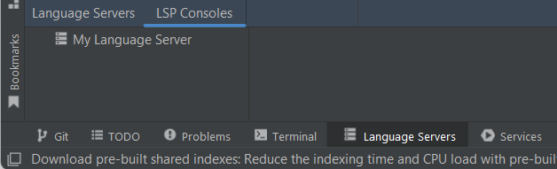
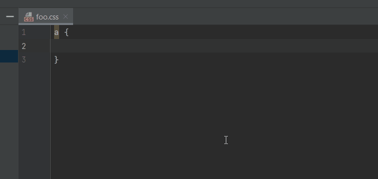
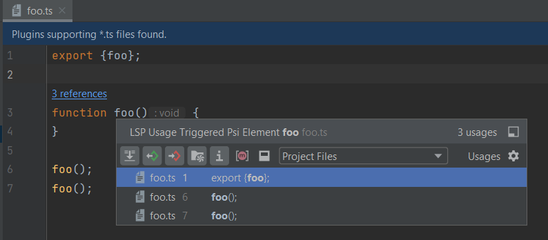
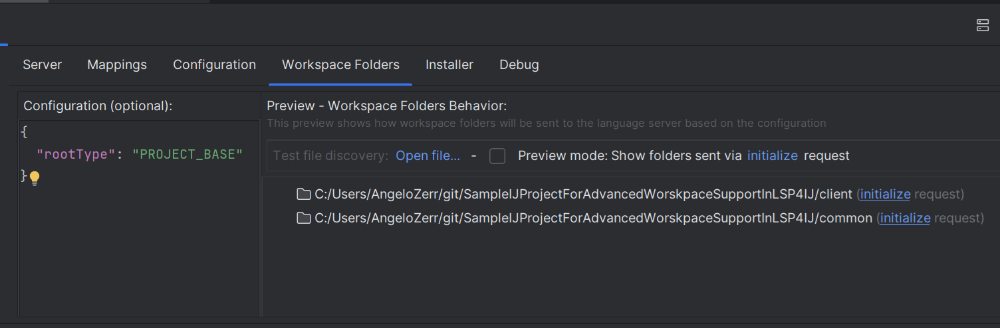
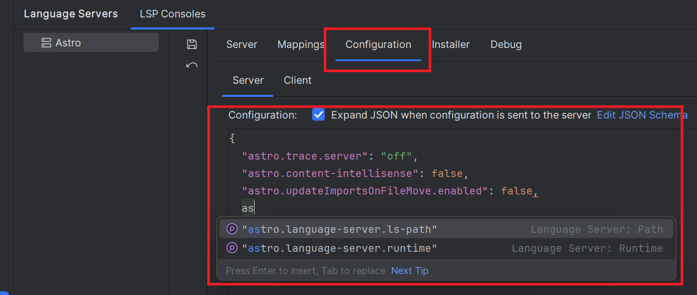

# Developer guide

This section provides step-by-step instructions for contributing an LSP language server in your IntelliJ plugin.

## Reference LSP4IJ

### plugin.xml

The first step is to reference LSP4IJ. LSP4IJ uses `com.redhat.devtools.lsp4ij` as plugin Id.

You
need [to declare dependency in your plugin.xml](https://plugins.jetbrains.com/docs/intellij/plugin-dependencies.html#dependency-declaration-in-pluginxml)
like this:

```xml
<idea-plugin>
    ...

    <depends>com.redhat.devtools.lsp4ij</depends>

    ...
</idea-plugin>
```

### Exclude all LSP4J dependencies

LSP4IJ depends on [Eclipse LSP4J](https://github.com/eclipse-lsp4j/lsp4j) (Java binding for
the [Language Server Protocol](https://microsoft.github.io/language-server-protocol) and
the [Debug Adapter Protocol](https://microsoft.github.io/debug-adapter-protocol).). It provides its own version of LSP4J
and its classes are loaded in the LSP4IJ plugin class loader.

If your IntelliJ Plugin contributes a Java-based language server, it must not embed its own version of LSP4J, in order to avoid conflicts with the version provided by
LSP4IJ. Failing to do so will result in `ClassCastException` errors to be thrown.
Make sure that the LSP4J dependency in your plugin is either declared with a `runtimeOnly` scope or excluded entirely,
if it's referenced as a transitive dependency.

Here is an example from the [build.gradle.kts](https://github.com/redhat-developer/intellij-quarkus/blob/main/build.gradle.kts) of the [Quarkus Tools](https://github.com/redhat-developer/intellij-quarkus) project,
excluding the LSP4J
dependency from the [Qute Language Server](https://github.com/redhat-developer/quarkus-ls/tree/master/qute.ls):

```kotlin
implementation("com.redhat.microprofile:com.redhat.qute.ls:0.17.0") {
  exclude("org.eclipse.lsp4j")
}
```

## Write Server-related code

## LanguageServerFactory

Create an implementation
of [LanguageServerFactory](https://github.com/redhat-developer/lsp4ij/blob/main/src/main/java/com/redhat/devtools/lsp4ij/LanguageServerFactory.java)
to expose your `my.language.server.MyLanguageServer`,
implementing [`StreamConnectionProvider`](https://github.com/redhat-developer/lsp4ij/blob/main/src/main/java/com/redhat/devtools/lsp4ij/server/StreamConnectionProvider.java) :

```java
package my.language.server;

import com.intellij.openapi.project.Project;
import com.redhat.devtools.lsp4ij.LanguageServerFactory;
import com.redhat.devtools.lsp4ij.client.LanguageClientImpl;
import com.redhat.devtools.lsp4ij.server.StreamConnectionProvider;
import org.eclipse.lsp4j.services.LanguageServer;
import org.jetbrains.annotations.NotNull;

public class MyLanguageServerFactory implements LanguageServerFactory {

    @Override
    public @NotNull StreamConnectionProvider createConnectionProvider(@NotNull Project project) {
        return new MyLanguageServer(project);
    }

    @Override // If you need to provide client specific features
    public @NotNull LanguageClientImpl createLanguageClient(@NotNull Project project) {
        return new MyLanguageClient(project);
    }

    @Override // If you need to expose a custom server API
    public @NotNull Class<? extends LanguageServer> getServerInterface() {
        return MyCustomServerAPI.class;
    }

}
```

In this sample `MyCustomServerAPI` interface could look like this:

```java
import org.eclipse.lsp4j.jsonrpc.services.JsonRequest;
import org.eclipse.lsp4j.services.LanguageServer;

import java.util.List;
import java.util.concurrent.CompletableFuture;

public interface MyCustomServerAPI  extends LanguageServer {

    @JsonRequest("my/applications")
    CompletableFuture<List<Application>> getApplications();
}
```

If you need to provide client specific features (e.g. commands), you can override the `createLanguageClient` method to
return your custom LSP client implementation.

If you need to expose a custom server API, i.e. custom commands supported by your language server, you can override
the `getServerInterface()` method to return a custom interface extending LSP4J's LanguageServer API.

### StreamConnectionProvider Implementation

Your `MyLanguageServer` needs to implement
the [StreamConnectionProvider](https://github.com/redhat-developer/lsp4ij/blob/main/src/main/java/com/redhat/devtools/lsp4ij/server/StreamConnectionProvider.java)
API which :

* manages the language server lifecycle (start/stop)
* returns the input/error stream of LSP requests, responses, notifications.

Frequently, a language server process is started through a runtime like Java, Node.js, etc. In this case you
need to
extend [OSProcessStreamConnectionProvider](https://github.com/redhat-developer/lsp4ij/blob/main/src/main/java/com/redhat/devtools/lsp4ij/server/OSProcessStreamConnectionProvider.java) or [ProcessStreamConnectionProvider](https://github.com/redhat-developer/lsp4ij/blob/main/src/main/java/com/redhat/devtools/lsp4ij/server/ProcessStreamConnectionProvider.java)

#### OSProcessStreamConnectionProvider

It is recommended to extend [OSProcessStreamConnectionProvider](#osprocessstreamconnectionprovider) instead of
[ProcessStreamConnectionProvider](#processstreamconnectionprovider) because the former internally uses the
IntelliJ [OSProcessHandler](https://github.com/JetBrains/intellij-community/blob/master/platform/platform-util-io/src/com/intellij/execution/process/OSProcessHandler.java) class 
which wraps a process and allows to track the process state via a 
[ProcessListener](https://github.com/JetBrains/intellij-community/blob/master/platform/util/src/com/intellij/execution/process/ProcessListener.java) listener.

In addition, OSProcessStreamConnectionProvider allows to log errors from the language server in the `Logs` tab of the 
[LSP console](https://github.com/redhat-developer/lsp4ij/blob/main/docs/UserGuide.md#lsp-console).

An `OSProcessStreamConnectionProvider` starts one process: LSP4IJ creates a new provider with `createConnectionProvider`
for each start of the language server, and `start()` throws a `CannotStartProcessException` when the provider has
already been started or stopped.

Since IntelliJ 2025.1, a plugin can set up the environment of a process for its working directory (the
`commandLineEnvCustomizer` extension point), as the [mise](https://mise.jdx.dev/) plugin does. A command line with a
working directory (`withWorkDirectory`) gets that environment when it starts, and `start()` looks its command up in
the `PATH` of that environment, as for a
[user-defined language server](./UserDefinedLanguageServer.md#directory-specific-environment-variables). A command
which is a path, or a command line without a working directory, is left as it is.
[ProcessStreamConnectionProvider](#processstreamconnectionprovider) starts its process with a `ProcessBuilder`, which
gets neither.

Here is a basic sample which starts the `path/to/my/language/server/main.js` language server written in JavaScript, with
the Node.js runtime found in "path/to/nodejs/node.exe":

```java
package my.language.server;

import com.intellij.execution.configurations.GeneralCommandLine;
import com.intellij.openapi.project.Project;
import com.redhat.devtools.lsp4ij.server.OSProcessStreamConnectionProvider;

public class MyLanguageServer extends OSProcessStreamConnectionProvider {

    public MyLanguageServer(Project project) {
        GeneralCommandLine commandLine = new GeneralCommandLine("path/to/nodejs/node.exe", "path/to/my/language/server/main.js");
        super.setCommandLine(commandLine);
    }
}
```

#### ProcessStreamConnectionProvider

Here is a basic sample which starts the `path/to/my/language/server/main.js` language server written in JavaScript, with
the Node.js runtime found in "path/to/nodejs/node.exe":

```java
package my.language.server;

import com.intellij.openapi.project.Project;
import com.redhat.devtools.lsp4ij.server.ProcessStreamConnectionProvider;

import java.util.Arrays;
import java.util.List;

public class MyLanguageServer extends ProcessStreamConnectionProvider {

    public MyLanguageServer(Project project) {
        List<String> commands = Arrays.asList("path/to/nodejs/node.exe", "path/to/my/language/server/main.js");
        super.setCommands(commands);
    }
}
```

If your language server is written in Java, you can
use [JavaProcessCommandBuilder](https://github.com/redhat-developer/lsp4ij/blob/main/src/main/java/com/redhat/devtools/lsp4ij/server/JavaProcessCommandBuilder.java) to build the launch command:

```java
package my.language.server;

import com.intellij.openapi.project.Project;
import com.redhat.devtools.lsp4ij.server.JavaProcessCommandBuilder;
import com.redhat.devtools.lsp4ij.server.ProcessStreamConnectionProvider;

import java.util.Arrays;
import java.util.List;

public class MyLanguageServer extends ProcessStreamConnectionProvider {

    public MyLanguageServer(Project project) {
        List<String> commands = new JavaProcessCommandBuilder(project, "myLanguageServerId")
                .setJar("path/to/my/language/server/server.jar")
                .create();
        super.setCommands(commands);
    }
}
```

This builder takes care of filling command with the current Java runtime, and adds additional debug flags if the settings of the
language server `myLanguageServerId` defines a debug port.

You can see a complete example
with the [QuteServer](https://github.com/redhat-developer/intellij-quarkus/blob/main/src/main/java/com/redhat/devtools/intellij/qute/lsp/QuteServer.java) implementation.

#### SocketStreamConnectionProvider

When the language server talks LSP over a TCP socket instead of its standard input and output, use
[SocketStreamConnectionProvider](https://github.com/redhat-developer/lsp4ij/blob/main/src/main/java/com/redhat/devtools/lsp4ij/server/SocketStreamConnectionProvider.java).
It covers the three ways a language server takes a socket connection:

```java
// The language server runs already, as in a debugger or inside another application, and listens on port 6005
SocketStreamConnectionProvider.attachTo("127.0.0.1", 6005);

// LSP4IJ starts the language server, which listens on a free port, and connects to it once it accepts connections
SocketStreamConnectionProvider.startAndConnect(0, port ->
        new GeneralCommandLine("path/to/my-language-server", "--port", String.valueOf(port)));

// LSP4IJ listens on a free port and starts the language server, which connects to it, as VS Code's socket
// transport does for a language server started with --socket=<port>
SocketStreamConnectionProvider.startAndAccept(0, port ->
        new GeneralCommandLine("path/to/nodejs/node.exe", "path/to/my/language/server/main.js", "--socket=" + port));
```

A port of 0 lets LSP4IJ choose a free port, for which the command line is made. LSP4IJ listens on the loopback addresses
only: on `127.0.0.1` and `::1`, on the same port, so that a language server which connects to `localhost` reaches it
on either, and on the first one alone when the port isn't free on the other, or without IPv6. `startAndConnect`
connects to the loopback address of the JVM and then to the other one. The output of a language server which LSP4IJ
starts goes to the `Logs` tab of the
[LSP console](https://github.com/redhat-developer/lsp4ij/blob/main/docs/UserGuide.md#lsp-console), since the socket
carries the protocol: its standard output as information, and its standard error as errors. A language server which ends, or closes the connection, is reported as stopped unexpectedly, as
a language server process is. Stopping the language server closes the connection, and ends the process only if LSP4IJ
started it: a language server which ran already keeps running. A start waits for the connection 60 seconds by default
(`setStartTimeout`), as when the command of a language server doesn't take the port: past it, the start fails, and stops
the language server if LSP4IJ started it. An attach waits 10 seconds at most (`ATTACH_TIMEOUT`, or the start timeout if
it is shorter), since a language server which runs already accepts the connection at once, or not at all, as on a host
which drops packets.

As with any TCP transport of LSP, which has no handshake to authenticate its peer, any local process can connect to a
loopback port: on a machine shared with other users, prefer the standard input and output of the language server's
process.

### LanguageClientImpl

It is not required, but you can override the [LanguageClientImpl](https://github.com/redhat-developer/lsp4ij/blob/main/src/main/java/com/redhat/devtools/lsp4ij/client/LanguageClientImpl.java) to, for instance:

* add some IJ listeners when the language client is created.
* override some LSP methods.

```java
package my.language.server;

import com.intellij.openapi.project.Project;
import com.redhat.devtools.lsp4ij.client.LanguageClientImpl;

public class MyLanguageClient extends LanguageClientImpl {
    public MyLanguageClient(Project project) {
        super(project);
    }
}
```

If your language server manages custom LSP requests, it is recommended to extend [IndexAwareLanguageClient](https://github.com/redhat-developer/lsp4ij/blob/main/src/main/java/com/redhat/devtools/lsp4ij/client/IndexAwareLanguageClient.java), to ensure it won't be adversely affected by indexing operations.

You can see a full example
with [QuteLanguageClient](https://github.com/redhat-developer/intellij-quarkus/blob/main/src/main/java/com/redhat/devtools/intellij/qute/lsp/QuteLanguageClient.java)

## workspace/didChangeConfiguration

If you need to send a `workspace/didChangeConfiguration` with your settings, you can:

 * override and implement `LanguageClientImpl#createSettings()` to create the settings to send
 * call `LanguageClientImpl#triggerChangeConfiguration()` to send the settings from your custom listener (ex : track the change of your settings)

if you need to send a `workspace/didChangeConfiguration` when server is started, you can override and 
implement `LanguageClientImpl#handleServerStatusChanged(ServerStatus serverStatus)` like this:

```java
@Override
public void handleServerStatusChanged(ServerStatus serverStatus) {
    if (serverStatus == ServerStatus.started) {
        triggerChangeConfiguration();
    }
}
```

## Extension point declaration

The next step is to declare the server in your plugin.xml with the `com.redhat.devtools.lsp4ij.server` extension point
referencing your `my.language.server.MyLanguageServerFactory`:

```xml
<extensions defaultExtensionNs="com.redhat.devtools.lsp4ij">
    <server id="myLanguageServerId"
            name="My Language Server"
            factoryClass="my.language.server.MyLanguageServerFactory">
        <description><![CDATA[
        Some description written in HTML to display it in the LSP consoles view and Language Servers settings.
        ]]>
        </description>
    </server>
</extensions>

```

`id`, `name` and `factoryClass` are the ones you need. The extension point also takes:

* `icon`: the resource path of the icon of the language server in the LSP console and the Language Servers settings,
  of 13x13 pixels.
* `bundle`, `nameKey` and `descriptionKey`: to take the name and the description from a resource bundle, instead of
  `name` and `description`.
* `singleton`: `true` for a language server which serves the files of all the open projects, instead of one language
  server per project. `false` by default.
* `supportsLightEdit`: `true` for a language server which also serves the files opened in LightEdit mode, without a
  project. `false` by default.
* `lastDocumentDisconnectedTimeout`: the time in seconds for which the language server keeps running once its last file
  is closed, before LSP4IJ stops it. 5 by default.

A that point, once the declaration is done, your server should appear in the `LSP Consoles` view:



## Declare file mappings

Once the server is defined in your `plugin.xml`, you still need to associate an IntelliJ language with the `server` defined by the id attribute.
You can use three kinds of mappings:

* [Language mapping](#language-mapping) with the `com.redhat.devtools.lsp4ij.languageMapping` extension point
  used to associate a [Language](https://plugins.jetbrains.com/docs/intellij/custom-language-support.html) with a
  language server.
* [File type mapping](#file-type-mapping) with the `com.redhat.devtools.lsp4ij.fileTypeMapping` extension point
  used to associate a [File type](https://www.jetbrains.com/help/idea/creating-and-registering-file-types.html) with a
  language server.
* [File name pattern mapping](#file-name-pattern-mapping) with the `com.redhat.devtools.lsp4ij.fileNamePatternMapping`
  extension point
  used to associate a simple pattern file name (ex: `*.less`) with a language server.
  This mapping can be very helpful if you need to support syntax coloration with TextMate.
  Indeed, when you manually define
  a [File type](https://www.jetbrains.com/help/idea/creating-and-registering-file-types.html) for some file name
  patterns, **you loose the TextMate syntax coloration**.

### Language mapping

Here is a sample snippet to associate the `XML` language with the `myLanguageServerId` server:

```xml
<extensions defaultExtensionNs="com.redhat.devtools.lsp4ij">

    <languageMapping language="XML"
                     serverId="myLanguageServerId"/>

</extensions>
```

#### Language ID

Some language servers use
the [TextDocumentItem#languageId](https://microsoft.github.io/language-server-protocol/specifications/lsp/3.17/specification/#textDocumentItem)
field to identify the document on the server side.
For instance the [vscode-css-languageservice](https://github.com/microsoft/vscode-css-languageservice) (used by the
vscode CSS language server) expects the `languageId` to be `css` or `less`.
To do that, you can declare it with the `languageId` attribute:

```xml
<extensions defaultExtensionNs="com.redhat.devtools.lsp4ij">

    <languageMapping language="CSS"
                     serverId="myLanguageServerId"
                     languageId="css"/>

</extensions>
```

#### Document Matcher

If the language check is not enough, you can implement a
custom [DocumentMatcher](https://github.com/redhat-developer/lsp4ij/blob/main/src/main/java/com/redhat/devtools/lsp4ij/DocumentMatcher.java).
For instance your language server could be mapped to the `Java` language, and you could implement a DocumentMatcher
to check if the module containing the file contains certain Java classes in its classpath.

The DocumentMatcher is executed in a non blocking read action. A matcher which throws an exception, or whose
`matchAsync` fails, counts as no match for its mapping, and logs a warning: the other mappings of the file still apply.

A document matcher looks like this:

```java
package my.language.server;

import com.intellij.openapi.project.Project;
import com.intellij.openapi.vfs.VirtualFile;
import com.redhat.devtools.lsp4ij.AbstractDocumentMatcher;
import org.jetbrains.annotations.NotNull;

public class MyDocumentMatcher extends AbstractDocumentMatcher {

    @Override
    public boolean match(@NotNull VirtualFile virtualFile, @NotNull Project project) {
        return true;
    }
}
```

and it must be registered as language mapping, with the `documentMatcher` attribute:

```xml
<extensions defaultExtensionNs="com.redhat.devtools.lsp4ij">

    <languageMapping language="XML"
                     serverId="myLanguageServerId"
                     documentMatcher="my.language.server.MyDocumentMatcher"/>

</extensions>
```

### File type mapping

If your plugin does not define an
IntelliJ [Language](https://plugins.jetbrains.com/docs/intellij/custom-language-support.html)
but just a [File type](https://www.jetbrains.com/help/idea/creating-and-registering-file-types.html), you can
use `fileTypeMapping`
instead of using `languageMapping`.

A good example is if you want to associate the existing `CSS` file type to the
`CSS language server` in `IntelliJ Community`, which only defines the CSS file type, but not the CSS language.

```xml
<extensions defaultExtensionNs="com.redhat.devtools.lsp4ij">

    <fileTypeMapping fileType="CSS"
                     serverId="myLanguageServerId"
                     languageId="css"/>

</extensions>
```

### File name pattern mapping

If your plugin does not define
a [File type](https://www.jetbrains.com/help/idea/creating-and-registering-file-types.html),
you can use `fileNamePatternMapping` instead of using `fileTypeMapping`.

A good example is if you want to associate `*.less` files to the `CSS language server`
where `LESS file type` doesn't exist in `IntelliJ Community`.

Using `fileNamePatternMapping` is recommended if you want to keep the `TextMate`-based syntax coloration.
(using [File type](https://www.jetbrains.com/help/idea/creating-and-registering-file-types.html) will override and
disable the syntax coloration with TextMate).

A good example is if you want to associate
the [TypeScript Language Server](./user-defined-ls/typescript-language-server.md)
without breaking existing syntax coloration managed with `TextMate` in `IntelliJ Community`.

```xml
<extensions defaultExtensionNs="com.redhat.devtools.lsp4ij">

    <fileNamePatternMapping patterns="*.less;*.scss"
                            serverId="myLanguageServerId"
                            languageId="css"/>

</extensions>
```

## Special cases

In general, LSP4IJ maps language server features to specific Intellij APIs. However, in some cases, the mapping needs to
be declared explicitly in your plugin.xml.

### Folding support

LSP folding support is implemented via the `lang.foldingBuilder` extension point, which requires binding to an IntelliJ language.
Your plugin.xml needs to specifically bind LSP4IJ's `LSPFoldingRangeBuilder` to that IntelliJ language:

```xml
<!-- LSP textDocument/folding -->
<lang.foldingBuilder language="MyLanguage"
                     implementationClass="com.redhat.devtools.lsp4ij.features.foldingRange.LSPFoldingRangeBuilder"
                     order="first"/>
```

See specific [folding implementation details](./LSPSupport.md#folding-range) for more details.

### Signature help

LSP Signature Help support is implemented via the `codeInsight.parameterInfo` extension point, which requires binding to an IntelliJ language.
Your plugin.xml needs to specifically bind LSP4IJ's `LSPParameterInfoHandler` to that IntelliJ language:

```xml
<!-- LSP textDocument/signatureHelp -->
<codeInsight.parameterInfo
        language="MyLanguage"
        implementationClass="com.redhat.devtools.lsp4ij.features.signatureHelp.LSPParameterInfoHandler"/>
```

See specific [Signature help implementation details](./LSPSupport.md#signature-help) for more details.

### Document symbol

[textDocument/documentSymbol](https://microsoft.github.io/language-server-protocol/specifications/lsp/3.17/specification/#textDocument_documentSymbol) is implemented via the `lang.psiStructureViewFactory` extension point, which requires binding to an IntelliJ language.
Your plugin.xml needs to specifically bind LSP4IJ's `LSPDocumentSymbolStructureViewFactory` to that IntelliJ language:

```xml
<!-- LSP textDocument/documentSymbol -->
<lang.psiStructureViewFactory
        language="MyLanguage"
        implementationClass="com.redhat.devtools.lsp4ij.features.documentSymbol.LSPDocumentSymbolStructureViewFactory"/>
```

See specific [Document symbol implementation details](./LSPSupport.md#document-symbol) for more details.

## Language Server Manager

If you need to `enable/disable` and / or `start/stop` your language server, LSP4IJ provides the [LanguageServerManager](https://github.com/redhat-developer/lsp4ij/blob/main/src/main/java/com/redhat/devtools/lsp4ij/LanguageServerManager.java) API which provides this support:

### Enable / Disable

By default, a language server is enabled : in other words, when the IDE starts, LSP4IJ tracks the opened files and starts the matching language servers.
If you need to manage this `enabled` state programmatically, your [LanguageServerFactory](#languageserverfactory) must implement [LanguageServerEnablementSupport](https://github.com/redhat-developer/lsp4ij/blob/main/src/main/java/com/redhat/devtools/lsp4ij/LanguageServerEnablementSupport.java):

```java
package my.language.server;

import com.intellij.openapi.project.Project;
import com.redhat.devtools.lsp4ij.LanguageServerFactory;
import com.redhat.devtools.lsp4ij.LanguageServerEnablementSupport;
import com.redhat.devtools.lsp4ij.client.LanguageClientImpl;
import com.redhat.devtools.lsp4ij.server.StreamConnectionProvider;
import org.jetbrains.annotations.NotNull;

public class MyLanguageServerFactory implements LanguageServerFactory, LanguageServerEnablementSupport {

    @Override
    public boolean isEnabled(@NotNull Project project) {
        // Get enabled state from your settings
        boolean enabled = ...
        return enabled;
    }

    @Override
    public void setEnabled(boolean enabled, Project project) {
        // Update enabled state from your settings
    }

}
```

### Start / Stop

To `start` your language server you can use the [LanguageServerManager](https://github.com/redhat-developer/lsp4ij/blob/main/src/main/java/com/redhat/devtools/lsp4ij/LanguageServerManager.java) API.

```java
Project project = ...
LanguageServerManager.getInstance(project).start("myLanguageServerId");
```

Here the language server will only start if there is an open file corresponding to your language server.

You can force the start of the language server with:

```java
LanguageServerManager.StartOptions options = new LanguageServerManager.StartOptions();
options.setForceStart(true);
Project project = ...
LanguageServerManager.getInstance(project).start("myLanguageServerId", options);
```

To `stop` your language server you can use the [LanguageServerManager](https://github.com/redhat-developer/lsp4ij/blob/main/src/main/java/com/redhat/devtools/lsp4ij/LanguageServerManager.java) API.

```java
Project project = ...
LanguageServerManager.getInstance(project).stop("myLanguageServerId");
```

Here the language server will be stopped and disabled.

If you just want to stop the language server without disabling it, you can write:

```java
LanguageServerManager.StopOptions options = new LanguageServerManager.StopOptions();
options.setWillDisable(false);
Project project = ...
LanguageServerManager.getInstance(project).stop("myLanguageServerId", options);
```

### Get language server

If you need to execute an LSP Command, please read [here](#execute-a-command)

If you need to get your language server and execute something with it, you can write code like this:

```java
LanguageServerManager.getInstance(project)
        .getLanguageServer("myLanguageServerId")
        .thenAccept(languageServerItem -> {
            if (languageServerItem != null) {
                // Language server item exists here...
              
                // Get the LSP4J LanguageServer
                org.eclipse.lsp4j.services.LanguageServer ls = languageServerItem.getServer();
              
                // Do something with the language server
                
            }});
```

Here `LanguageServerItem#getServer()` is used because we are sure that language server is initialized.

Here a sample which consumes custom services with [MyCustomApi](#languageserverfactory) 

```java
import org.eclipse.lsp4j.jsonrpc.services.JsonRequest;
import org.eclipse.lsp4j.services.LanguageServer;

import java.util.List;
import java.util.concurrent.CompletableFuture;

public interface MyCustomServerAPI  extends LanguageServer {

    @JsonRequest("my/applications")
    CompletableFuture<List<Application>> getApplications();
}
```

to get list of Application:

```java
CompletableFuture<List<Application>> applications =
  LanguageServerManager.getInstance(project)
    .getLanguageServer("myLanguageServerId")
    .thenApply(languageServerItem -> 
                    languageServerItem != null ? languageServerItem.getServer() // here getServer is used because we are sure that server is initialized  
                    : null)
    .thenCompose(ls -> {
      if (ls == null) {
          return CompletableFuture.completedFuture(Collections.emptyList());
      }
      MyCustomServerAPI myServer = (MyCustomServerAPI) ls;
      return myServer.getApplications();}
    );
```

If you need to get your language server and store it in a field to keep a connection and reuse it several times, you can:

 * store the result in a languageServerFuture field:

```java
Project project = ...
CompletableFuture<@Nullable LanguageServerItem> languageServerFuture = 
        LanguageServerManager.getInstance(project)
            .getLanguageServer("myLanguageServerId");
```
 * consume it several times:

```java
CompletableFuture<List<Application>> applications = 
     languageServerFuture
     .thenCompose(languageServerItem -> {
       if (languageServerItem == null) {
         return CompletableFuture.completedFuture(null);
       }
       return languageServerItem.getInitializedServer(); // here getInitializedServer is used because language server could be stopped and must be restarted
     })
    .thenCompose(ls -> {
      if (ls == null) {
          return CompletableFuture.completedFuture(Collections.emptyList());
      }
      MyCustomServerAPI myServer = (MyCustomServerAPI) ls;
      return myServer.getApplications();}
    );
```

### Install language server

Installs the language server using the given [`ServerInstallationContext`](https://github.com/redhat-developer/lsp4ij/blob/main/src/main/java/com/redhat/devtools/lsp4ij/installation/ServerInstallationContext.java).  

#### Behavior

When invoked, this method returns at once. For each started language server of the definition in the project, or for
a new one if none was started, it:

1. Checks whether a [`Language server installer`](./LSPApi.md#language-server-installer) is configured for the current language server.
2. If a `ServerInstaller` is present:
  - Stops the language server if it is currently starting or already started.
  - Resets the installer's internal state.
  - Executes the installation via `checkInstallation(context)`, in the background.
  - If the server was previously running, it restarts it once the installation completes.
3. If no `ServerInstaller` is configured:
  - The server is assumed to be already installed, and nothing runs.

A definition with [several instances](#several-language-server-instances) runs the installer once for all of them.

The `ServerInstallationContext` says how:

- `setForceInstall(true)` skips the check of the installation and installs, as the `Reinstall` action of the LSP
  console does. By default (`false`), the server is installed only if the check fails, as `Install if Needed` does.
- `setStartServerAfterInstallation(false)` keeps the installer from starting the language server once it is installed,
  as the actions of the LSP console do; a language server which ran before the installation still starts again. By
  default (`true`), the installer starts it.

#### Example

```java
ServerInstallationContext context = new ServerInstallationContext()
        .setForceInstall(true); 
LanguageServerManager.getInstance(project)
    .install("myLanguageServerId", context);
```

## Keep a Language Server alive with a Lease

If you need a reference to your language server and need to execute operations with it, 
for an extended period of time, you can use `LanguageServerItem.keepAlive()` method to create
a `Lease` on the item. The lease represents a request for lsp4ij not to terminate the language 
server until the `Lease` is disposed.

```java
Project project = ...
CompletableFuture<@Nullable Lease<LanguageServerItem>> serverLease = 
        LanguageServerManager.getInstance(project).getLanguageServer("myLanguageServerId")
        .thenApply(item -> item != null ? item.keepAlive() : null);
```

As long as the lease has not been disposed this will request lsp4ij not arbitrarily terminate the language
server under 'normal circumstances'. This means that the server will not be terminated for example when
there are no more open editors.

To get access to your language server from the lease call the `get()` method on the lease.
This will return a LanuageServerItem that is guaranteed to have an 'active' server at that time.

```java
import com.intellij.openapi.util.Disposer;
...

serverLease.thenAccept(lease -> {
    if (lease == null) {
        // No language server with this id
        return;
    }
    try {
       while (...we need to do suff...) {
          // Fetch list of 'applications' using some custom protocol on 'MyCustomServerAPI'
          List<Application> applications = ((MyCustomServerAPI) lease.get().getServer()).getApplications().join();
          ... do something with the result...
       }
    } catch (ServerWasStoppedException e) {   
        // handle the case where the server was unexpectedly terminated
        ...
    } finally {
       // Release the lease when the server is no longer needed
       Disposer.dispose(lease);
    }
});
```

Note that it is still possible under some circumstance that the server might get terminated despite having 
active leases: 

  - the server process could crash unexpectedly. 
  - a user could stop the language server from lsp4ij UI (but see [LSP Client Features API](./LSPApi.md#lsp-client-features)
    for a way to disable this user ability by overriding `canStopServerByUser()`)
  - when the IDE shuts down all language servers will be terminated regardles of active leases.

You should be prepared to handle these kinds of situations in a graceful manner. You can detect whether
this has happened by handling `ServerWasStoppedException` thrown from `Lease.get()`.

Once you are done using the server and no longer need it to remain alive, you 
should `dispose` the lease. This tells lsp4ij that you are not using it anymore
and it is okay to stop the server (presuming there is nothing else still using it, be 
it another active `Lease` or any open editors).

For more information on the correct way to `dispose` a disposable, see the 
JavaDoc on `com.intellij.openapi.Disposable` and [here](https://plugins.jetbrains.com/docs/intellij/disposers.html#the-disposer-singleton).

## LSP commands

### LSPCommandAction

If the language server support requires to implement a custom client command related to codelens, inlay hints, etc., you can extend
[LSPCommandAction.java](https://github.com/redhat-developer/lsp4ij/blob/main/src/main/java/com/redhat/devtools/lsp4ij/commands/LSPCommandAction.java) and register it
in `plugin.xml` with a `standard` action element.

The action `id` must match the `command` name the language server sends (for example on a CodeLens).
When the user clicks that CodeLens, LSP4IJ looks up an IntelliJ action with that id and runs it.

```java
package com.example.lua;

import com.intellij.openapi.actionSystem.AnActionEvent;
import com.redhat.devtools.lsp4ij.commands.LSPCommand;
import com.redhat.devtools.lsp4ij.commands.LSPCommandAction;
import org.jetbrains.annotations.NotNull;

public class ShowUsagesCommand extends LSPCommandAction {

    @Override
    protected void commandPerformed(@NotNull LSPCommand command, @NotNull AnActionEvent e) {
        // command.getCommand() is the LSP command name, e.g. "lua.showReferences"
        // command.getArgumentAt(i) reads the arguments the CodeLens sent
        // getLanguageServer(e) is the server that issued the command
    }
}
```

```xml
<actions>
    <action id="lua.showReferences"
            class="com.example.lua.ShowUsagesCommand"/>
</actions>
```

If the language server already uses VS Code's `editor.action.showReferences` command,
LSP4IJ registers that action and shows the usages popup. No extra action is needed in that case.
See [editor.action.showReferences](#editoractionshowreferences) below.

### Default commands

LSP4IJ provides default LSP commands that you language servers leverage.

#### editor.action.triggerSuggest

[TriggerSuggestAction.java](https://github.com/redhat-developer/lsp4ij/blob/main/src/main/java/com/redhat/devtools/lsp4ij/commands/editor/TriggerSuggestAction.java) emulates Visual Studio Code's `editor.action.triggerSuggest` command,
to trigger code completion after selecting a completion item.

This command is used for instance with the [CSS Language Server](./user-defined-ls/vscode-css-language-server.md)
to reopen completion after `applying color completion item`:



#### editor.action.showReferences

[ShowReferencesAction.java](https://github.com/redhat-developer/lsp4ij/blob/main/src/main/java/com/redhat/devtools/lsp4ij/commands/editor/ShowReferencesAction.java) emulates Visual Studio Code's `editor.action.showReferences` command,
to show the LSP references in a popup.

This command is used for instance with the [TypeScript Language Server](./user-defined-ls/typescript-language-server.md)
to open `references/implementations` in a popup when  clicking on a `Codelens` :



### Execute a command

If you need to `execute an LSP org.eclipse.lsp4j.Command` of your language server in e.g a `View` or a regular IntelliJ `AnAction`, you can use `CommandExecutor` like this:

```java
Command command = new Command("My command", "command.from.your.ls");
LSPCommandContext commandContext = new LSPCommandContext(command, project);
commandContext.setPreferredLanguageServerId("myLanguageServerId");
CommandExecutor.executeCommand(commandContext)
        .response()
        .thenAccept(r -> {
        // Do something with the workspace/executeCommand Object response
        });
```

# Workspace Configuration

[workspace/configuration](https://microsoft.github.io/language-server-protocol/specifications/lsp/3.17/specification/#workspace_configuration) is implemented, but it requires to implement and override:

 * `LanguageClientImpl#createSettings()` which must return a Gson JsonObject of your configuration.
 * or `LanguageClientImpl#findSettings(String section)` if you don't want to work with GSon JsonObject.

A member set to `null` in the `JsonObject` of `createSettings()` reaches the language server as `null`, in the reply
to `workspace/configuration` and in `workspace/didChangeConfiguration`, so that it can reset that setting to its default.

# Workspace Folders

LSP4IJ provides support for [workspace/workspaceFolders](https://microsoft.github.io/language-server-protocol/specifications/lsp/3.17/specification/#workspace_workspaceFolders) to control which directories are sent to the language server as workspace roots
with [WorkspaceFolderStrategy](https://github.com/redhat-developer/lsp4ij/blob/main/src/main/java/com/redhat/devtools/lsp4ij/features/workspaceFolder/WorkspaceFolderStrategy.java) API.

## Default Behavior

By default, LSP4IJ uses the [ProjectWorkspaceFolderStrategy](https://github.com/redhat-developer/lsp4ij/blob/main/src/main/java/com/redhat/devtools/lsp4ij/features/workspaceFolder/ProjectWorkspaceFolderStrategy.java) which sends all project base directories as workspace folders during initialization.

## Workspace Folder Strategy

A `WorkspaceFolderStrategy` decides which workspace folders a language server gets. The built-in strategies, lazy
and eager loading, their configuration options, examples and how to write your own strategy are described in
[Workspace folder strategies](./WorkspaceFolders.md).

## Several Language Server Instances

By default, one language server instance serves all workspace folders of a project. If parts of a project need a server process of their own, for example because each one has its own environment, a strategy can spread the files over several instances:

```java
package my.language.server;

import com.redhat.devtools.lsp4ij.features.workspaceFolder.ProjectWorkspaceFolderStrategy;

public class MyWorkspaceFolderStrategy extends ProjectWorkspaceFolderStrategy {

    @Override
    public boolean hasServerInstances() {
        return true;
    }
}
```

Set this strategy with a workspace folder feature as described above. Then:

 * LSP4IJ asks the strategy before an instance exists, so the strategy must not need the language server. If getting it fails, one language server serves the project, and the log says why.
 * `getServerInstanceRoot` decides which instance serves a file, and files with the same root share an instance, however the URI of the root is written. By default, the root is the workspace folder of the file, so each workspace folder gets an instance of its own. Override it to separate the instances from the workspace folders, for example to give all content roots of a module one instance. It's also asked about the directories of workspace folders, so a directory that is a root has to give itself.
 * A file without a root gets no instance, so this language server provides no features for it. LSP4IJ says so once, when such a file is open in an editor.
 * An instance starts when the first of its files is opened. It's initialized with its root as `rootUri`.
 * Each instance has client features of its own, so a server installer set in `createClientFeatures()` with `setServerInstaller` is one per instance. A new instance waits for the check of its installer before it takes a file, and starts when the installer starts the definition at the end of the check. If `isEnabled(file)` leaves out the files of some roots, decide that by the root before calling `super.isEnabled(file)`: an instance of such a root then starts no check, and isn't kept.
 * The workspace folders work for an instance as they work for a language server without instances, with the folders that belong to it: a workspace folder belongs to the instance that its own directory has as root (`belongsToServerInstance`). If none does and the strategy sends its folders at initialization, the instance gets its root.
 * With lazy loading, an instance gets its folders through `workspace/didChangeWorkspaceFolders` as their files are opened. A folder that belongs to another instance, or that contains several, doesn't reach it: its root takes that folder's place.
 * File events and file operations aren't limited to the workspace folders of an instance: each instance gets what it registered, as with a language server client per folder in VS Code.
 * A file that is moved or renamed goes to the instance of its new place, or to none if its new place has no root.
 * Requests without a file, such as workspace symbols, go to all instances, and start those that stopped.
 * A stop that disables, as Stop in the Language Servers view does, or too many failed starts switch off one instance, and the others keep working. `restart()` switches it on again, and a changed configuration replaces it with one that is on.
 * The Language Servers view shows each instance as a process of its own, with the path of its root in the project. The node of an instance stays when the instance stops or is replaced, with its traces and logs, and the next instance of that root takes it over.

By default, all instances run the same way. If each one needs its own command, for example the interpreter of its module, override the methods of the factory that get the root of the instance:

```java
package my.language.server;

import com.intellij.openapi.project.Project;
import com.redhat.devtools.lsp4ij.LanguageServerFactory;
import com.redhat.devtools.lsp4ij.server.StreamConnectionProvider;
import org.eclipse.lsp4j.WorkspaceFolder;
import org.jetbrains.annotations.NotNull;

public class MyLanguageServerFactory implements LanguageServerFactory {

    @Override
    public @NotNull StreamConnectionProvider createConnectionProvider(@NotNull Project project) {
        return new MyLanguageServer(project);
    }

    @Override
    public @NotNull StreamConnectionProvider createConnectionProvider(@NotNull Project project,
                                                                      @NotNull WorkspaceFolder instanceRoot) {
        return new MyLanguageServer(project, instanceRoot);
    }
}
```

`createLanguageClient(project, instanceRoot)` does the same for the language client. By default, these methods call the ones without a root, which a language server without instances keeps using. Like those, they run on a background thread without a read action. `LSPIJUtils.findResourceFor(instanceRoot.getUri())` gives the directory of the root.

The [Language Server Manager](#language-server-manager) reaches one instance with a file or a root:

```java
var manager = LanguageServerManager.getInstance(project);
// The instance that serves the file, created and started if needed
manager.getLanguageServer("myLanguageServerId", file)
        .thenAccept(languageServerItem -> {
            // ...
        });
// The instance with the given root
manager.start("myLanguageServerId", instanceRoot, new LanguageServerManager.StartOptions().setForceStart(true));
manager.stop("myLanguageServerId", instanceRoot, LanguageServerManager.StopOptions.DEFAULT);
var status = manager.getServerStatus("myLanguageServerId", instanceRoot);
// All instances, in the order in which they were created, started if they stopped
manager.getLanguageServers("myLanguageServerId");
```

The methods that only take the id mean the instance created first, so use the ones with the file or the root where you know them. `stop` with the root of an instance and `willDisable` switches off that instance only, and `start` switches it on again only with `willEnable`, as for a definition that is switched off. `stop("myLanguageServerId", options)` with `willDisable` switches off the whole definition, and switching the definition on again switches on all its instances but those that a stop with their root switched off. With `forceStart`, `start("myLanguageServerId", options)` creates no instance, because without a file nothing tells which one: start each instance with its root instead. `install` runs the installer once for all instances.

## User-Defined Language Server Configuration

For user-defined language servers, workspace folder configuration is configured in the `Workspace Folders` tab of the
settings of the language server. A template can have it as a `workspaceFolderSettings.json` file, which an export
writes, and which the New Language Server dialog gives the language server it creates:



The JSON configuration follows the same format as the programmatic API.

 
# Semantic tokens colors provider

Before you start reading this section, please read the [User Guide](UserGuide.md#semantic-tokens-support) to configure support for semantic tokens.

When the language server supports semantic tokens, the decoded token type and token modifiers must be translated to an IntelliJ `TextAttributeKeys`.
using the [SemanticTokensColorsProvider](https://github.com/redhat-developer/lsp4ij/blob/main/src/main/java/com/redhat/devtools/lsp4ij/features/semanticTokens/SemanticTokensColorsProvider.java) API:

```java
public interface SemanticTokensColorsProvider {

    /**
     * Returns the {@link TextAttributesKey} to use for colorization for the given token type and given token modifiers and null otherwise.
     *
     * @param tokenType      the token type.
     * @param tokenModifiers the token modifiers.
     * @param file           the Psi file.
     * @return the {@link TextAttributesKey} to use for colorization for the given token type and given token modifiers and null otherwise.
     */
    @Nullable
    TextAttributesKey getTextAttributesKey(@NotNull String tokenType,
                                           @NotNull List<String> tokenModifiers,
                                           @NotNull PsiFile file);
}
```

By default, LSP4IJ uses the [DefaultSemanticTokensColorsProvider](https://github.com/redhat-developer/lsp4ij/blob/main/src/main/java/com/redhat/devtools/lsp4ij/features/semanticTokens/DefaultSemanticTokensColorsProvider.java),
but you can use your own provider with the `semanticTokensColorsProvider` extension point:

```xml
<extensions defaultExtensionNs="com.redhat.devtools.lsp4ij">

  <semanticTokensColorsProvider
                   serverId="myLanguageServerId"
                   class="my.language.server.MySemanticTokensColorsProvider" />

</extensions>
```

# Contribute to UI settings

When you integrate a **Language Server** into an IntelliJ plugin, the **LSP console** does not automatically show tabs like `Configuration` or `Installer`.

If your plugin needs to expose a **JSON-based configuration editor** (like VS Code), you can contribute to the UI by implementing the `LanguageServerSettingsContributor` interface.

Suppose you're integrating the **Astro Language Server** into an IntelliJ plugin and want to allow users to customize its behavior using a JSON editor.



You need to create `AstroLanguageServerSettingsContributor` like this:

```java
package my.language.server;

import com.redhat.devtools.lsp4ij.settings.contributors.LanguageServerSettingsContributorBase;
import com.redhat.devtools.lsp4ij.settings.contributors.ServerConfigurationContributor;

public class AstroLanguageServerSettingsContributor extends LanguageServerSettingsContributorBase {

    public AstroLanguageServerSettingsContributor() {
        super.setServerConfigurationContributor(new AstroServerConfigurationContributor());
    }

    private static class AstroServerConfigurationContributor implements ServerConfigurationContributor {

        @Override
        public String getDefaultConfigurationContent() {
            // language=json
            return """
                    {
                      "astro.trace.server": "off",
                      "astro.content-intellisense": false,
                      "astro.updateImportsOnFileMove.enabled": false
                    }""";
        }

        @Override
        public String getDefaultConfigurationSchemaContent() {
            // language=json
            return """                  
                  {
                    "$schema": "http://json-schema.org/draft-07/schema#",
                    "$id": "LSP4IJ/astro/settings.schema.json",
                    "title": "LSP4IJ astro server settings JSON schema",
                    "description": "JSON schema for astro server settings.",
                    "type": "object",
                    "additionalProperties": false,
                    "properties": {
                      "astro.language-server.ls-path": {
                        "type": "string",
                        "title": "Language Server: Path",
                        "description": "Path to the language server executable. You won\\u0027t need this in most cases, set this only when needing a specific version of the language server"
                      },
                      "astro.language-server.runtime": {
                        "type": "string",
                        "title": "Language Server: Runtime",
                        "description": "Path to the node executable used to execute the language server. You won\\u0027t need this in most cases"
                      },
                      "astro.trace.server": {
                        "type": "string",
                        "enum": [
                          "off",
                          "messages",
                          "verbose"
                        ],
                        "default": "off",
                        "description": "Traces the communication between VS Code and the language server."
                      },
                      "astro.content-intellisense": {
                        "type": "boolean",
                        "default": false,
                        "description": "Enable experimental support for content collection intellisense inside Markdown, MDX and Markdoc. Note that this require also enabling the feature in your Astro config (experimental.contentCollectionIntellisense) (Astro 4.14+)"
                      },
                      "astro.updateImportsOnFileMove.enabled": {
                        "type": "boolean",
                        "default": false,
                        "description": "Controls whether the extension updates imports when a file is moved to a new location. In most cases, you\\u0027ll want to keep this disabled as TypeScript and the Astro TypeScript plugin already handles this for you. Having multiple tools updating imports at the same time can lead to corrupted files."
                      }
                    }
                  }""";
        }
    }
}
```

and register this settings contributor with [LanguageServerFactory](#languageserverfactory):

```java
package my.language.server;

import com.intellij.openapi.project.Project;
import com.redhat.devtools.lsp4ij.LanguageServerFactory;
import com.redhat.devtools.lsp4ij.client.LanguageClientImpl;
import com.redhat.devtools.lsp4ij.server.StreamConnectionProvider;
import com.redhat.devtools.lsp4ij.settings.contributors.LanguageServerSettingsContributor;
import org.jetbrains.annotations.NotNull;
import org.jetbrains.annotations.Nullable;

public class MyLanguageServerFactory implements LanguageServerFactory {

  @Override
  public @Nullable LanguageServerSettingsContributor createLanguageServerSettingsContributor() {
    return new AstroLanguageServerSettingsContributor();
  }
  ...

}
```

# Customize LSP features

If you need to customize LSP (completion, diagnostics, etc) features please read [LSP API](./LSPApi.md). 
