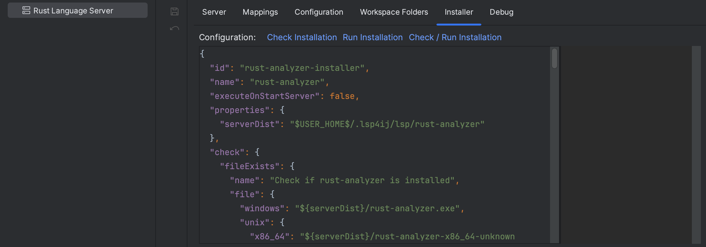

# User-defined language server template

LSP4IJ provides a [default user-defined language server template](./UserDefinedLanguageServer.md#default-template),
stored in the [templates folder](https://github.com/redhat-developer/lsp4ij/tree/main/src/main/resources/templates).

This section explains how to structure a user-defined template for your language server. A template is a folder with
these files, of which only `template.json` is required. LSP4IJ ignores any other file in the folder.

* [`template.json`](#template-descriptor): describes the language server, the command that starts it and its file
  mappings.
* `settings.json`: the `Configuration` of the `Server` tab of the `Configuration` tab, which LSP4IJ sends to the
  language server. `{}` without the file.
* `settings.schema.json`: the JSON Schema of `settings.json`, which the `Configuration` field uses.
* `initializationOptions.json`: the `Initialization Options`, which LSP4IJ sends in the `initialize` request. `{}`
  without the file.
* `experimental.json`: the `Experimental` field, the `experimental` client capabilities of the `initialize` request.
  `{}` without the file.
* `clientSettings.json`: the configuration of the `Client` tab of the `Configuration` tab, which sets how LSP4IJ
  itself handles the language server. `{}` without the file.
* [`installer.json`](#installer-descriptor): defines how to check, install, and configure the server.
* `workspaceFolderSettings.json`: the JSON of the
  [`Workspace Folders` tab](./UserDefinedLanguageServer.md#workspace-folders-tab). LSP4IJ reads it with the template,
  and the New Language Server dialog gives it to the language server that it creates.
* `README.md`: the instructions of the template, which the help button of the New Language Server dialog opens. The
  dialog shows that button only for a template with a `README.md`.

## How to Contribute a User-Defined Language Server Template

If you have [created a user-defined language server](./UserDefinedLanguageServer.md#new-language-server-dialog) 
and want to share it with others, you can contribute it to the official template repository used by LSP4IJ. Follow the steps below to submit your contribution.

### Steps to Contribute

1. **Edit the `template.json`**  
   After [exporting](./UserDefinedLanguageServer.md#exporting-templates) your language server, a folder will be generated containing `template.json`.
  - Add a unique `id` to identify your language server.
  - Adjust the `programArgs` section to support all relevant operating systems.
  - See the [template descriptor](#template-descriptor) section for more details.

2. **Submit a Pull Request**  
   Add your language server template folder in the [`/templates/lsp`](https://github.com/redhat-developer/lsp4ij/tree/main/src/main/resources/templates/lsp) directory.
  - Follow the structure of existing examples like [`/templates/lsp/typescript-language-server`](https://github.com/redhat-developer/lsp4ij/tree/main/src/main/resources/templates/lsp/typescript-language-server).

3. **Write the Documentation**  
   Provide documentation for your language server in the [`/docs/user-defined-ls`](https://github.com/redhat-developer/lsp4ij/tree/main/docs/user-defined-ls) folder.
  - Use existing docs as reference, for instance: [`/docs/user-defined-ls/typescript-language-server`](https://github.com/redhat-developer/lsp4ij/tree/main/docs/user-defined-ls/typescript-language-server.md).

4. **Reference it**  
   Add your language server in the [`Default template`](https://github.com/redhat-developer/lsp4ij/blob/main/docs/UserDefinedLanguageServer.md#default-template).

### ✅ Contribution Checklist

- [ ] `template.json` contains a unique `id` and correct `programArgs`
- [ ] Template is placed under `/templates/lsp/<your-language-server-name>`
- [ ] Documentation is placed under `/docs/user-defined-ls/<your-language-server-name>.md`
- [ ] Template is listed in the [Default template](https://github.com/redhat-developer/lsp4ij/blob/main/docs/UserDefinedLanguageServer.md#default-template)
- [ ] Pull Request includes only relevant files and follows the structure of existing examples
 
## Template descriptor

The template descriptor (`template.json`) is a JSON file used to define:

* the server ID and name
* the command to start the server
* the socket of a language server which doesn't talk LSP over its standard input and output (optional)
* the transports which the language server supports (optional)
* the file type mappings

All its fields are listed in [Fields](#fields).

#### Example `template.json`

```json
{
  "id": "typescript-language-server",
  "name": "TypeScript Language Server",
  "programArgs": {
    "default": "typescript-language-server --stdio",
    "windows": "cmd /C typescript-language-server.cmd --stdio"
  },
  "transports": [
    {
      "mode": "stdio",
      "argument": "--stdio"
    }
  ],
  "fileTypeMappings": [
    {
      "fileType": {
        "name": "JavaScript",
        "patterns": ["*.js"]
      },
      "languageId": "javascript"
    },
    {
      "fileType": {
        "name": "JavaScript-React",
        "patterns": ["*.jsx"]
      },
      "languageId": "javascriptreact"
    },
    {
      "fileType": {
        "name": "TypeScript",
        "patterns": ["*.ts"]
      },
      "languageId": "typescript"
    },
    {
      "fileType": {
        "name": "TypeScript-React",
        "patterns": ["*.tsx"]
      },
      "languageId": "typescriptreact"
    }
  ]
}
```

This language server talks LSP over its standard input and output only, so the template lists `stdio` in its
`transports` and has no `socket`. See [Socket](#socket) for a template with one.

#### Fields

| Field                 | Value                                                                                                                                                                                                                                                                  | Default                                                                                                        |
|-----------------------|------------------------------------------------------------------------------------------------------------------------------------------------------------------------------------------------------------------------------------------------------------------------|----------------------------------------------------------------------------------------------------------------|
| `id`                  | the id of the template. A language server created from the template keeps it: the banner which suggests the template for a file it supports stays away while such a language server exists, and the settings and the [export](./UserDefinedLanguageServer.md#exporting-templates) of the language server take the `transports` of the bundled template with this id. | none                                                                                                           |
| `name`                | the name of the language server                                                                                                                                                                                                                                        | none                                                                                                           |
| `url`                 | the page of the instructions, which the `Server` tab links as `Read the instructions`                                                                                                                                                                                  | `https://github.com/redhat-developer/lsp4ij/tree/main/docs/user-defined-ls/<id>.md`                            |
| `dev`                 | `true` lists the template only when the IDE runs with `idea.plugin.in.sandbox.mode`, as `runIde` does                                                                                                                                                                  | `false`                                                                                                        |
| `programArgs`         | the command which starts the language server, by OS, see [Command](#command). Required.                                                                                                                                                                                | none                                                                                                           |
| `workingDir`          | the working directory, which the New Language Server dialog gives the language server it creates. An [exported](./UserDefinedLanguageServer.md#exporting-templates) language server writes it.                                                                         | none                                                                                                           |
| `env`                 | the environment variables of the `Server` tab: `variables`, an object of names and values, and `includeSystemEnvironmentVariables`, `true` to pass the IDE's environment variables too                                                                                 | without `env`, no variables, and the IDE's are passed; `includeSystemEnvironmentVariables` is `false` when `env` doesn't set it |
| `fileTypeMappings`    | the files of the language server: each entry has a `fileType`, with the `name` of an IntelliJ file type, file name `patterns`, or both, and the `languageId` of the files                                                                                              | none                                                                                                           |
| `languageMappings`    | the files of the language server by IntelliJ language: each entry has the `language`, an IntelliJ language id, and the `languageId` of the files                                                                                                                       | none                                                                                                           |
| `socket`              | how LSP4IJ talks to a language server over a TCP socket, see [Socket](#socket)                                                                                                                                                                                         | the standard input and output, or the first mode of `transports` when it lists only socket modes               |
| `transports`          | the transports which the language server supports, see [Transports](#transports)                                                                                                                                                                                       | none                                                                                                           |
| `expandConfiguration` | `true` checks `Expand JSON when configuration is sent to the server`: a name with dots in the `Configuration`, as `"css.validate": true`, is sent as nested objects, `{"css": {"validate": true}}`                                                                      | `false`                                                                                                        |
| `disablePromotionFor` | plugin ids: while one of these plugins is installed, the banner which suggests the template for a file it supports doesn't show, as the Clojure LSP template does for `com.github.clojure-lsp`                                                                         | none                                                                                                           |
| `promotable`          | `false`: the banner which suggests templates for a file never suggests this one, as for the discontinued erlang-ls. The New Language Server dialog still lists it. LSP4IJ 0.30.1 and earlier don't know the field, and still suggest it                                 | `true`                                                                                                         |

A `fileType` with both a `name` and `patterns` gives two mappings, one for the file type and one for the patterns,
with the same `languageId`. The banner shows only in a file which IntelliJ opens as plain text, with TextMate, or with a
file type of your own from the `File Types` settings, and which no language server maps: one of yours, from a template
or not, or one of a plugin, also while it is disabled.

#### Command

`programArgs` holds the command by OS. LSP4IJ takes the value of the OS it runs on, `windows`, `mac` or `unix` (Linux
and other Unix systems), and `default` when there is none for it. The New Language Server dialog puts it in the
`Command` field.

LSP4IJ starts the command without a shell: it expands the macros, such as `$USER_HOME$`, and then splits the command at
its spaces. A part in double quotes stays one argument, so put a path in quotes, as the CSS template does, for a home
directory with a space:

```json
{
  "programArgs": {
    "default": "node \"$USER_HOME$/.lsp4ij/lsp/vscode-langservers-extracted/node_modules/vscode-langservers-extracted/lib/css-language-server/node/cssServerMain.js\" --stdio"
  }
}
```

Don't start the command with `sh -c` or `cmd /c` unless it needs shell syntax, see
[Environment variables](./UserDefinedLanguageServer.md#environment-variables). The command can also take the
placeholders `${instanceRoot}` and `${port}`, see [Macro syntax](./UserDefinedLanguageServer.md#macro-syntax).

#### Socket

`socket` is optional: without it, LSP4IJ talks to the language server over its standard input and output, unless its
[`transports`](#transports) lists only socket modes. A language server which talks LSP over a TCP socket instead has a
`socket`, whose `mode` is one of the [transports](./UserDefinedLanguageServer.md#transport):

* `attach`: LSP4IJ attaches to a language server which runs already and listens on `host` (the loopback address by
  default) and `port`.
* `startAndConnect`: LSP4IJ starts the language server, which listens on the port, and connects to it.
* `startAndAccept`: LSP4IJ listens on the port and starts the language server, which connects to it.

| Field  | Value                                                                          | Default                                         |
|--------|--------------------------------------------------------------------------------|-------------------------------------------------|
| `mode` | `attach`, `startAndConnect`, `startAndAccept`, or `stdio`                      | none: standard input and output, with a warning |
| `host` | a plain host name or IP address, used by `attach` only                         | the loopback address                            |
| `port` | a number from 0 to 65535; 0 lets LSP4IJ choose a free port (not with `attach`) | 0                                               |

A `mode` of `stdio` is the same as no `socket`. The command of a language server which LSP4IJ starts takes the port as
`${port}`, and a `port` of 0, or none, lets LSP4IJ choose a free one. With `attach`, LSP4IJ can't choose the port, so
the New Language Server dialog asks for one. A value LSP4IJ can't use, such as a missing or unknown `mode` or a `port`
that isn't a number from 0 to 65535, is shown as a warning in the New Language Server dialog, which says what LSP4IJ
does instead:

```json
{
  "id": "my-language-server",
  "name": "My Language Server",
  "programArgs": {
    "default": "node path/to/server.js --socket=${port}"
  },
  "socket": {
    "mode": "startAndAccept",
    "port": 0
  }
}
```

#### Transports

`transports` is optional. A template can list the transports which its language server supports, in `transports`,
each with its `mode` (`stdio` or one of the socket modes above) and the `argument` of the
command for it. The New Language Server dialog then helps with the transport: for a language server which lists only
`stdio`, a hint says that it talks LSP only over its standard input and output, for one which lists only socket modes, a
hint says that it talks LSP only over a socket, and for each socket mode which it lists, a hint below the socket modes
names the mode and the argument. Every transport can still be chosen, as the template may be the starting point of a
language server of your own which does talk over a socket: Socket, for a language server which lists only `stdio`,
gives the warning "The template says this language server talks LSP only over its standard input and output", which
blocks neither OK nor Apply in the settings of a language server created from the template.
Without `transports`, no hint shows.

A language server which lists only socket modes is the other way round: `Standard input and output (stdio)` gives the
warning "The template says this language server talks LSP only over a socket", which blocks neither OK nor Apply
either. Without a `socket`, the New Language Server dialog selects `Socket` for it, in the first mode of the list, with
an `Auto` port, or, for `attach`, no port yet. An [installer](./UserDefinedLanguageServer.md#transport) whose command
has no `${port}` leaves it on its socket, rather than switching it to its standard input and output, where it couldn't
talk at all; with an `Auto` port, a warning then says that its command needs `${port}`.

| Field      | Value                                                                 | Required |
|------------|-----------------------------------------------------------------------|----------|
| `mode`     | `stdio`, `attach`, `startAndConnect` or `startAndAccept`              | yes      |
| `argument` | the argument of the command for this mode, such as `--socket=${port}` | no       |

An entry with a missing or unknown `mode` is skipped, and shown as a warning in the New Language Server dialog. Without
an `argument`, the hint names only the mode. The hints follow the order of the list, and Socket starts in the first
socket mode of the list. The CSS language server, for instance, is started over its standard input and output, and also
talks over a socket it connects to:

```json
{
  "id": "vscode-css-language-server",
  "programArgs": {
    "default": "node .../cssServerMain.js --stdio"
  },
  "transports": [
    {
      "mode": "stdio",
      "argument": "--stdio"
    },
    {
      "mode": "startAndAccept",
      "argument": "--socket=${port}"
    }
  ]
}
```

When the user changes the transport, in the New Language Server dialog or in the settings of a language server created
from the template, the argument of the chosen transport replaces that of another listed transport in the command. The
arguments are matched as whole words, and the one which comes last in the command is replaced. A command with none of
the listed arguments stays as it is, and so does the command when LSP4IJ loads a template or saved settings. The
settings, and the installer of a language server created from the template, find the template by its `id` among the
bundled templates, so a language server created from a
[custom template](./UserDefinedLanguageServer.md#custom-template) gets this in the New Language Server dialog only.
The [export](./UserDefinedLanguageServer.md#exporting-templates) of a language server finds its template in the same
way, and writes the `transports` of the template: the New Language Server dialog gives an import of the export the
same hints, warning and arguments as the template. The export of a language server created from a custom template has
no `transports`.

#### Socket and transports

`socket` and `transports` answer two questions. `socket` is the transport which the New Language Server dialog
preselects, and which an [exported](./UserDefinedLanguageServer.md#exporting-templates) language server keeps.
`transports` lists what the language server supports: it changes what the dialog offers and hints, and the argument
that a change of the transport swaps in the command, and an exported language server has the `transports` of its
bundled template. A `socket` whose `mode` isn't one of the `transports` is still preselected, and the New Language
Server dialog warns: "The socket mode ... of the template isn't one of its transports". Keep them in line, for instance
with the `socket` mode as the socket mode of `transports`. The export of a language server which talks over a socket
that its template doesn't list, as one created from the TypeScript template, has both, and so gives this warning too
when it's imported.

## Installer descriptor

The installer descriptor (`installer.json`) is a JSON file used to:

* `check` the current installation,
* `run` the installation of the LSP/DAP server,
* and optionally `configure` the start command once installation is complete.

It is used:

* at the first start of a language server created with it, and before the first debug session of a debug adapter
  created with it in each IDE session: LSP4IJ runs the `check`, and the `run` if the check fails,
* when the user installs or reinstalls the server, or runs the installer from its `Installer` tab.

See [When the installer runs](#when-the-installer-runs).

You can find a sample in the .

It should follow this structure:

```json5
{
  "id": "...",
  "name": "...",
  "executeOnStartServer": false,
  "properties": {
    // Declare values that the tasks take as ${name}...
  },
  "check": {
    // Declare tasks to check the installation...
  },
  "run": {
    // Declare tasks to run the installation...
  }
}
```

| Key                    | Value                                                                                                                                                           | Default                                                     |
|------------------------|-----------------------------------------------------------------------------------------------------------------------------------------------------------------|-------------------------------------------------------------|
| `id`                   | not read by LSP4IJ                                                                                                                                              | none                                                        |
| `name`                 | the name of the installation, in its console and its notifications, as "Installation of `name` completed successfully."                                         | `Untitled`                                                  |
| `executeOnStartServer` | `true` checks the installation at the first start of the language server in each IDE session, not only at its first start ever                                  | `false`                                                     |
| `properties`           | strings, numbers or booleans, which the tasks take as `${name}`, see [Properties](#properties)                                                                  | none                                                        |
| `check`                | the task which checks that the server is installed                                                                                                              | none: the server counts as installed when it starts         |
| `run`                  | the task which installs the server                                                                                                                              | none                                                        |

`check` and `run` define starting [tasks](#task-descriptor), which can trigger other tasks using the `onFail` or `onSuccess` keys.

LSP4IJ provides built-in tasks:

* [exec](#task-exec) to execute a command (e.g., `npm install typescript-language-server`),
* [initialize](#task-initialize) to check that the server starts and answers the `initialize` request,
* [fileExists](#task-fileexists) to check that a file, as the installed server, exists,
* [download](#task-download) to retrieve a server from a given URL,
* [configureServer](#task-configureServer) to set the launch command based on the downloaded files,
* [replaceTemplateCommand](#task-replacetemplatecommand) to set the launch command while the server still has the
  command of its template.

To define custom tasks, you can contribute to the extension point `com.redhat.devtools.lsp4ij.installerTaskFactory`.

### Task descriptor

Typical task structure:

```json5
{
  "id": "...",
  "name": "...",
  // custom keys depending on task type
  "onFail": {
    // Task to execute on failure
  },
  "onSuccess": {
    // Task to execute on success
  }
}
```

These keys go inside the type of the task: a task is an object with one key, its type, such as `exec`, whose value
holds the keys of the task, as in this step of the check of the Go language server:

```json
{
  "exec": {
    "name": "Check Go runtime",
    "command": {
      "windows": "where go",
      "default": "which go"
    }
  }
}
```

LSP4IJ takes the first key of the object as the type of the task, and ignores the other keys next to it, so `onFail`
and `onSuccess` go inside the task, next to its `name`. A task of a type which no task factory registers is ignored, as
if the installer didn't have it.

* `name`: the name of the step, which the console of the installation shows as `- Step: <name>`.
* `id`: not used by the tasks of LSP4IJ.
* `onSuccess`: the task which runs when this one succeeds. This task then succeeds or fails as that one does.
* `onFail`: the task which runs when this one fails. This task then succeeds or fails as that one does, so an `onFail`
  can make up for what failed: the check of the Go language server tries the current command, and when it fails,
  checks that `go` is installed and tries the command again, or [shows a message](#task-showmessage) if `go` is missing.

To add a type of task, register an `InstallerTaskFactory`, such as a subclass of `InstallerTaskFactoryBase`, which
reads `id`, `name`, `onFail` and `onSuccess` for it. Its `type` is the key of the task in `installer.json`:

```xml
<extensions defaultExtensionNs="com.redhat.devtools.lsp4ij">
  <installerTaskFactory type="myTask"
                        factoryClass="my.plugin.MyTaskFactory"/>
</extensions>
```

### Properties

The tasks take these values as `${name}`:

| Property                                  | Value                                                                                                                                  |
|-------------------------------------------|----------------------------------------------------------------------------------------------------------------------------------------|
| `${server.command}`                       | the command of the language server or debug adapter when the installation starts, but not in the `Installer` tab of a debug session   |
| the `properties` of the installer         | each value as written, such as `${serverDist}` for `"serverDist": "$USER_HOME$/.lsp4ij/lsp/clojure-lsp"` in the clojure-lsp installer |
| `${output.dir}` and `${output.file.name}` | where a [download](#task-download) put the server, for the tasks that run after it                                                    |

LSP4IJ replaces them in the `workingDir` of an `exec`, the `output.dir` of a `download` and the `command` of a
`configureServer`. In the `command` of an `exec`, it replaces only `${server.command}`, and only when it is the whole
command, as in `"command": "${server.command}"`. A property is replaced with its value as written: its macros, such as
`$USER_HOME$`, are expanded where the value is used.

### When the installer runs

A language server created with an installer, from a template or with the JSON of its `Installer` tab, checks its
installation at its first start, as when a file that it serves is opened:

1. LSP4IJ runs the `check` in the background, with a progress bar in the status bar.
2. If the check fails, LSP4IJ runs the `run`, and a notification says whether the installation completed successfully
   or failed.
3. LSP4IJ then starts the language server, also when the `run` failed.

LSP4IJ keeps in the settings of the language server that this first check ran, so that the later starts don't check
again, also after a restart of the IDE. An installation which failed, or whose `run` failed, isn't kept: the first start
of the language server in the next IDE session checks again, and installs the server if the check fails. One that the
user cancelled is kept, so that the installer doesn't run again by itself. With `"executeOnStartServer": true`, the
installation is checked at the first start of the language server in each IDE session. The bundled installers have
`false`.

The installer also runs on request:

* `Install if Needed`, in the context menu of the language server in the Language Servers view of the LSP console,
  runs the `check`, and the `run` if the check fails.
* `Reinstall`, in the same menu, runs the `run` without the `check`, as to get the latest version.
* The links of the `Installer` tab of the LSP console run the JSON of the tab: `Check Installation` the `check`,
  `Run Installation` the `run`, and `Check / Run Installation` the `check` and then the `run`, also when the check
  passes. A link whose task the installer doesn't have runs nothing, and says that there is nothing to check or to
  install. The `Installer` tab of the New Language Server dialog and of the settings page has no links.

An installer without a `check` counts as installed, at the start of the language server and with `Install if Needed`,
so only `Reinstall`, `Run Installation` and `Check / Run Installation` run its `run`.

`Install if Needed` and `Reinstall` stop the language server, and start it again after the installation if it ran. A
language server with [several instances](./UserDefinedLanguageServer.md#several-language-server-instances) has one
installer for all of them.

A debug adapter checks its installation before its first debug session in each IDE session, whatever
`executeOnStartServer` says: a console, `DAP Debugger (initializing)`, shows the `check`, and the `run` if the check
fails, and the debug session then starts. The `Installer` tab of the debug session has the links of the LSP console.

The IDE's log, `idea.log` (*Help | Show Log in Finder*, *Explorer* or *Files*), has what an installer does, also when no
console shows it, as when the installer runs at the start of a language server whose console was never opened: the
start and the result of the installation and of each step, and the errors as warnings. With
`#com.redhat.devtools.lsp4ij.installation` in *Help | Diagnostic Tools | Debug Log Settings*, it also has the rest of
what the console shows, as the commands of the `exec` tasks and their output. The log has `<redacted>` instead of a
value which can be a secret, as a token, an `Authorization` header or the password of a URL.

### Task showMessage

Shows a notification, as in the `onFail` of a check which finds that a tool is missing. The check of the Go language
server shows this one when `go` isn't installed:

```json
{
  "showMessage": {
    "name": "Go Language Server install problem",
    "content": [
      "<a href=\"https://go.dev/doc/install\">Install Go</a> to install the Go Language Server (<code>gopls</code>) using <code>go install</code>.",
      "Make sure <code>go</code> is in your PATH, then restart your IDE."
    ]
  }
}
```

* `name`: the title of the notification, `Error` by default.
* `content`: the message, in HTML: a string, or an array of strings, each a paragraph. A link opens in the browser.
* `actions` (optional): an array of tasks, each an action of the notification, named by its `name`.

Without `actions`, the task shows the message as an error and fails, and the installation shows no notification of
its own. With `actions`, the task waits until the user clicks one of them, runs that task, and succeeds or fails as it
does. A notification closed without a click ends the task, which then fails.

### Task exec

Runs a command. The task succeeds when the command exits with 0 and writes nothing on its standard error.

| Key            | Value                                                                                                                                                                                                                                                                                                                  | Default                                   |
|----------------|------------------------------------------------------------------------------------------------------------------------------------------------------------------------------------------------------------------------------------------------------------------------------------------------------------------------|-------------------------------------------|
| `command`      | the command: a string, which LSP4IJ splits at its spaces outside double quotes, or an array of its arguments; or an object of these by OS, as [`programArgs`](#command). LSP4IJ expands the macros, such as `$USER_HOME$`, in each argument. Of the [properties](#properties), it replaces only a whole `${server.command}`. | none: the task fails                      |
| `workingDir`   | the directory in which the command runs, with properties and macros. LSP4IJ creates it if it doesn't exist.                                                                                                                                                                                                            | the project's directory                   |
| `timeout`      | the time in milliseconds after which LSP4IJ stops the command. The task then succeeds.                                                                                                                                                                                                                                 | none: LSP4IJ waits until the command ends |
| `ignoreStderr` | `true` lets the task succeed when the command writes on its standard error, as `npm install` does with its warnings                                                                                                                                                                                                   | `false`                                   |

The console of the installation shows the command after `> `, and its output. The command gets the environment
variables of the IDE and, since IntelliJ 2025.1, the environment of its working directory, as a language server does
(see [Directory-specific environment variables](./UserDefinedLanguageServer.md#directory-specific-environment-variables)),
and LSP4IJ looks the command up in the `PATH` of that environment, so that `npm` is the one of the directory's `node`.

Two `exec` tasks with the same `workingDir` run one after the other, also in two IDEs, as those of the CSS and ESLint
installers, which install one npm package into `$USER_HOME$/.lsp4ij/lsp/vscode-langservers-extracted/node_modules`.
An installation which started because its check failed, and waited, runs the check again once the other task is done,
and skips the command if the check then passes. `Reinstall` and the links of the `Installer` tab don't skip it.

Example using `npm` to install [typescript-language-server](https://github.com/typescript-language-server/typescript-language-server),
as the bundled template does:

```json
{
  "id": "typescript-language-server",
  "name": "TypeScript Language Server",
  "executeOnStartServer": false,
  "properties": {
    "workingDir" : "$USER_HOME$/.lsp4ij/lsp/typescript-language-server/node_modules"
  },
  "check": {
    "exec": {
      "name": "Trying current command",
      "command": "${server.command}",
      "timeout": 2000,
      "onSuccess": {
        "initialize": {
          "name": "Check that typescript-language-server starts"
        }
      }
    }
  },
  "run": {
    "exec": {
      "name": "Install TypeScript Language Server",
      "workingDir": "${workingDir}",
      "ignoreStderr": true,
      "command": {
        "windows": "npm.cmd install typescript-language-server typescript --force",
        "default": "npm install typescript-language-server typescript --force"
      },
      "onSuccess": {
        "configureServer": {
          "name": "Configure TypeScript Language Server command",
          "command": {
            "windows": "\"${workingDir}/.bin/typescript-language-server.cmd\" --stdio",
            "default": "\"${workingDir}/.bin/typescript-language-server\" --stdio"
          },
          "update": true
        }
      }
    }
  }
}
```

`npm install` runs in the `node_modules` folder of the server, because npm installs into the first folder, from its
working directory up, which has a `package.json` or a `node_modules` folder. Run in a new, empty folder, it would install
into a parent folder which has one, such as the home directory. Run in `node_modules`, it installs into its parent,
`$USER_HOME$/.lsp4ij/lsp/typescript-language-server`, so the command is in `${workingDir}/.bin`.

An `exec` whose command still runs at its `timeout` succeeds: that's meant for a command which waits, as a language
server does, but a command which hangs, waits for input, or fails later, succeeds too. That's why the `check` above
runs the [initialize](#task-initialize) task once the `exec` of `${server.command}` succeeds. Use `exec` alone for a
command which ends by itself, as `node --version`.

### Task initialize

`initialize` checks that the language server or debug adapter starts and talks its protocol. It starts the server as
LSP4IJ starts it, with its command, working directory, environment variables and transport, sends it `initialize` (the
LSP request for a language server, the DAP request for a debug adapter), and succeeds only if the server answers within
the `timeout`. An answer which is an error succeeds too, since it shows that the server runs, and the console says so.
A server which can't be started, ends, or doesn't answer in time fails the check, so that the server gets installed.

Then the task ends the server: it sends `shutdown` and `exit` to a language server, or `disconnect` to a debug adapter,
and destroys the process if it hasn't ended within 2 seconds. It destroys the process at once when the installation is
cancelled.

```json
{
  "check": {
    "exec": {
      "name": "Trying current command",
      "command": "${server.command}",
      "timeout": 2000,
      "onSuccess": {
        "initialize": {
          "name": "Check that ruby-lsp starts",
          "timeout": 10000
        }
      }
    }
  }
}
```

* `timeout` (optional, `30000` by default): how long the task waits for the answer to `initialize`, from the start of
  the server, in milliseconds.

The bundled installers run `initialize` as the `onSuccess` of the `exec` of `${server.command}` which they ran before,
rather than as the `check` itself, for the LSP4IJ versions which don't know the `initialize` task. Such a version
ignores it, as any task it doesn't know: as an `onSuccess`, the check is then the `exec` alone, as before, while as the
`check`, the installer would have no check, and the server would count as installed. The cost is that LSP4IJ starts the
server twice to check it: for the `timeout` of the `exec`, then for `initialize`.

The `initialize` request of a language server has the initialization options of its settings, and the project's
folder as root, without client capabilities. A language server which runs already, which LSP4IJ attaches to, isn't
touched: the task succeeds. A debug adapter is reached as a debug session reaches it: over a socket to the port of
`${port}` in its command, or to the address which it prints as its debug server ready pattern says, and otherwise over
its standard input and output.

### Task fileExists

Checks that a file exists, as the server that the `run` of the installer installs, so that the installation doesn't run
again once the server is there. Example: the check of clangd, whose archive has a folder named after the version of
clangd, as `clangd_19.1.2/`:

```json
{
  "check": {
    "fileExists": {
      "name": "Check if clangd is installed",
      "file": {
        "windows": "${serverDist}/clangd*/bin/clangd.exe",
        "default": "${serverDist}/clangd*/bin/clangd"
      },
      "onSuccess": {
        "replaceTemplateCommand": {
          "name": "Configure Clangd server command",
          "templateCommand": "clangd",
          "command": "\"${check.file}\""
        }
      }
    }
  }
}
```

* `file`: the path of the file, by OS and architecture as the `url` of a [download](#task-download), with the properties
  of the installer, as `${serverDist}`, and macros, as `$USER_HOME$`. Its segments can have the globs `*` and `?`, as
  `clangd*`, and `**` for any number of folders.
* The file found is `${check.file}` for the tasks that run after the check, as its `onSuccess`: the path as written in
  `file`, with the properties resolved, the macros kept and the globs replaced by the names found, as
  `$USER_HOME$/.lsp4ij/lsp/clangd_19.1.2/bin/clangd`, in the form of the `${output.dir}` of a download. Of several files
  that the globs match, it is the last in natural order, which compares the numbers in a name by their value, from the
  first segment on: `clangd_19.1.10/bin/clangd` after `clangd_19.1.2/bin/clangd`. A `fileExists` which finds no file
  removes `${check.file}`.

When the check finds the server installed, the `run` doesn't run, so a server created from the template would keep the
command of the template: a [replaceTemplateCommand](#task-replacetemplatecommand) in the `onSuccess` of the check gives
it the command that the download gives, from `${check.file}`.

### Task download

Structure of a `download` task:

```json5
{
  "download": {
    "id": "...",
    "name": "...",
    "url": "...",
    "output": {
      "dir": "...",
      "file": {
        "name": "...",
        "executable": true
      }
    },
    "onFail": {},
    "onSuccess": {}
  }
}
```

| Key      | Value                                                                                          | Default                                     |
|----------|------------------------------------------------------------------------------------------------|---------------------------------------------|
| `url`    | the URL of the file, one for all, or by OS and architecture, see [below](#unique-url)          | none                                        |
| `github` | the latest release of a GitHub repository, see [GitHub asset download](#github-asset-download) | none                                        |
| `maven`  | the latest version on Maven Central, see [Maven artifact download](#maven-artifact-download)   | none                                        |
| `output` | where the server goes, see [Output customization](#output-customization)                       | a new folder `$USER_HOME$/.lsp4ij/<random>` |

LSP4IJ takes the URL from `github` when it has an `owner`, a `repository` and an `asset`, or else from `maven` when it
has a `groupId` and an `artifactId`. When they give no URL, as when GitHub can't be reached, LSP4IJ falls back to `url`,
and the console says so. Without a URL for the OS and the architecture, the task fails.

LSP4IJ downloads the file into a temporary folder. An archive, such as a `.zip`, `.vsix`, `.tar`, `.tar.gz` or `.tgz`
file, is extracted into `output.dir`, and a `.gz` file that isn't a `.tar.gz` is decompressed there, as the one that
the rust-analyzer installer downloads on Linux and macOS. Any other file is copied there, under `output.file.name` or
its own name, in place of the file of an earlier installation. The name of the downloaded file, by which LSP4IJ also
recognizes an archive, is the last segment of the path of the URL, without its query or fragment.

Example: downloading a JAR and configuring the start command

```json
{
  "id": "camel-lsp-server",
  "name": "Camel Language Server",
  "check": {},
  "run": {
    "download": {
      "name": "Download Camel Language Server",
      "url": "https://repo1.maven.org/maven2/com/github/camel-tooling/camel-lsp-server/1.31.0/camel-lsp-server-1.31.0.jar",
      "output": {
        "dir": "$USER_HOME$/.lsp4ij/lsp/camel-lsp-server"
      },
      "onSuccess": {
        "configureServer": {
          "name": "Configure Camel Language Server command",
          "command": "java -jar \"${output.dir}/${output.file.name}\"",
          "update": true
        }
      }
    }
  }
}
```

> `configureServer.command` supports variable substitution with `${output.dir}` and `${output.file.name}`.
> These values are resolved from the `output` object of the preceding `download` task.

In this example, `check` is empty, so the server counts as installed at the first start, and only `Reinstall`,
`Run Installation` and `Check / Run Installation` download it (see [When the installer runs](#when-the-installer-runs)).
The bundled [camel-lsp-server installer](../src/main/resources/templates/lsp/camel-lsp-server/installer.json) checks
first that the JAR is in its folder, and downloads the latest version from Maven Central, with this `url` as a
fallback.

#### Unique URL:

```json
{
  "download": {
    "url": "<same URL for all OS>"
  }
}
```

#### OS-specific URLs:

```json
{
  "download": {
    "url": {
      "windows": "<windows URL>",
      "default": "<linux/mac URL>"
    }
  }
}
```

you can find a sample with [clangd installer](../src/main/resources/templates/lsp/clangd/installer.json)

#### OS and architecture-specific URLs:

```json
{
  "download": {
    "url": {
      "windows": {
        "x86_64": "<URL for win x86_64>",
        "x86": "<URL for win x86>"
      },
      "default": "<URL for linux/mac>"
    }
  }
}
```

A value by OS has the keys `windows`, `mac`, `unix` (Linux and other Unix systems) and `default`: LSP4IJ takes the key
of the OS it runs on, or else `default`. A value by architecture, inside one of them, has the keys of the CPU: LSP4IJ
takes IntelliJ's name for it, `x86_64`, `x86`, `arm64` or `arm32`, or else the `os.arch` of the JVM, such as `amd64` or
`aarch64`, or else `default`. So `x86_64` and `arm64` match on every OS. The `asset` of `github`, and the `dir` and the
`file.name` of `output`, take the same keys.

#### GitHub asset download:

If DAP/LSP server can be downloaded from GitHub release like https://github.com/clojure-lsp/clojure-lsp/releases
you can use the `github` JSON object to download the proper asset: 

```json
{
  "download": {
    "github": {
      "owner": "clojure-lsp",
      "repository": "clojure-lsp",
      "prerelease": false,
      "asset": {
        "windows": "clojure-lsp-native-windows-amd64.zip",
        "unix": {
          "amd64": "clojure-lsp-native-linux-amd64.zip",
          "arm64": "clojure-lsp-native-linux-aarch64.zip"
        },
        "mac": {
          "aarch64": "clojure-lsp-native-macos-aarch64.zip",
          "amd64": "clojure-lsp-native-macos-amd64.zip"
        }
      }
    }
  }
}
```

When the download occurs, LSP4IJ requests the 100 newest releases of the repository,
`https://api.github.com/repos/${owner}/${repository}/releases?per_page=100`: in the previous sample,
https://api.github.com/repos/clojure-lsp/clojure-lsp/releases?per_page=100. It takes the newest of them whose
`prerelease` is the `prerelease` of the task, and in it the first asset whose name matches `asset`, and downloads its
`browser_download_url`. When that release has no such asset, LSP4IJ doesn't look at older releases, and falls back to
`url`. It requests the releases of a repository once per IDE session.

 * `owner` (required) the github owner.
 * `repository` (required) the github repository. 
 * `prerelease` (optional): `true` takes the newest prerelease, and `false`, the default, the newest release which isn't
   a prerelease.
 * `asset` (required) is used to select the proper file to download. Without `*`, the name of the asset must contain
   `asset`, ignoring case. With `*`, which stands for any text, the whole name must match, as for an asset whose name
   has a version or a timestamp.

```json
{
  "asset": "perllsp-*-x86_64-unknown-linux-gnu.tar.gz"
}
```

If there is an asset per OS and with architecture, you can write:

```json
{
  "asset": {
    "windows": "clojure-lsp-native-windows-amd64.zip",
    "unix": {
      "amd64": "clojure-lsp-native-linux-amd64.zip",
      "arm64": "clojure-lsp-native-linux-aarch64.zip"
    },
    "mac": {
      "aarch64": "clojure-lsp-native-macos-aarch64.zip",
      "amd64": "clojure-lsp-native-macos-amd64.zip"
    }
  }
}
```

Samples:

* [clangd installer](../src/main/resources/templates/lsp/clangd/installer.json)
* [clojure-lsp installer](../src/main/resources/templates/lsp/clojure-lsp/installer.json)
* [rust-analyzer installer](../src/main/resources/templates/lsp/rust-analyzer/installer.json)

##### GitHub API rate limit

Without a token, the GitHub API allows 60 requests an hour per IP address, which all the IDEs and tools behind one
address share, as on a corporate network, a VPN or CI runners. When they are used up, LSP4IJ falls back to `url`, and a
download without `url` fails until the limit resets. With a GitHub token in the environment variable `GITHUB_TOKEN`, or
else `GH_TOKEN`, the variable that the `gh` CLI reads, LSP4IJ sends it to the GitHub API, `api.github.com`, and the
limit is 5,000 requests an hour. Any token works, as a fine-grained personal access token or the one that
`gh auth token` prints: public repositories need no scope or permission. LSP4IJ doesn't send it with the download of
the asset, nor to another host, and the console doesn't show it. The variable must be in the environment of the IDE,
as for the commands of `exec` tasks: set in the shell that starts the IDE, or, for an IDE started from the Dock on
macOS, in the profile of the login shell, as `~/.zprofile` or `~/.zshrc`. After setting it, restart the IDE.

The 5,000 requests an hour are per GitHub user: all the tokens of a user share them. In GitHub Actions, the
`GITHUB_TOKEN` of a workflow allows 1,000 requests an hour per repository.

A `github` download supports public repositories only: since the token goes with the request to the GitHub API only,
the assets of a private repository don't download.

When a request to the GitHub API fails, the console says why:

| The console says                                     | Because                                                                                                                                                                                                      |
|------------------------------------------------------|--------------------------------------------------------------------------------------------------------------------------------------------------------------------------------------------------------------|
| `GitHub API rate limit reached`                      | the 60 requests an hour, or those of the token, are used up; the console says when the limit resets                                                                                                          |
| `GitHub API refused the token ... (HTTP 401)`        | the token is invalid or has expired                                                                                                                                                                          |
| `... enforces SAML single sign-on`                   | the owner of the repository is an organization which enforces SAML single sign-on, and the token isn't authorized for it; the console shows the link which authorizes it, for an hour, when GitHub gives one |
| `the token lacks the permission ...`                 | the token, as a fine-grained one, hasn't the permissions that GitHub names                                                                                                                                   |
| `the repository ... was not found, or it is private` | the `owner` or the `repository` of the download is wrong, or the repository is private                                                                                                                       |

When GitHub refuses the token, as for these messages, or the rate limit of the token is reached, LSP4IJ tries the
request once again without the token, since the releases of a public repository don't need one, and the console says
so.

When a download without `url` fails for one of these reasons, the notification of the failed installation says why
too.

The IDE's log, `idea.log` (*Help | Show Log in Finder*, *Explorer* or *Files*), has a line for each download, with its
URL, where the URL comes from and how long it took, and a warning for a rate limit, a refused token or a failed
download. With `#com.redhat.devtools.lsp4ij.installation` in *Help | Diagnostic Tools | Debug Log Settings*, it also
has each request to the GitHub API, with its status, its rate limit and how long it took. The log never has the token.

#### Maven artifact download

If the DAP/LSP server is published on [Maven Central](https://search.maven.org), you can use the `maven` object in your installer JSON to download the corresponding artifact:

```json
{
  "download": {
    "name": "Download Camel Language Server",
    "maven": {
      "groupId": "com.github.camel-tooling",
      "artifactId": "camel-lsp-server"
    }
  }
}
```

When the download occurs:

1. A request is made to the following Maven Central API endpoint to find the latest artifact:
   ```
   https://search.maven.org/solrsearch/select?q=g:%22com.github.camel-tooling%22%20AND%20a:%22camel-lsp-server%22&rows=20&wt=json
   ```
2. The `latestVersion` of the first result is the version to download.
3. The download URL is then computed as:
   ```
   https://repo1.maven.org/maven2/{groupId with slashes}/{artifactId}/{version}/{artifactId}-{version}.jar
   ```

For example, if the groupId is `com.github.camel-tooling` and the artifactId is `camel-lsp-server`, the computed download URL might be:
```
https://repo1.maven.org/maven2/com/github/camel-tooling/camel-lsp-server/1.5.0/camel-lsp-server-1.5.0.jar
```

LSP4IJ requests the version once per IDE session. When Maven Central gives none, as when it can't be reached, the task
falls back to `url`.

**Fields:**

- `groupId` (required): Maven group ID.
- `artifactId` (required): Maven artifact ID.

**Sample:**

- [Camel Language Server installer](../src/main/resources/templates/lsp/camel-lsp-server/installer.json)

##### Output customization

You can customize the output directory and executable name, as the
[rust-analyzer installer](../src/main/resources/templates/lsp/rust-analyzer/installer.json) does, whose `serverDist`
property is `$USER_HOME$/.lsp4ij/lsp/rust-analyzer`:

```json5
{
  "output": {
    "dir": "${serverDist}",
    "file": {
      "name": {
        "windows": "rust-analyzer.exe",
        "unix": {
          "x86_64": "rust-analyzer-x86_64-unknown-linux-gnu",
          "arm64": "rust-analyzer-aarch64-unknown-linux-gnu"
        },
        "mac": {
          "x86_64": "rust-analyzer-x86_64-apple-darwin",
          "arm64": "rust-analyzer-aarch64-apple-darwin"
        }
      },
      "executable": true
    }
  }
}
```

* `dir`: base folder where the downloaded file will be saved or extracted, by OS and architecture, with
  [properties](#properties) and macros. LSP4IJ creates it if it doesn't exist. Without it, LSP4IJ creates a new folder
  in `$USER_HOME$/.lsp4ij` at each download.
  The value is available as `${output.dir}` for use in other tasks, with the properties replaced and the macros kept,
  as `$USER_HOME$/.lsp4ij/lsp/rust-analyzer`.
  An archive with a single root folder, as `perllsp-0.17.0-x86_64-unknown-linux-gnu/`, is extracted with that folder,
  which is then added to `${output.dir}`.
* `stripRootFolder` (optional, `false` by default): extracts the content of the single root folder of the archive into
  `dir` itself, so the server is found at the same place from one version to the next, as the
  [perl-lsp installer](../src/main/resources/templates/lsp/perl-lsp/installer.json) does.
* `file.name`: name of the executable file (registered as `${output.file.name}`), by OS and architecture. When it is
  set, the task fails if the file isn't in `${output.dir}` after the download. A file which isn't an archive is saved
  under this name, and without it, under its own name, the last segment of the path of the URL without its query or
  fragment, which is then `${output.file.name}`.
* `file.executable` (optional, `false` by default): `true` makes the file of `file.name` executable.

#### Task configureServer

Used to set the server launch command:

```json5
{
  "configureServer": {
    "name": "Configure Camel Language Server command",
    "command": "java -jar \"${output.dir}/${output.file.name}\"",
    "update": true
  }
}
```

* `command`: the command, by OS and architecture, with the properties of the installer and of the tasks before it, as
  `${output.dir}` and `${output.file.name}` of a [download](#task-download), or `${check.file}` of a
  [fileExists](#task-fileexists). A command with `${check.file}` that no `fileExists` found a file for is an error, and
  the command of the server stays as it is.

#### Task replaceTemplateCommand

Sets the server launch command, as [configureServer](#task-configureServer) does, but only while the server has the
command of its template. In the `onSuccess` of a check, which also runs from *Check installation* in the settings, it
gives a server created from the template the command of the file that the check found, and leaves a command that the
user or a download gave the server as it is:

```json5
{
  "replaceTemplateCommand": {
    "name": "Configure Clangd server command",
    "templateCommand": "clangd",
    "command": "\"${check.file}\""
  }
}
```

* `templateCommand`: the command of the template, by OS and architecture, as its `programArgs`, or the `launch` of a
  debug adapter, compared as written. While the server has another command, the task leaves it as it is and succeeds.
  On an OS without a `templateCommand`, the task never changes the command.
* `command`: the command that replaces it, as the `command` of a `configureServer`.

An earlier version of LSP4IJ, which doesn't know this task, skips it: the server keeps the command of its template, and
the check still passes.
