# User guide

## Getting started

LSP4IJ gives the editors of your files the features of a language server, such as completion, diagnostics and hover.
A language server comes from a plugin which [integrates it](./DeveloperGuide.md), or from a definition that you add:

1. Open the [New Language Server dialog](./UserDefinedLanguageServer.md#new-language-server-dialog), with the `+` of
   `Settings | Languages & Frameworks | Language Servers (LSP4IJ)` or the menu of the [LSP console](#lsp-console).
2. Click `Choose template...` to start from one of the [templates](./UserDefinedLanguageServer.md#default-template),
   most of which install their language server, or set the command of the language server in the
   [Server tab](./UserDefinedLanguageServer.md#server-tab) and the files that it serves in the
   [Mappings tab](./UserDefinedLanguageServer.md#mappings-tab).
3. Click `OK`, and open a file that the language server serves: LSP4IJ starts it.

When no language server is configured, the LSP console says `No language servers`, with a `Getting Started` link to
this page, and `Add a language server`, which opens the `Language Servers (LSP4IJ)` settings.

## LSP console

Although not directly useful to users in most cases, the Language Server console view is extremely valuable 
when we need to troubleshoot issues with the language servers.

The state of the servers is visible, stop and restart is available with a right-click, and you can enable different levels of tracing:

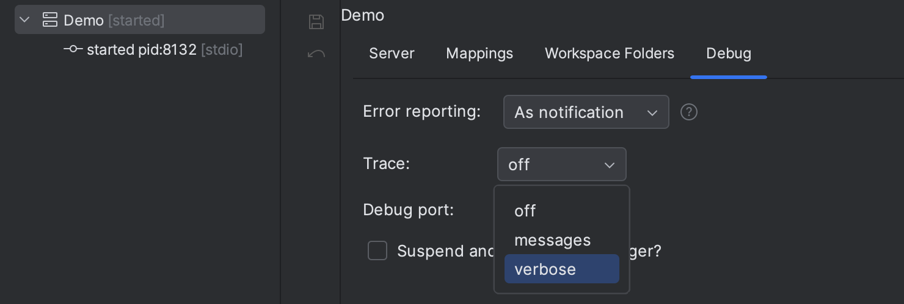

The communication details between the IDE and the language servers are seen in the "LSP consoles" pane. 
In verbose mode, the messages can be expanded for more details:

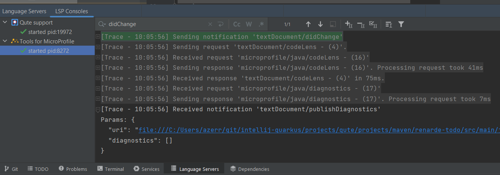

A message of the language server that LSP4J can't parse, such as a notification whose params don't have the type that
LSP gives them, is shown in the traces too, as `Received notification '...' that could not be parsed.`, followed by
the error, such as `Issue: Message could not be parsed. java.lang.NumberFormatException: Expected an int but was ...`.

If the language server logs messages via [window/logMessage](https://microsoft.github.io/language-server-protocol/specifications/lsp/3.17/specification/#window_logMessage), you can see them in the `Logs` tab:

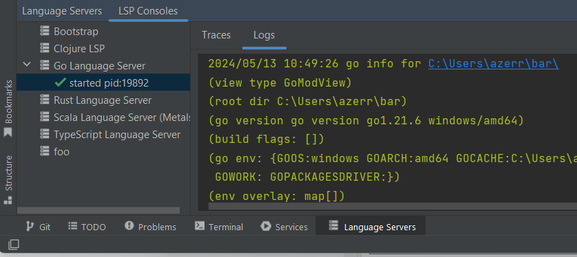 

When a language server is started, several actions are available, like stopping the language server or copying the command starting the language server :

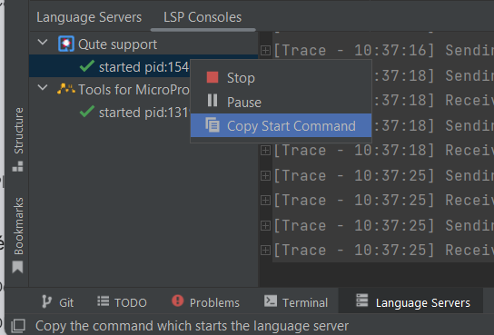

Each language server of the tree shows its state after its name, in grey, such as `[started]`, `[1/2 started]`,
`[starting]`, `[crashed]`, `[stopped]` or `[disabled]`. Hovering over it shows its name and id, the name and version
that the server reports in its response to [initialize](https://microsoft.github.io/language-server-protocol/specifications/lsp/3.17/specification/#initialize)
when it reports them, whether it is enabled, the number of its instances, and the error of an instance which failed:

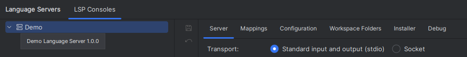

Below it, each instance of the language server shows its state, and how LSP4IJ talks to it, in grey: `[stdio]`, or its
socket, such as `[accept on port 5008]`. Hovering over an instance shows its root, when the language server has
[several instances](./UserDefinedLanguageServer.md#several-language-server-instances), its state, the connection, the
PID and the command of its process, and its error.

### Language Server Installation

If the language server defines an [installation procedure](./DeveloperGuide.md#install-language-server), you can use the following actions:

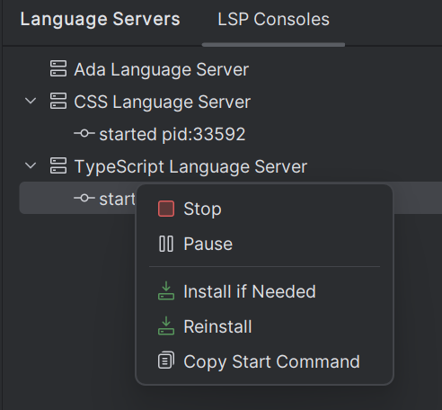

 * `Install if Needed`: Checks if the server can start. Installs it only if necessary.
 * `Reinstall`: Forces a full reinstall, even if the server is already working.

## Settings

### Language Servers preferences

The preference page under `Preferences | Languages & Frameworks | Language Servers (LSP4IJ)` allows power users 
to configure mappings, language servers debugging and tracing:

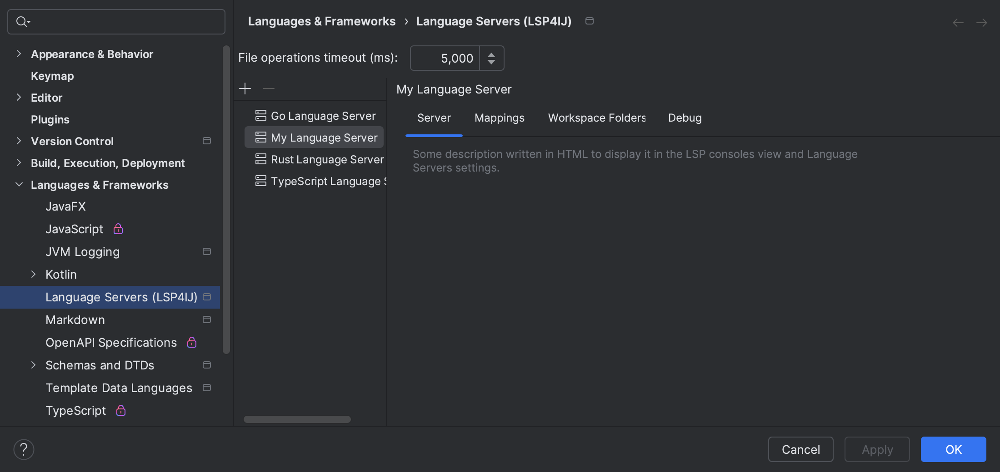

The `Mappings` tab shows the file associations with the language server:

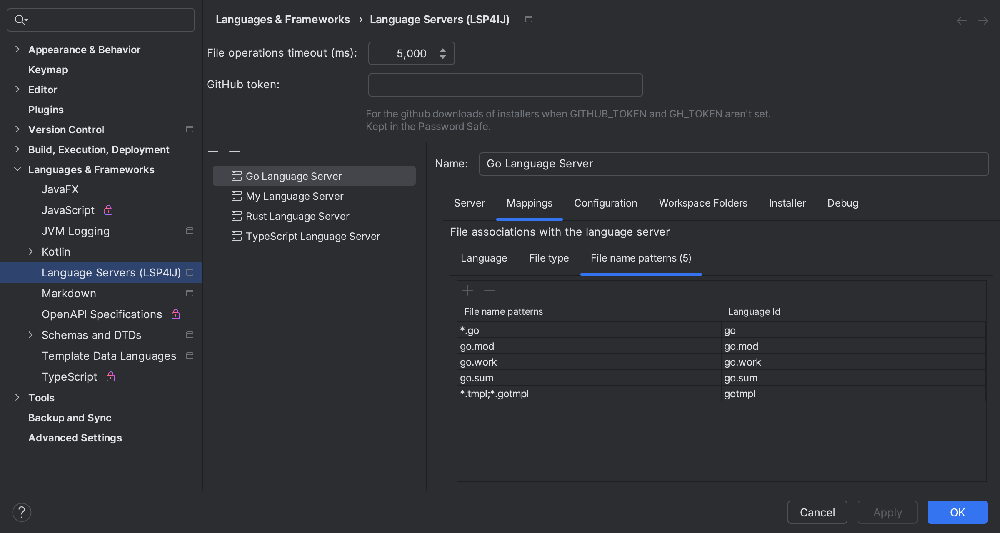

The `Debug` tab allows to configure language servers debugging and tracing:

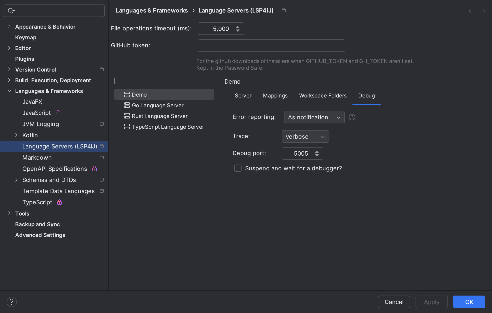

`Debug port` and `Suspend and wait for a debugger?` are shown for a language server which a plugin integrates: the
plugin starts it with them when it builds its command with
[JavaProcessCommandBuilder](./DeveloperGuide.md#processstreamconnectionprovider).
A [user-defined language server](./UserDefinedLanguageServer.md#debug-tab) is started by its own command, so its
`Debug` tab doesn't show them.

### Files served twice

IntelliJ IDEA 2026.3 has a language server client of its own, configured in
`Settings | Languages & Frameworks | Language Servers`. When a language server of that page and a language server of
LSP4IJ are both enabled for a file, both serve it, and you see each diagnostic, completion item and hover twice. The
editor of the file then warns: "This file is served twice: by 'X' of LSP4IJ, and by 'Y' of IntelliJ's Language
Servers settings. Disable one of them to avoid duplicate results." Its links open the `Language Servers (LSP4IJ)` and
the `Language Servers` settings, and `Don't show again` turns the warning off. The language servers that other plugins
add to IntelliJ's page aren't checked.

### LSP CodeLens

The standard preference page under `Preferences | Inlay Hints` allows to configure `LSP Codelens`:

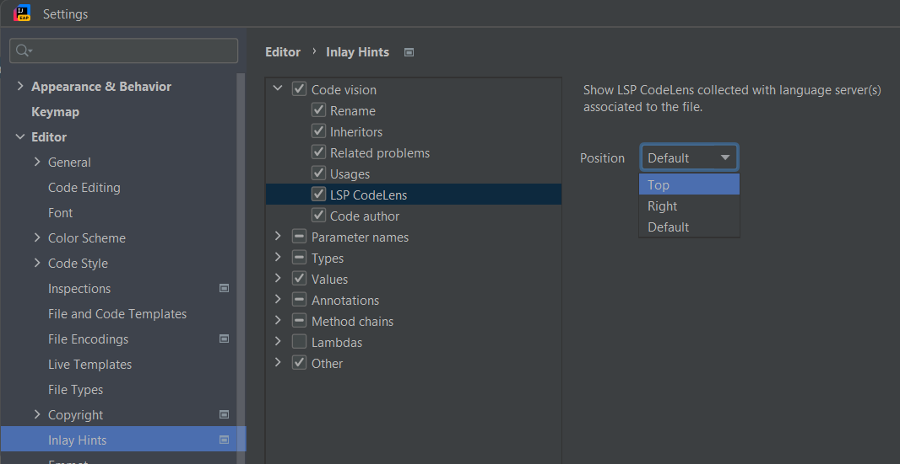

You can configure LSP CodeLens on the `Top`:

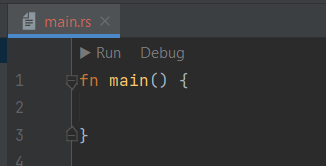

or configure LSP CodeLens on the `Right`:

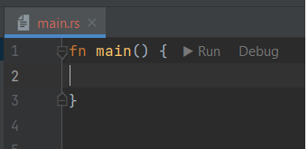

## Structure View

The Structure View displays the file outline using LSP [textDocument/documentSymbol](https://microsoft.github.io/language-server-protocol/specifications/lsp/3.17/specification/#textDocument_documentSymbol):

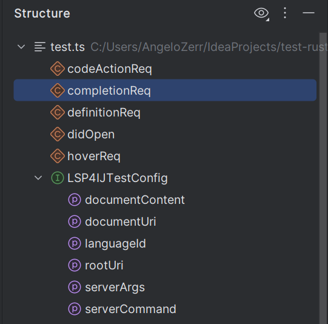

### Filters

You can filter symbols by [SymbolKind](https://microsoft.github.io/language-server-protocol/specifications/lsp/3.17/specification/#symbolKind) 
(Class, Method, Field, etc.) using the filter dropdown.

Show all symbols:

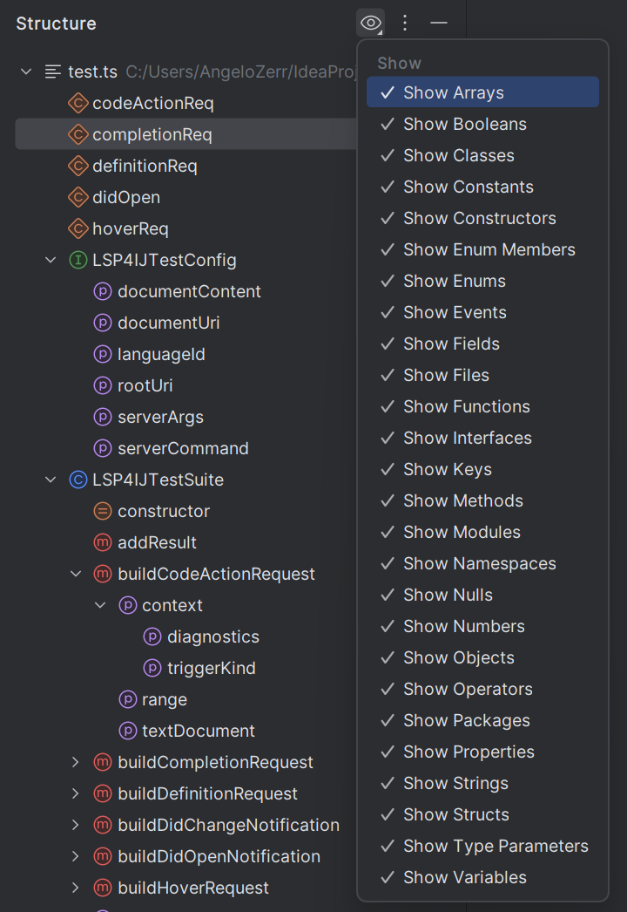

Hide specific symbol types (e.g., constants):

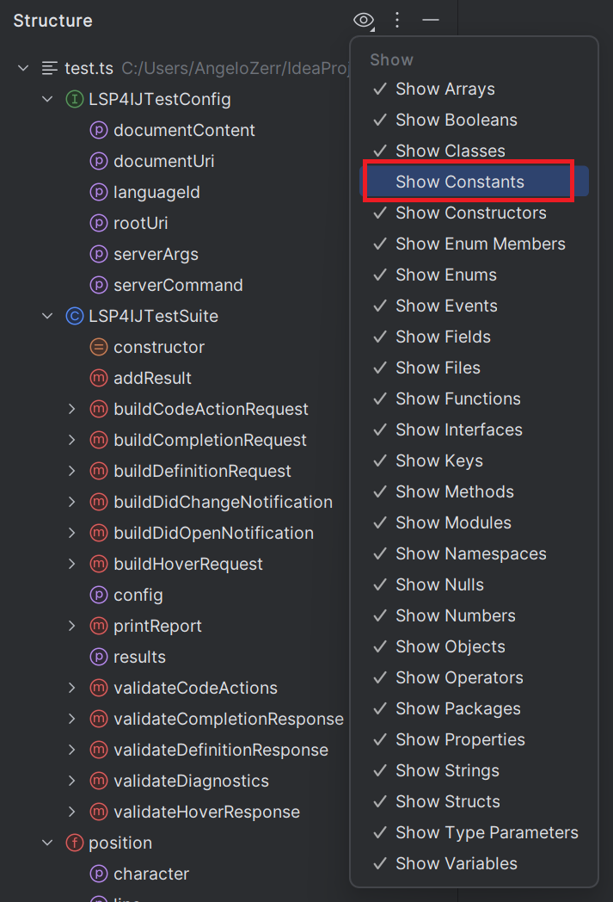

## Actions

### Formatting

The LSP formatting support can be done with the standard `Reformat Code` and `Reformat File` actions.

A language server doesn't format a file which matches a `Do not format` pattern of
`Settings | Editor | Code Style | Formatter`, also when `Reformat code` runs before a commit. Server-side on-type
formatting doesn't check these patterns.

### Find Usages

The following LSP features are integrated with the standard `Find Usages` menu (provided they're supported by the underlying language server): 

* [Declarations](https://microsoft.github.io/language-server-protocol/specifications/lsp/3.17/specification/#textDocument_declaration)
* [Definitions](https://microsoft.github.io/language-server-protocol/specifications/lsp/3.17/specification/#textDocument_definition)
* [Type Definitions](https://microsoft.github.io/language-server-protocol/specifications/lsp/3.17/specification/#textDocument_typeDefinition)
* [References](https://microsoft.github.io/language-server-protocol/specifications/lsp/3.17/specification/#textDocument_references)
* [Implementations](https://microsoft.github.io/language-server-protocol/specifications/lsp/3.17/specification/#textDocument_implementation)

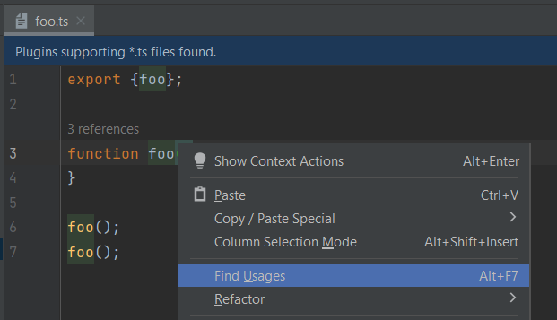

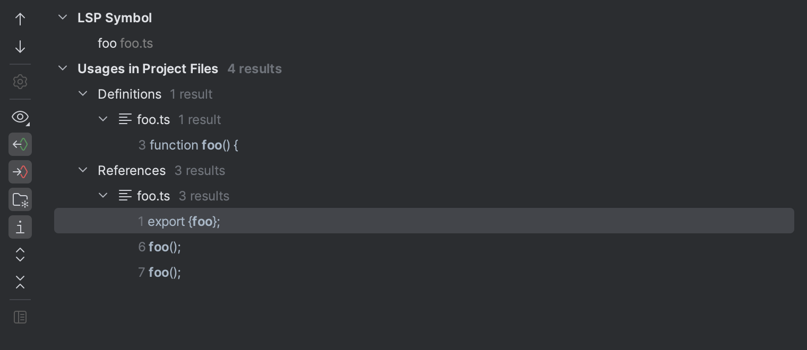

A declaration or a definition is listed once: a reference or a type definition at the same place isn't listed again.
When Find Usages searches an element of a language plugin, such as a Scala class with the Metals language server, a
reference that both the plugin and the language server find is listed once, in the group of the plugin's usage, such as
`Method call`.

### Refactoring

#### On file operation

If the language server can support [workspace/willRenameFiles](https://microsoft.github.io/language-server-protocol/specifications/lsp/3.17/specification/#workspace_willRenameFiles), when a file is
renamed inside IntelliJ IDEA, LSP4IJ can consume it and applies the `WorkspaceEdit`
to apply some refactoring.

## Linked Editing Range

If the language server supports [textDocument/linkedEditingRange](https://microsoft.github.io/language-server-protocol/specifications/lsp/3.17/specification/#textDocument_linkedEditingRange),
typing in a range which it links to others, such as the declaration of a local variable, edits the others too, such as
the variable's uses.

Linked editing is off by default. Turn it on with `Edit linked ranges together, such as a variable's declaration and its uses`
in `Settings | Editor | General | Smart Keys`, under `Language Servers`:

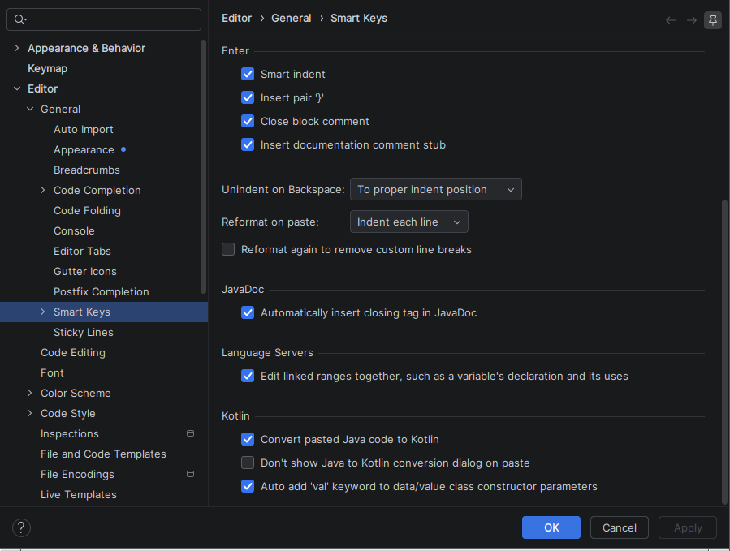

In this [Ecstasy](https://github.com/xtclang/) file, the language server links the declaration of `total` with its two uses: typing `sub` in the
declaration renames all three to `subtotal`, and one undo reverts them together.

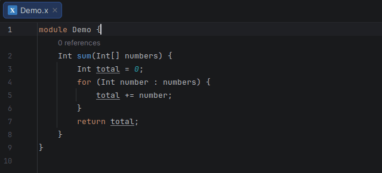

## Semantic Tokens support

LSP4IJ provides **experimental**  support for [LSP Semantic Tokens](https://microsoft.github.io/language-server-protocol/specifications/lsp/3.17/specification/#textDocument_semanticTokens).

### Language Server coloration

LSP4IJ provides default colors for semantic tokens, configurable in `Editor / Color Scheme / Language Server`:

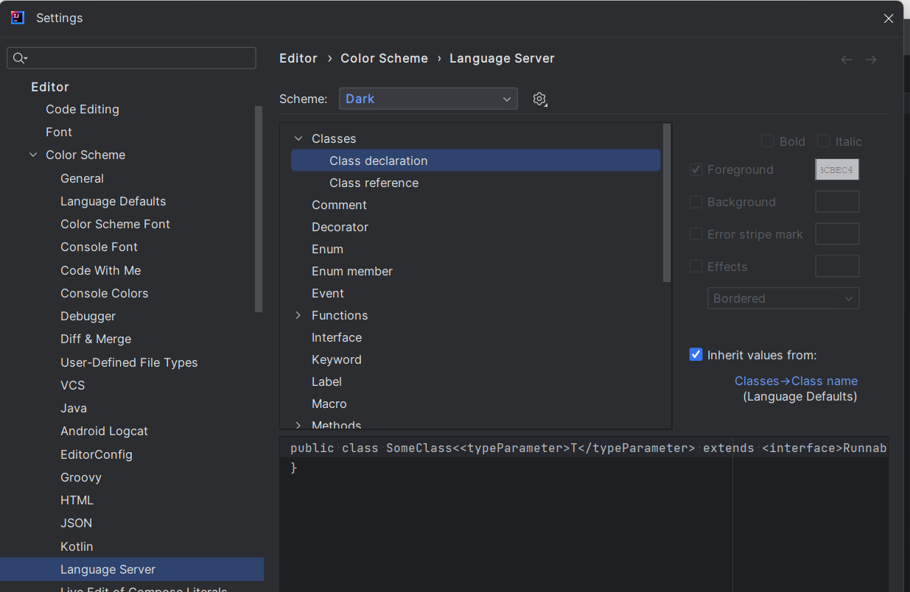

You can see the mapping between token types/modifiers and IntelliJ's TextAttributeKey on the color settings page (e.g., Class declaration)
in [DefaultSemanticTokensColorsProvider](./LSPSupport.md#DefaultSemanticTokensColorsProvider) section.

### Semantic Tokens Inspector

The `Semantic Tokens Inspector` allows you to understand semantic coloring via LSP semantic tokens support. You can open the inspector
with the menu `View / Tool Window / Semantic Tokens Inspector`:

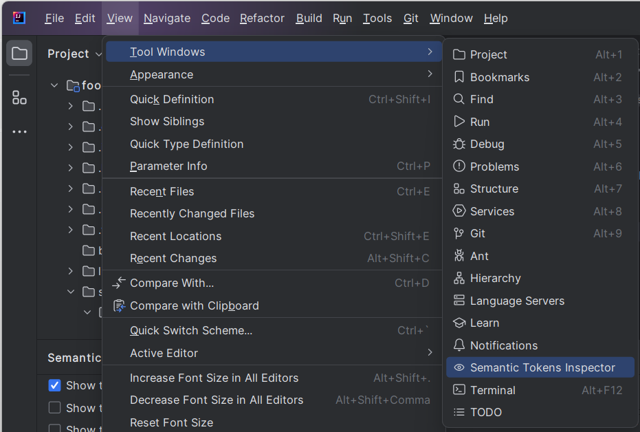

Once the inspector is open, it tracks all calls to semantic tokens. 
If a file must be colored via semantic tokens, it appears in a tab of the inspector 
and must display information on the TextAttributeKeys to use and the token types / modifiers decoded
that you can select in the left panel via the checkboxes:

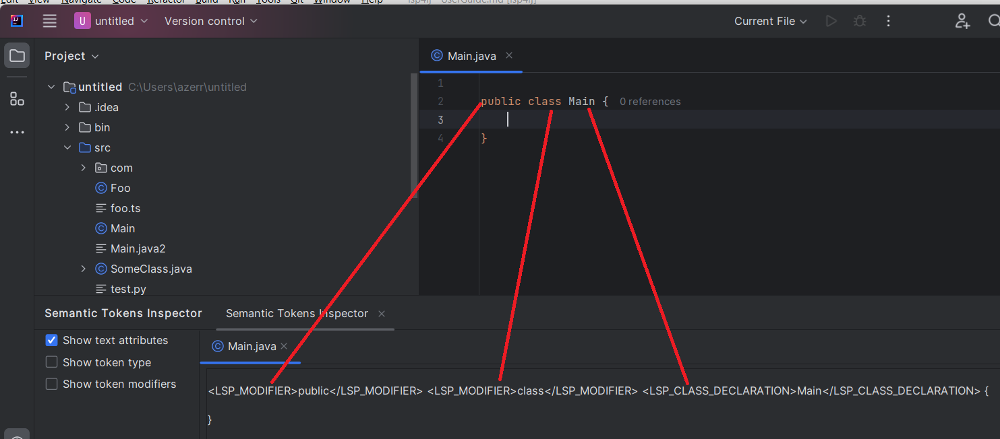

### Troubleshooting

If the `Semantic Tokens` doesn't show the expected result, please check that:

 * show in the [LSP console](#lsp-console) that your language server reports 
LSP request `textDocument/semanticTokens/full`
 * uses the [Semantic Tokens Inspector](#semantic-tokens-inspector) to understand more how the 
file content is tokenized. Problem could come if LSP4IJ doesn't support some token types / modifiers.

## Show Problem in Project View

When language server reports some diagnostics for a given file with `error severity`, the `file from the project view
is highlighted as an error`:

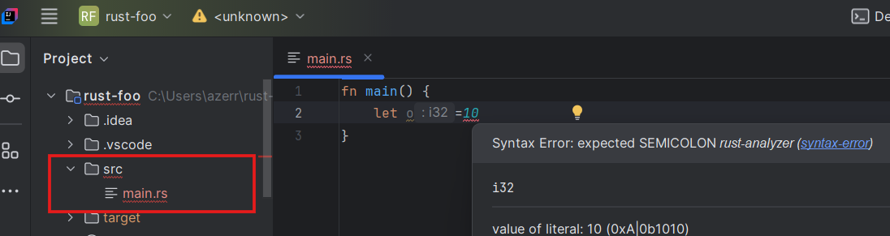

## Inspections

You can click on `Inspect Code...` hyperlink available on the `Project Errors` from the `Problems` view to
show all LSP diagnostics errors of your project in the `Language Servers` local inspection tool:

- from opened files.
- from closed files, if your language server support it.

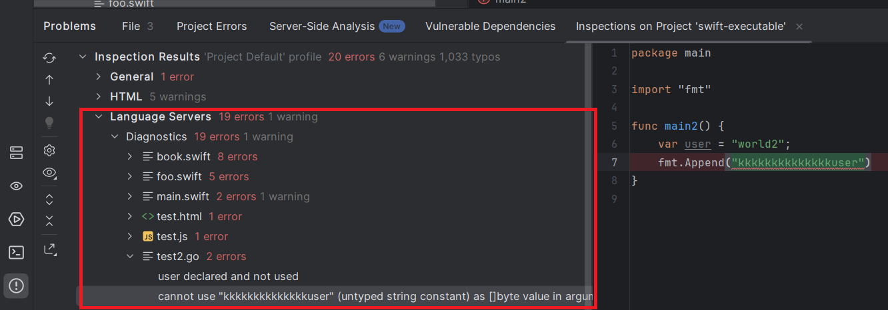
