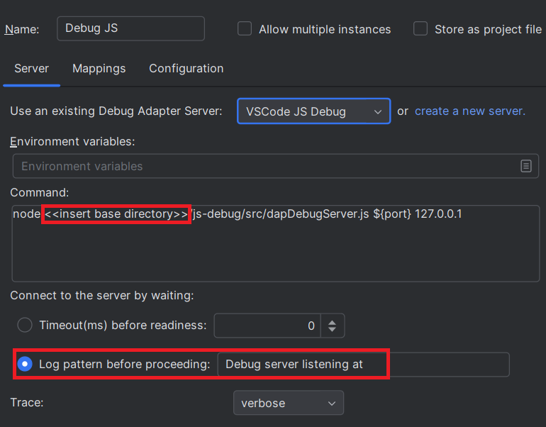
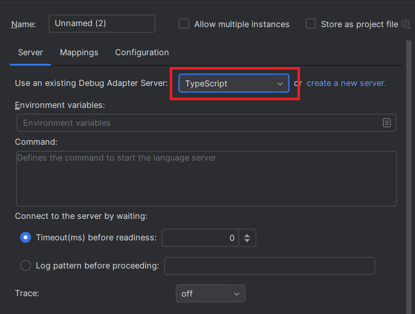

# Developer Guide

DAP support provides a [generic DAP configuration interface](./UserGuide.md) that allows to configure any DAP server. 
The fact that it is generic can confuse the user with all the possible configurations.

To improve the user experience, it is possible to register a custom DAP server via the
`com.redhat.devtools.lsp4ij.debugAdapterServer` extension point which allows for example:

* to [embed the DAP server in its plugin](#embed-the-dap-server) to avoid the user to download it, to configure its environment.
* to [customize the DAP server startup](#customize-the-dap-server-startup) to avoid the user to configure it.
* to [customize the Run/Debug configuration interface](#provide-your-own-rundebug-configuration) to simplify and provide a user interface adapted to the language.
* to [manage its own type of breakpoints](#manage-your-own-type-of-breakpoints) to avoid being polluted by the breakpoints of other DAP servers.
* to [customize how variables and expressions are shown](#customize-variables-and-expressions).

The API is experimental (`@ApiStatus.Experimental`) and can still change.

* [Before you start](#before-you-start)
* [How a debug session starts](#how-a-debug-session-starts)
* [TypeScript DAP server](#typescript-dap-server), a step-by-step example
* [Starting the DAP server](#starting-the-dap-server)
* [Launch and attach](#launch-and-attach)
* [Provide your own Run/Debug configuration](#provide-your-own-rundebug-configuration)
* [Manage your own type of breakpoints](#manage-your-own-type-of-breakpoints)
* [Customize variables and expressions](#customize-variables-and-expressions)
* [Customize the DAP client](#customize-the-dap-client)

# Before you start

Declare the dependency on LSP4IJ in your `plugin.xml`, and exclude LSP4J from your plugin's dependencies, as for a
language server: see [Reference LSP4IJ](../DeveloperGuide.md#reference-lsp4ij). The DAP classes of LSP4J
(`org.eclipse.lsp4j.debug`) come from LSP4IJ too.

The main classes are:

| Class | Role |
|-------|------|
| `debugAdapterServer` extension point | Registers a DAP server: its id, its name and its factory. |
| `DebugAdapterDescriptorFactory` | One instance per DAP server. It says which files the server debugs, which breakpoint types and executors it supports, and creates a descriptor for each debug session. |
| `DebugAdapterDescriptor` | One instance per debug session. It starts the DAP server, gives the `launch` or `attach` arguments, says when the client can connect, and creates the breakpoint handlers, the DAP client and the variable support. |
| `DAPRunConfigurationBase` | The base class of a DAP Run/Debug configuration. LSP4IJ's runner runs any configuration of this class. |

# How a debug session starts

When the user runs or debugs a DAP Run/Debug configuration:

1. The configuration asks the factory of its DAP server for a descriptor
   (`DebugAdapterDescriptorFactory#createDebugAdapterDescriptor`).
2. The descriptor starts the process of the session with `startServer(DebugMode)`, in the mode that `getDebugMode()`
   returns. For a launch it calls `startServer()`, which starts the DAP server. For an attach it starts nothing
   by default (see [Launch and attach](#launch-and-attach)).
3. `getServerReadyConfig(DebugMode)` says when the DAP server is ready, and so when the client connects to it
   (see [Wait for the DAP server](#wait-for-the-dap-server)).
4. The client connects with a socket if it knows a port, and through the standard input and output of the process
   otherwise (see [Transport](#transport)).
5. The client sends `initialize`, with the arguments of `createInitializeRequestArguments`, and then `launch` or
   `attach` with the parameters of `getDapParameters()`. A launch also gets `noDebug`, which is `true` when the
   user runs the configuration rather than debugs it. When the server sends the `initialized` event, the client sends
   the breakpoints, when it debugs, and `configurationDone`, when the server supports it.

# TypeScript DAP server

In this example we will explain how to register [VSCode JS Debug DAP server](./user-defined-dap/vscode-js-debug.md) 
with the `com.redhat.devtools.lsp4ij.debugAdapterServer` extension point.

## Embed the DAP server

Here we will embed the [VSCode JS Debug DAP server](./user-defined-dap/vscode-js-debug.md) in your plugin.
You will need to download the `js-debug-dap-v*.tar.gz` asset from the [VSCode JS Debug releases](https://github.com/microsoft/vscode-js-debug/releases)
and extract it. It contains a `js-debug` folder.

The DAP server is started as a separate process (`node`), which cannot read a file inside your plugin's jar. So ship the
`js-debug` folder in your plugin's directory, next to its `lib` folder, and not in `src/main/resources`. With the
[IntelliJ Platform Gradle Plugin](https://plugins.jetbrains.com/docs/intellij/tools-intellij-platform-gradle-plugin.html),
copy it from your project into the sandbox, which `buildPlugin` packs into the plugin's distribution:

```kotlin
tasks {
    prepareSandbox {
        from(layout.projectDirectory.dir("js-debug")) {
            into(pluginName.map { "$it/js-debug" })
        }
    }
}
```

At runtime, your plugin's directory is the plugin path of your plugin's descriptor, which your plugin's class loader
(a `com.intellij.ide.plugins.cl.PluginAwareClassLoader`) gives:

```java
Path dapServerPath = ((PluginAwareClassLoader) TypeScriptDebugAdapterDescriptor.class.getClassLoader())
        .getPluginDescriptor()
        .getPluginPath()
        .resolve("js-debug/src/dapDebugServer.js");
```

## Customize the DAP server startup

Configuring manually [VSCode JS Debug DAP server](./user-defined-dap/vscode-js-debug.md) can be boring:

 * you need to download `js-debug-dap-v*.tar.gz`, unzip it, and update the `<<insert base directory>>`
to use the proper path of the DAP server.
 * the UI configuration is little complex.



In this step we will register the DAP server with the `com.redhat.devtools.lsp4ij.debugAdapterServer` extension point.

### DebugAdapterDescriptor

Create the `TypeScriptDebugAdapterDescriptor` class like this:

```java
package my.dap.server;

import com.intellij.execution.ExecutionException;
import com.intellij.execution.configurations.GeneralCommandLine;
import com.intellij.execution.configurations.RunConfigurationOptions;
import com.intellij.execution.process.ProcessHandler;
import com.intellij.execution.runners.ExecutionEnvironment;
import com.intellij.ide.plugins.cl.PluginAwareClassLoader;
import com.intellij.openapi.fileTypes.FileType;
import com.redhat.devtools.lsp4ij.dap.DebugMode;
import com.redhat.devtools.lsp4ij.dap.client.LaunchUtils;
import com.redhat.devtools.lsp4ij.dap.configurations.options.FileOptionConfigurable;
import com.redhat.devtools.lsp4ij.dap.configurations.options.WorkingDirectoryConfigurable;
import com.redhat.devtools.lsp4ij.dap.definitions.DebugAdapterServerDefinition;
import com.redhat.devtools.lsp4ij.dap.descriptors.DebugAdapterDescriptor;
import com.redhat.devtools.lsp4ij.dap.descriptors.ServerReadyConfig;
import org.jetbrains.annotations.NotNull;
import org.jetbrains.annotations.Nullable;

import java.nio.file.Path;
import java.util.Map;

public class TypeScriptDebugAdapterDescriptor extends DebugAdapterDescriptor {

    private static final Path dapServerPath = ((PluginAwareClassLoader) TypeScriptDebugAdapterDescriptor.class.getClassLoader())
            .getPluginDescriptor()
            .getPluginPath()
            .resolve("js-debug/src/dapDebugServer.js");

    public TypeScriptDebugAdapterDescriptor(@NotNull RunConfigurationOptions options,
                                            @NotNull ExecutionEnvironment environment,
                                            @Nullable DebugAdapterServerDefinition serverDefinition) {
        super(options, environment, serverDefinition);
    }

    @Override
    public ProcessHandler startServer() throws ExecutionException {
        String command = "node \"" + dapServerPath + "\" ${port} 127.0.0.1";
        GeneralCommandLine commandLine = createStartServerCommandLine(command);
        return startServer(commandLine);
    }

    @Override
    public @NotNull Map<String, Object> getDapParameters() {
        // language=JSON
        String launchJson = """                
                {
                  "type": "pwa-node",
                  "name": "Launch TypeScript file",
                  "request": "launch",
                  "program": "${file}",
                  "cwd": "${workspaceFolder}",
                  "outFiles": [
                    "${workspaceFolder}/**/*.(m|c|)js",
                    "!**/node_modules/**"
                  ],
                  "sourceMaps": true,
                  "__workspaceFolder": "${workspaceFolder}"
                }
                """;
        String file = ((FileOptionConfigurable) options).getFile();
        String workspaceFolder = ((WorkingDirectoryConfigurable) options).getWorkingDirectory();
        LaunchUtils.LaunchContext context = new LaunchUtils.LaunchContext(file, workspaceFolder);
        return LaunchUtils.getDapParameters(launchJson, context);
    }

    @Override
    public @NotNull ServerReadyConfig getServerReadyConfig(@NotNull DebugMode debugMode) {
        return new ServerReadyConfig("Debug server listening at ");
    }

    @Override
    public @Nullable FileType getFileType() {
        return null;
    }
}
```

* `startServer()` starts the DAP server. `${port}` in the command is replaced with a free port, and the client
  connects to the server on that port (see [Starting the DAP server](#starting-the-dap-server)).
* `getDapParameters()` returns the arguments of the `launch` request. `LaunchUtils.getDapParameters` replaces
  `${file}` and `${workspaceFolder}` in the JSON with the values of the `LaunchContext`. Here they come from the
  options of the generic DAP Run/Debug configuration, which implement `FileOptionConfigurable` and
  `WorkingDirectoryConfigurable`.
* `getServerReadyConfig(DebugMode)` makes the client wait until the server writes `Debug server listening at `
  before it connects (see [Wait for the DAP server](#wait-for-the-dap-server)).
* `getFileType()` returns the file type of the editors where the user types expressions: Evaluate, watches and
  breakpoint conditions. `null` means plain text.

### DebugAdapterDescriptorFactory

Create the `TypeScriptDebugAdapterDescriptorFactory` class like this:

```java
package my.dap.server;

import com.intellij.execution.configurations.RunConfigurationOptions;
import com.intellij.execution.runners.ExecutionEnvironment;
import com.redhat.devtools.lsp4ij.dap.descriptors.DebugAdapterDescriptor;
import com.redhat.devtools.lsp4ij.dap.descriptors.DebugAdapterDescriptorFactory;
import org.jetbrains.annotations.NotNull;

public class TypeScriptDebugAdapterDescriptorFactory extends DebugAdapterDescriptorFactory {

    @Override
    public DebugAdapterDescriptor createDebugAdapterDescriptor(@NotNull RunConfigurationOptions options,
                                                               @NotNull ExecutionEnvironment environment) {
        return new TypeScriptDebugAdapterDescriptor(options, environment, getServerDefinition());
    }
}
```

### debugAdapterServer extension point

Register the `TypeScriptDebugAdapterDescriptorFactory` class with the `debugAdapterServer` extension point like this:

```xml
<extensions defaultExtensionNs="com.redhat.devtools.lsp4ij">
    <debugAdapterServer
        id="typescript"
        name="TypeScript"
        factoryClass="my.dap.server.TypeScriptDebugAdapterDescriptorFactory" />
</extensions>
```

`id`, `name` and `factoryClass` are the ones you need. The extension point also takes a `description` element (HTML),
an `icon` (a resource path, 13x13 pixels), and `bundle`, `nameKey` and `descriptionKey` to take the name and the
description from a resource bundle.

### Declare the files that the DAP server debugs

The files that a DAP server debugs are the ones where the user can put its breakpoints, and the ones that **Run** and
**Debug** in the editor's context menu run with it.

You can declare them with the [file mappings](../DeveloperGuide.md#declare-file-mappings) of language servers, whose
`serverId` is the id of the DAP server:

```xml
<extensions defaultExtensionNs="com.redhat.devtools.lsp4ij">
    <fileNamePatternMapping patterns="*.ts"
                            serverId="typescript"/>
</extensions>
```

LSP4IJ's language server registry logs a warning for a mapping whose `serverId` is not a language server's. To avoid
it, or to decide in code, override `isDebuggableFile` in your factory instead:

```java
@Override
public boolean isDebuggableFile(@NotNull VirtualFile file, @NotNull Project project) {
    return "ts".equals(file.getExtension());
}
```

**Run** and **Debug** in the editor's context menu create a generic DAP Run/Debug configuration, which the factory's
`prepareConfiguration(RunConfiguration, VirtualFile, Project)` fills with the file and the DAP server. Override it to
fill it otherwise, or return `false` to create none, for example when your DAP server only attaches.

### Test your debugAdapterServer

At this step, you can test your `TypeScriptDebugAdapterDescriptorFactory` with the generic Debug Adapter Protocol runconfiguration.
You should see TypeScript in the existing server,



Select it, select the TypeScript file that you wish to run in the Configuration tab and run the configuration.
It should start your DAP server and execute the TypeScript file.

# Starting the DAP server

## The process

`startServer()` returns the `ProcessHandler` of the DAP server. `DebugAdapterDescriptor` helps to build it:

* `createStartServerCommandLine(command)` parses the command and replaces `${port}` with a free port, which the client
  then uses. `createStartServerCommandLine(workingDirectory, command, environmentVariables, includeSystemEnvironment)`
  sets the working directory and the environment variables of the process too.
* `startServer(GeneralCommandLine)` starts the process. When the process ends, the console shows its exit code.

If you create the `ProcessHandler` in another way, call `DAPProcessTerminatedListener.attach(processHandler)` to
show the exit code too.

## Wait for the DAP server

The client connects when `getServerReadyConfig(DebugMode)` says that the server is ready:

| `ServerReadyConfig` | The client connects |
|---------------------|---------------------|
| `new ServerReadyConfig(int connectTimeout)` | after `connectTimeout` milliseconds; `0` connects at once. |
| `new ServerReadyConfig(String pattern)` | when the server writes the given text. The pattern can also give the address and the port, as in `DAP server listening at: ${address}:${port}` (see the [Go Delve example](./user-defined-dap/go-delve.md)). |
| `new ServerReadyConfig(String address, int port)` | to the given address and port: for an attach at once, and for a launch when a socket to the port opens. |

By default, `getServerReadyConfig` returns the address and the port of an attach configuration (see
[Launch and attach](#launch-and-attach)), follows the wait strategy of the generic DAP Run/Debug configuration, or
waits 500 milliseconds.

## Transport

The client connects with a socket when it knows a port: the port of `${port}`, the port of the `ServerReadyConfig`,
or the port that the pattern found in the server's output. Otherwise it reads and writes the DAP messages through the
standard output and input of the process that `startServer()` returned.

A DAP server that is not a separate process, for example one that runs in your language server, can return its own
`ProcessHandler`, with `new ServerReadyConfig(0)` and no port. The client reads the server's messages from the
handler's standard output (`notifyTextAvailable` with `ProcessOutputTypes.STDOUT`), and writes its own to the
handler's `getProcessInput()`.

## Install the DAP server

A factory whose `createServerInstaller()` returns a `ServerInstaller` lets LSP4IJ install the DAP server before a debug
session needs it: the runner checks the installation first and shows its progress in the console. See
[Install language server](../DeveloperGuide.md#install-language-server) for how to write an installer.

# Launch and attach

`getDebugMode()` says whether the client sends `launch` or `attach`. It returns `DebugMode.LAUNCH` by default.

For an attach, the DAP server already runs, and the descriptor starts no process: `startServer(DebugMode.ATTACH)`
returns a process that does nothing. The client connects at once to the address and the port of
`getServerReadyConfig(DebugMode.ATTACH)`. When the options of the Run/Debug configuration implement
`AttachConfigurable`, the default `getServerReadyConfig` takes them from its address and port fields.

A descriptor whose DAP server is reached through the process that `startServer()` starts, such as one that carries its
sessions over another connection, overrides `startServer(DebugMode)` to start that process for an attach too:

```java
@Override
public ProcessHandler startServer(@NotNull DebugMode debugMode) throws ExecutionException {
    return startServer();
}
```

# Provide your own Run/Debug configuration

The generic Debug Adapter Protocol configuration shows every option of every DAP server. Your own configuration type
shows only what your users need.

LSP4IJ's runner runs any configuration that extends `DAPRunConfigurationBase`. Its `getState` asks the factory of the
configuration's DAP server for a descriptor, so the descriptor reads its options from the configuration.

## An attach configuration

LSP4IJ provides `DAPAttachRunConfiguration`, `DAPAttachRunConfigurationOptions` and `DAPAttachSettingsEditor` for a
configuration that attaches to a running DAP server, with an address, a port and the DAP server trace:

```java
public class MyAttachRunConfiguration extends DAPAttachRunConfiguration<MyAttachRunConfigurationOptions> {

    protected MyAttachRunConfiguration(@NotNull Project project,
                                       @Nullable ConfigurationFactory factory,
                                       @Nullable String name) {
        super(project, factory, name, "my-dap-server"); // the id of the debugAdapterServer
    }
}
```

```java
public class MyAttachRunConfigurationOptions extends DAPAttachRunConfigurationOptions {
}
```

Its configuration factory creates it and declares its options class:

```java
public class MyConfigurationFactory extends ConfigurationFactory {

    public MyConfigurationFactory(@NotNull ConfigurationType type) {
        super(type);
    }

    @Override
    public @NotNull String getId() {
        return getType().getId();
    }

    @Override
    public @NotNull RunConfiguration createTemplateConfiguration(@NotNull Project project) {
        return new MyAttachRunConfiguration(project, this, "My Attach");
    }

    @Override
    public @Nullable Class<? extends BaseState> getOptionsClass() {
        return MyAttachRunConfigurationOptions.class;
    }
}
```

Register its [configuration type](https://plugins.jetbrains.com/docs/intellij/run-configurations.html) as any other:

```xml
<extensions defaultExtensionNs="com.intellij">
    <configurationType implementation="my.dap.server.MyConfigurationType"/>
</extensions>
```

Its descriptor returns `DebugMode.ATTACH` from `getDebugMode()`, and the arguments of the `attach` request from
`getDapParameters()`. LSP4IJ does not call its `startServer()` for an attach.

The Qute debugger of [Quarkus Tools](https://github.com/redhat-developer/intellij-quarkus/tree/main/src/main/java/com/redhat/devtools/intellij/qute/run)
is a complete example: its `QuteRunConfiguration` extends `DAPAttachRunConfiguration`.

## A launch configuration

For a launch, extend `DAPRunConfigurationBase<T>` with options that extend `DAPRunConfigurationOptionsBase`:

* `getDebugAdapterServer()` returns the server of the configuration:
  `DebugAdapterManager.getInstance().getDebugAdapterServerById("my-dap-server")`.
* The options store what your descriptor needs. Implement `FileOptionConfigurable`, `WorkingDirectoryConfigurable`
  or `EnvironmentVariablesDataConfigurable` where they fit: a descriptor that reads its options through these
  interfaces, as `TypeScriptDebugAdapterDescriptor` does, works with the generic configuration and with yours.
* `getConfigurationEditor()` returns your `SettingsEditor`. By default it returns the factory's
  `getConfigurationEditor(Project)`, which is the generic editor.

## Executors

A configuration runs with an executor only when its `canRun(executorId)` is `true`, which asks the factory's
`canRun`. By default it accepts **Run** and **Debug**. Override it in your factory to accept less, such as **Debug**
only, or an executor of your own.

# Manage your own type of breakpoints

By default, the breakpoints of a DAP server are LSP4IJ's DAP breakpoints: `DebugAdapterDescriptorFactory#supportsBreakpointType`
accepts only `DAPBreakpointType`. The user can put them in every file that such a DAP server debugs, and all these
DAP servers share them.

To give your DAP server its own breakpoints:

1. Extend `DAPBreakpointTypeBase`, which puts breakpoints in the files of the DAP servers that support the type, and
   supports conditions:

    ```java
    public class MyBreakpointType extends DAPBreakpointTypeBase<XBreakpointProperties<?>> {

        public MyBreakpointType() {
            super("my-breakpoint", "My Breakpoint");
        }

        @Override
        public @Nullable XBreakpointProperties<?> createBreakpointProperties(@NotNull VirtualFile file, int line) {
            return null;
        }
    }
    ```

2. Register it:

    ```xml
    <extensions defaultExtensionNs="com.intellij">
        <xdebugger.breakpointType implementation="my.dap.server.MyBreakpointType"/>
    </extensions>
    ```

3. Make your factory support it:

    ```java
    @Override
    public boolean supportsBreakpointType(@NotNull XBreakpointType breakpointType) {
        return breakpointType.getClass() == MyBreakpointType.class;
    }
    ```

4. Make your descriptor send its breakpoints, with a handler for the type:

    ```java
    public class MyBreakpointHandler extends DAPBreakpointHandlerBase<XLineBreakpoint<XBreakpointProperties<?>>> {

        public MyBreakpointHandler(@NotNull XDebugSession session,
                                   @NotNull DebugAdapterDescriptor descriptor,
                                   @NotNull Project project) {
            super(MyBreakpointType.class, session, descriptor, project);
        }
    }
    ```

    ```java
    @Override
    public @NotNull DAPBreakpointHandlerBase<?> createBreakpointHandler(@NotNull XDebugSession session, Project project) {
        return new MyBreakpointHandler(session, this, project);
    }
    ```

While a DAP session runs, the line breakpoints of the other breakpoint types, such as a language's own, are sent to
its DAP server too when they are in a file that the server debugs (`DebugAdapterDescriptor#isDebuggableLineBreakpoint`).

Function breakpoints and data breakpoints have their own handlers, which `createFunctionBreakpointHandler` and
`createDataBreakpointHandler` create. They send their breakpoints only to a DAP server with the
`supportsFunctionBreakpoints` and `supportsDataBreakpoints` capabilities.

# Customize variables and expressions

## Variables

The descriptor's `DebugAdapterVariableSupport` decides how the Variables view shows a variable. Set your own in the
constructor of your descriptor:

```java
public MyDebugAdapterDescriptor(@NotNull RunConfigurationOptions options,
                                @NotNull ExecutionEnvironment environment,
                                @Nullable DebugAdapterServerDefinition serverDefinition) {
    super(options, environment, serverDefinition);
    setVariableSupport(new MyDebugAdapterVariableSupport());
}
```

and override what you need:

* `getIcon(Variable)` and `getValuePresentation(Variable)`: the icon and the presentation of a variable. They use
  `isStringType`, `isNumericType`, `isBooleanType`, `isObjectType`, `isArrayType`, `isXmlType` and `isErrorType`,
  which look at the variable's `type`. Override them when your DAP server names its types differently.
* `formatValue(Variable)`: the text of a value. By default it removes the quotes around a string.
* `getDebugVariablePositionProvider()`: where the editor shows the values of the variables inline. The first provider
  that places a variable wins. By default the positions of the language servers' `textDocument/inlineValue` come
  first, and then the positions that the editor's highlighter finds; keep the language servers' provider first when
  you add one.

## Expressions

* `DebugAdapterVariableSupport#getExpressionInfo` finds the expression at the caret or under the mouse, which the
  user evaluates or sees the value of. By default it is the identifier there, with the dots of a qualified name;
  override `getTextRange` and `getExpression` for your language.
* `DebugAdapterDescriptor#getFileType()` is the file type of the editors where the user types expressions, and
  `createDebuggerEditorsProvider(FileType, DAPDebugProcess)` creates their provider. Override it to give these editors
  your language's support.

# Customize the DAP client

* `createInitializeRequestArguments(Map)` returns the arguments of the `initialize` request: the client's id and name,
  the adapter id (the `type` of the DAP parameters), and the client's capabilities.
* `createClient(...)` creates the `DAPClient` of the session. Override it with a subclass of `DAPClient` to handle
  requests or events of your own DAP server, or to send it requests that LSP4IJ does not send.

The DAP features that the client supports, and the capabilities they need, are listed in [DAP support](./DAPSupport.md).
