# Debug Adapter Protocol

LSP4IJ provides [Debug Adapter Protocol](https://microsoft.github.io/debug-adapter-protocol/) support. 
You can read [the DAP Support overview](./DAPSupport.md), describing which DAP features are implemented, and how.
If you need to customize the DAP support you can [register your DAP server with extension point](./DeveloperGuide.md).

The DAP support is available with the `Debug Adapter Protocol` run/debug configuration type:

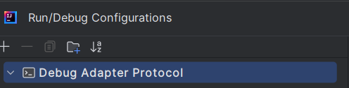

After configuring the [DAP configuration type](#dap-configuration-type), you can debug your file.

Here is an example with `JavaScript debugging`, which uses the [VSCode JS Debug DAP server](./user-defined-dap/vscode-js-debug.md):

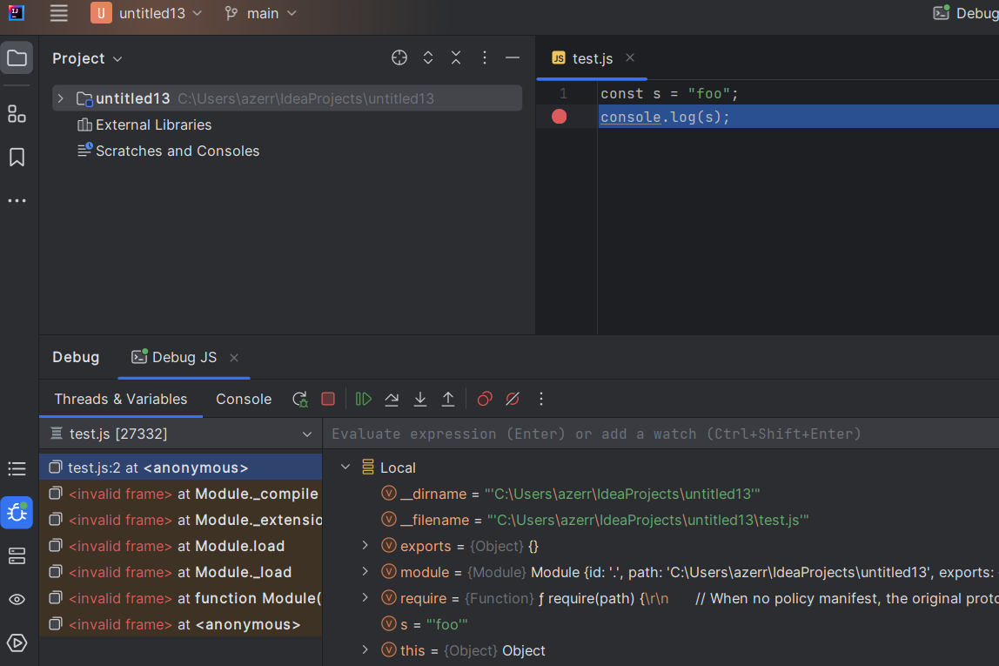

## DAP Configuration Type:

To configure debugging with DAP, you need to fill in:

### Server tab

The `Server` tab to specify the DAP server:

  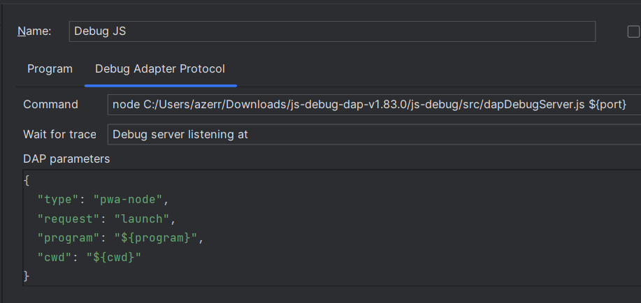

### Mappings tab

The `Mappings` tab to specify the files which can be debugged to allow adding/removing breakpoints:

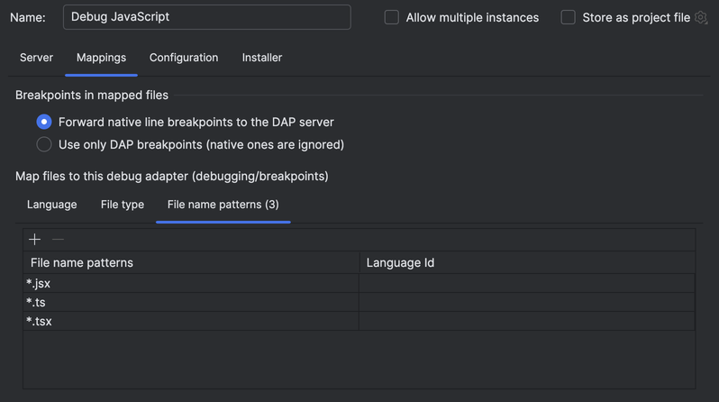

### Configuration tab

The `Configuration` tab to specify the working directory and the file you want to run/debug:

  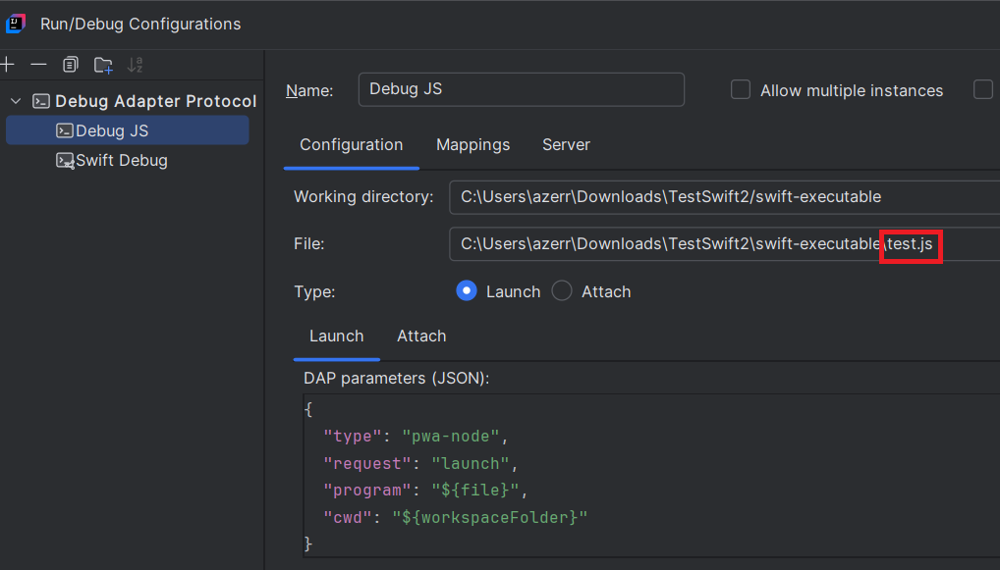


### IntelliJ macro expansion

You can use [built-in IntelliJ macros](https://www.jetbrains.com/help/idea/built-in-macros.html) in DAP configuration parameters. This allows you to reference project and file paths without hardcoding absolute paths.

For example, you can use `$PROJECT_DIR$` to reference the root of the project:

```json
{
  "program": "$PROJECT_DIR$/src/main.js"
}
```

You can also use `$FilePath$` to reference the path of the currently selected editor file:

```json
{
  "program": "$FilePath$"
}
```

Here are some useful standard built-in macros that you can use:

- `$WORKSPACE_DIR$`: The path to the workspace where the current project belongs. The workspace is the root of the open file hierarchy and can include multiple projects.
- `$PROJECT_DIR$`: The root of the project.
- `$USER_HOME$`: The user's home directory.
- `$FilePath$`: The path of the currently selected editor file.

Macro expansion is applied to string values in DAP parameters, including values nested inside objects and arrays.


## Breakpoints

### Adding breakpoint

When a file can be debugged using a DAP server specified in the [Mappings tab](#mappings-tab), a breakpoint can be added.

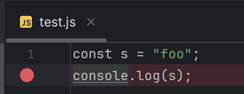

### Verify breakpoint

When the DAP server starts, breakpoints are sent to it, and it responds with the status of those breakpoints — 
whether they are validated or not.

For example, when the DAP server [VSCode JS Debug](./user-defined-dap/vscode-js-debug.md) starts, it invalidates all breakpoints.:

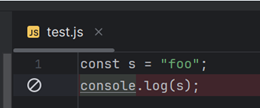

When the program starts, it checks and validates the breakpoints.

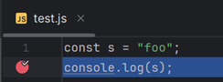

### Conditional breakpoint

Conditional breakpoints are also supported. Here is an example of a conditional breakpoint written in JavaScript:

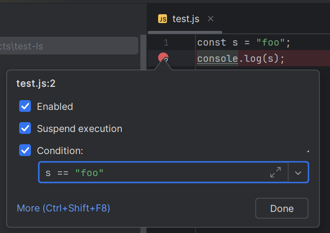

### Hit condition

A breakpoint also has a `Hit condition`, in the `Breakpoints` dialog (`Run | View Breakpoints...`), which the DAP server
reads, such as `3` or `>= 3`, to stop only at some hits of the breakpoint. It is sent to the DAP server with the
breakpoint; a DAP server which doesn't support hit conditions (`supportsHitConditionalBreakpoints`) ignores it.

### Logpoint

A breakpoint whose `Suspend` option is unchecked logs instead of stopping. Its `"Breakpoint hit" message` and
`Evaluate and log` expression are sent to the DAP server as a
[logpoint](https://microsoft.github.io/debug-adapter-protocol//specification.html#Types_SourceBreakpoint), whose message
the DAP server writes to the console without stopping the program; the expression is evaluated by the DAP server.
A DAP server which doesn't support logpoints stops at it: LSP4IJ then evaluates the expression in the stopped frame,
logs it, and resumes the program. A breakpoint which suspends logs its expression when it stops.

### Function breakpoints

When the DAP server supports
[function breakpoints](https://microsoft.github.io/debug-adapter-protocol//specification.html#Requests_SetFunctionBreakpoints)
(`supportsFunctionBreakpoints`), a breakpoint can be set on a function by its name rather than on a line. In the
`Breakpoints` dialog (`Run | View Breakpoints...`), click `+`, choose `DAP Function Breakpoint`, and enter the name of
the function as the DAP server names it, such as `main` or `Point.move`.

A function breakpoint has the `Condition`, `Suspend` and logging options of a line breakpoint, and a `Hit condition`,
which the DAP server reads, such as `3` or `>= 3`; its name and hit condition can be changed in the dialog. The enabled
function breakpoints are sent to the DAP server when the debug session starts, and all of them again whenever one is
added, changed or removed. The dialog shows each as verified or not, as the DAP server answers. When the DAP server
names the function breakpoint where the program stopped (`hitBreakpointIds` of its `stopped` event), the program stops
at it as at a line breakpoint. A DAP function breakpoint has no log message, so one whose `Suspend` option is unchecked
stops, and LSP4IJ logs and resumes the program.

### Data breakpoints

When the DAP server supports
[data breakpoints](https://microsoft.github.io/debug-adapter-protocol//specification.html#Requests_SetDataBreakpoints)
(`supportsDataBreakpoints`), a breakpoint can stop the program when a value changes rather than at a line. While the
program is stopped, right-click a variable in the `Variables` or `Watches` view and choose `Break on Value Change`.
LSP4IJ asks the DAP server which data the variable is
([dataBreakpointInfo](https://microsoft.github.io/debug-adapter-protocol//specification.html#Requests_DataBreakpointInfo)),
by the variable's name and its container. When the DAP server can't watch it, the debug tool window shows the reason
which the DAP server gives, and no breakpoint is added. Otherwise a `DAP Data Breakpoint` is added, named as the DAP
server describes the data, such as `Counter.count`; it stops at writes when the DAP server offers them, and at the
first access type which it offers otherwise.

A data breakpoint has the `Condition`, `Suspend` and logging options of a line breakpoint, and a `Hit condition`, which
the DAP server reads; the hit condition can be changed in the `Breakpoints` dialog. The enabled data breakpoints are
sent to the DAP server which named their data, all of them again whenever one is added, changed or removed, and the
dialog shows each as verified or not, as the DAP server answers. When the DAP server names the data breakpoint where the
program stopped (`hitBreakpointIds` of its `stopped` event), the program stops at it, and the `description` of the
`stopped` event, which says what changed, such as `Counter.count changed from 0 to 2`, is shown where it stopped.

The DAP server says whether the data of a data breakpoint stays the same in a later debug session (`canPersist`). When
it doesn't, as for most DAP servers, the data breakpoint is removed when its debug session ends, so that it is neither
saved with the project nor sent to a later debug session. When it does, the data breakpoint is kept, and sent to the
later debug sessions of the same DAP server.

### Exception breakpoint

Some DAP servers support exception breakpoints. If so, you must first run the configuration process, 
which starts the DAP server and retrieves the list of available exception breakpoints. 
This list is accessible through the `Exception Breakpoints` menu:

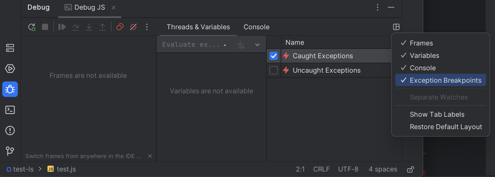

The first time, the selected exception breakpoints 
are based on the default configuration provided by the DAP server.

You can then select or deselect the exception breakpoints you want to use.

An exception breakpoint which the DAP server allows to be conditional (`supportsCondition`) can be given a condition
in the `Condition` column, such as the exception types to stop at; until then, the column shows what the DAP server
says the condition means. The condition is sent with the
[exception filter options](https://microsoft.github.io/debug-adapter-protocol//specification.html#Types_ExceptionFilterOptions)
when the DAP server supports them (`supportsExceptionFilterOptions`), and kept with the selected exception breakpoints.

Take a sample JavaScript file containing an error:

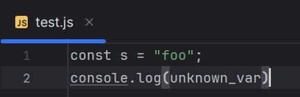

In this example, no breakpoints are defined. 
However, when you start the DAP server, it stops at the line with the line error:

###  Smart Step Into

[Smart Step Into](https://www.jetbrains.com/help/idea/stepping-through-the-program.html#smart-step-into) is available
if the DAP server supports [StepInTargets](https://microsoft.github.io/debug-adapter-protocol//specification.html#Requests_StepInTargets).

When you're stopped at a breakpoint on a line with multiple function calls, press **Shift+F7** (or select **Smart Step Into** from the debug menu).
A popup will appear showing all available functions you can step into. 
Use the arrow keys to navigate between functions, and press **Enter** to step into the selected one.
You can also click directly on a function name in the editor.

For example, on this line:
```python
result = multiply(add(x, y), subtract(x, y))
```

Smart Step Into will let you choose between `multiply`, `add`, and `subtract`.

The feature also handles duplicate function names on the same line correctly. For instance:
```python
result = add(1, 2) + add(3, 4)
```

Each `add` call will be highlighted separately, allowing you to step into the specific occurrence you want.

Here's a demo with [Python Debugpy](./user-defined-dap/python-debugpy.md) which supports [StepInTargets](https://microsoft.github.io/debug-adapter-protocol//specification.html#Requests_StepInTargets):

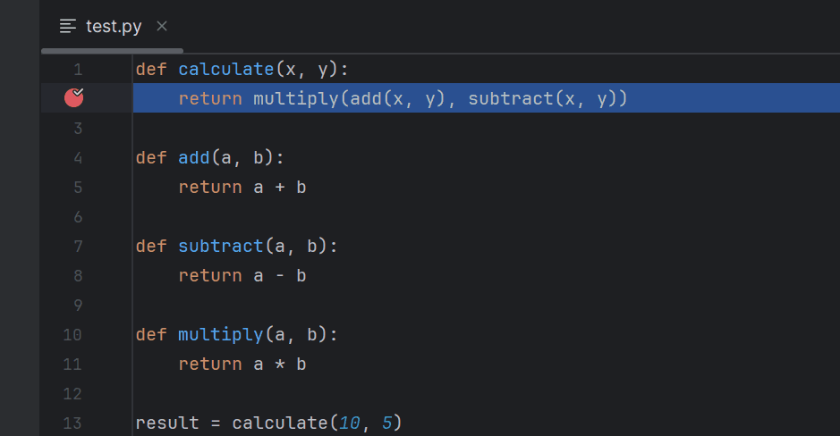

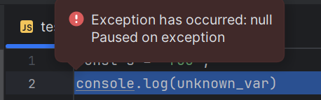

This happens because `Caught Exceptions` is selected.

## Reset Frame

When the DAP server supports the
[RestartFrame](https://microsoft.github.io/debug-adapter-protocol//specification.html#Requests_RestartFrame) request
(`supportsRestartFrame`), **Reset Frame** restarts the execution of a stack frame while the program is stopped. It is
available in the context menu of the `Frames` view, with the icon shown when hovering a frame, and in the
`Run | Debugging Actions` menu, for each frame that the DAP server doesn't mark as one that can't be restarted
(`canRestart` set to `false`).

The program runs until the DAP server sends a
[stopped](https://microsoft.github.io/debug-adapter-protocol//specification.html#Events_Stopped) event with the reason
`restart`, which stops it in the restarted frame. When the DAP server can't restart the frame, the console shows why,
and the program stays stopped where it was.

## Inline value

The values of the variables are displayed inline, but a DAP server gives only their values, not their positions.

When a language server of the stopped file supports
[textDocument/inlineValue](https://microsoft.github.io/language-server-protocol/specifications/lsp/3.17/specification/#textDocument_inlineValue)
(`inlineValueProvider`), LSP4IJ asks it where the variables are, up to the stopped line, and shows the value of each
variable that it names at the last line where it names it, before or on the stopped line (see
[implementation details](../LSPSupport.md#inline-value)).

Otherwise, and for the variables that the language server doesn't name, LSP4IJ uses the syntax highlighting information
from the editor (TextMate or others), which is not perfect.

The debugger computes inline values only for the variables it shows, so the group of the frame's local variables (the
scope that the DAP server presents as `locals`, or else its first scope) is expanded when the frame is shown.

Here a de demo with JavaScript:

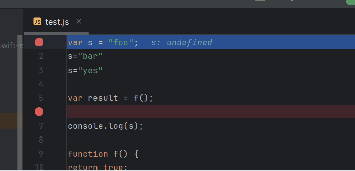

## Evaluate expression

Evaluate expression is available by consuming the [Evaluate request](https://microsoft.github.io/debug-adapter-protocol//specification.html#Requests_Evaluate) 

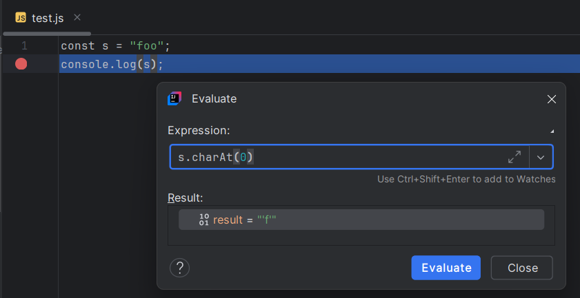

### Completion

If debug adapter [supports the `completions` request](https://microsoft.github.io/debug-adapter-protocol//specification.html#Types_Capabilities),
completion should be available in the expression editor by consuming the
[Completion request](https://microsoft.github.io/debug-adapter-protocol//specification.html#Requests_Completions):

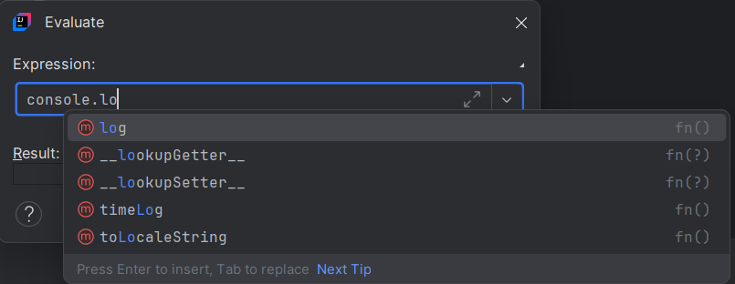

## Hexadecimal values

When the DAP server supports value formatting (`supportsValueFormattingOptions`), the context menu of the Variables and
Watches views has `Show Values as Hexadecimal`, which asks the DAP server for numbers in hexadecimal
([ValueFormat](https://microsoft.github.io/debug-adapter-protocol//specification.html#Types_ValueFormat)) in the
variables, evaluations and set values of the debug session, and shows the values again.

## Large variables

A variable with more than 100 indexed children, such as a large array, whose
[Variable](https://microsoft.github.io/debug-adapter-protocol//specification.html#Types_Variable) says how many it has
(`indexedVariables`), shows its first 100 and a `...` node with how many more there are. Opening the node asks the
DAP server for the next 100 ([`variables`](https://microsoft.github.io/debug-adapter-protocol//specification.html#Requests_Variables)
with `filter` `indexed`, `start` and `count`), so a large variable is read a page at a time. Its named children, when
it says it has any (`namedVariables`), are asked for first.

## Lazy variables

A variable which the DAP server marks as lazy
([presentationHint.lazy](https://microsoft.github.io/debug-adapter-protocol//specification.html#Types_VariablePresentationHint)),
such as a property computed by a getter, is shown with a `Show value` link instead of its value, since getting the value
may run code. Clicking the link asks the DAP server for the value, which then replaces the link and can be expanded.

## Set value

If debug adapter [supports setting a variable to a value](https://microsoft.github.io/debug-adapter-protocol//specification.html#Types_Capabilities),
the `Set Value...` contextual menu should be available: 

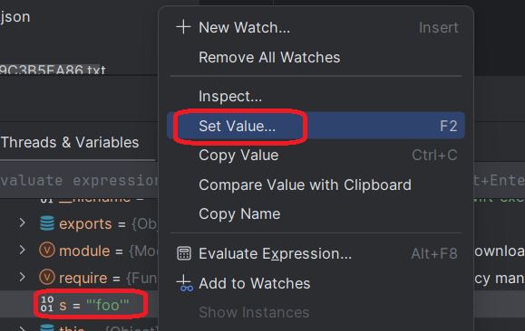

You should edit the variable:

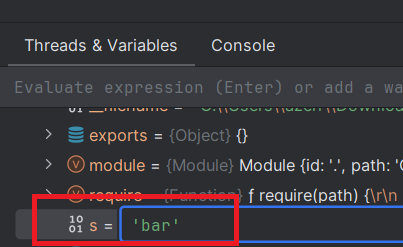

the edit apply will consume the
[SetVariable request](https://microsoft.github.io/debug-adapter-protocol//specification.html#Requests_SetVariable):

## Loaded sources and modules

When the DAP server reports the sources it has loaded (`supportsLoadedSourcesRequest`), the debug tab gets a
`Loaded Sources` tab the first time it reports any. It lists each source with its path, as the
[loadedSources](https://microsoft.github.io/debug-adapter-protocol//specification.html#Requests_LoadedSources) request
gives them at the first stop, and as the
[loadedSource](https://microsoft.github.io/debug-adapter-protocol//specification.html#Events_LoadedSource) event adds,
changes and removes them. Double-clicking a source, or Enter, opens it: a source with a path in its file, and one with
a `sourceReference` in the text that the DAP server gives for it, read-only.

When the DAP server reports its modules (`supportsModulesRequest`), a `Modules` tab lists each module's name, version
and path, and whether it is user code, as the
[modules](https://microsoft.github.io/debug-adapter-protocol//specification.html#Requests_Modules) request gives them at
the first stop and the [module](https://microsoft.github.io/debug-adapter-protocol//specification.html#Events_Module) event
updates them.

## Run In Terminal

If the DAP server supports the [Run In Terminal](https://microsoft.github.io/debug-adapter-protocol/specification.html#Reverse_Requests_RunInTerminal) request, **LSP4IJ** can handle it automatically.  
This feature allows launching a debug session in either the `integrated terminal` or an `external terminal`.

Most DAP servers let you choose which terminal to use through the `console` field in the launch parameters:

- `"console": "integratedTerminal"` → Use the IDE's integrated terminal
- `"console": "externalTerminal"` → Open a separate external terminal window

The [VS Code JS Debug](./user-defined-dap/vscode-js-debug.md) adapter supports `Run In Terminal`. Below are two sample configurations:

### Integrated terminal

Here a sample with VSCode JS Debug and `integratedTerminal`:

```json
{
  "type": "pwa-node",
  "name": "Launch JavaScript file",
  "request": "launch",
  "program": "${file}",
  "cwd": "${workspaceFolder}",
  "console": "integratedTerminal"
}
```

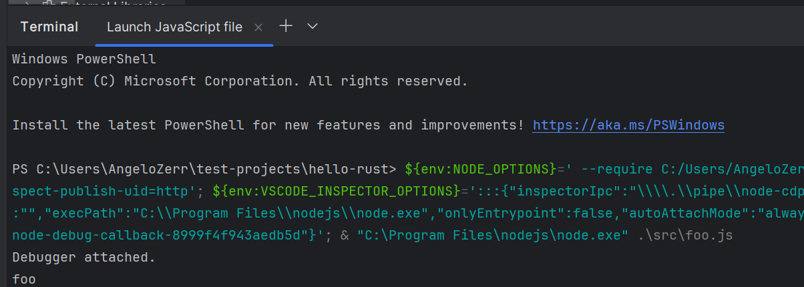

### External terminal

Here a sample with VSCode JS Debug and `externalTerminal`:

```json
{
  "type": "pwa-node",
  "name": "Launch JavaScript file",
  "request": "launch",
  "program": "${file}",
  "cwd": "${workspaceFolder}",
  "console": "externalTerminal"
}
```

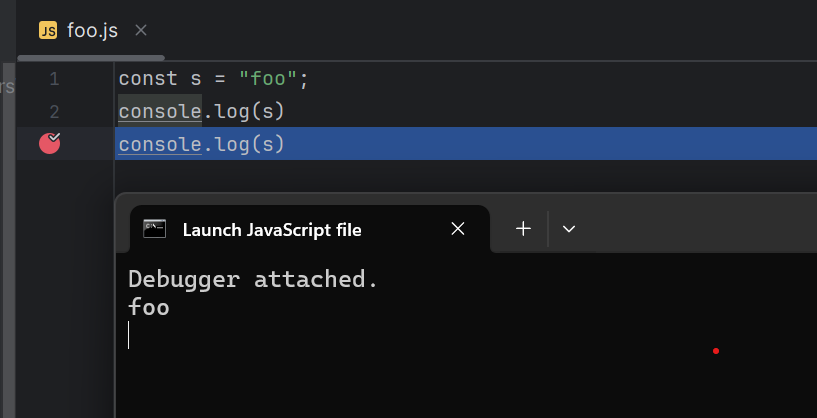

The `externalTerminal` is supported on **Windows** and **Linux**, but **not on macOS**.

## Disassemble

If the DAP server [supports disassembly](https://microsoft.github.io/debug-adapter-protocol//specification.html#Requests_Disassemble), open the Disassembly view from the stack trace context menu: `Open Disassembly View`.

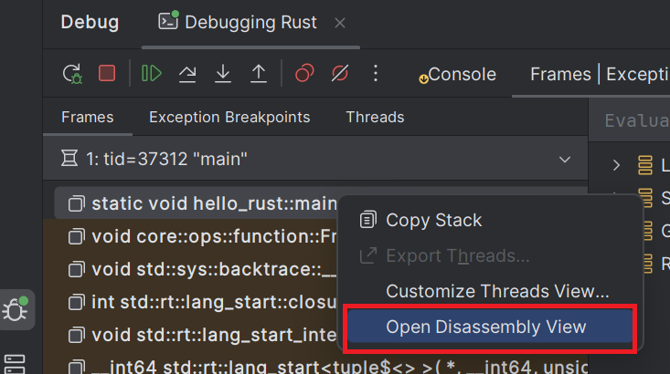

The Disassembly view shows the instructions for the current stack frame. You can add breakpoints and step through instructions one by one.

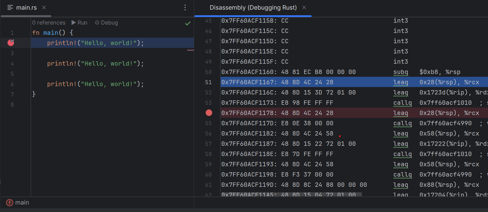

You can switch between source files and the Disassembly view at any time to continue step-by-step debugging.

Example: using [CodeLLDB](./user-defined-dap/codelldb.md) to debug a Rust executable built with `cargo build`.

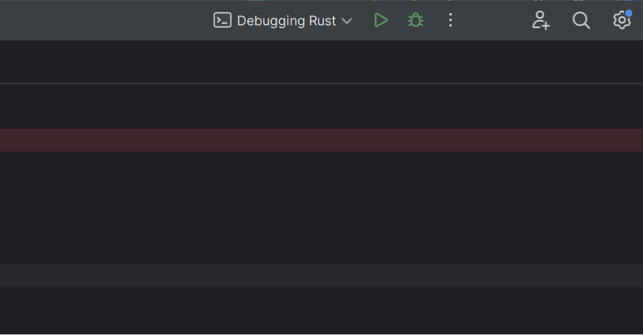

## Contextual Menu

Click on right button open existing / new DAP run configuration:

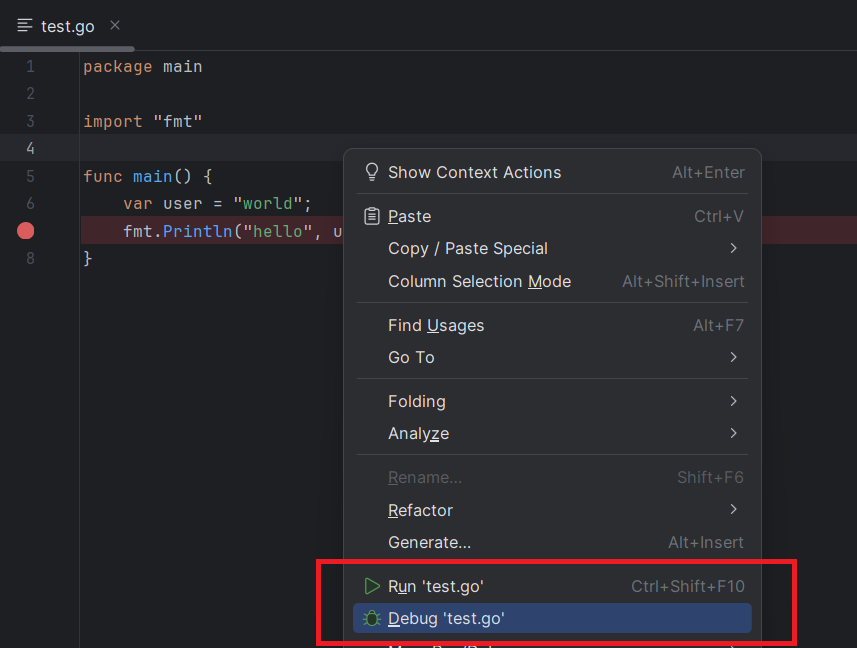

## DAP server traces

If you wish to show DAP request/response traces when you will debug:

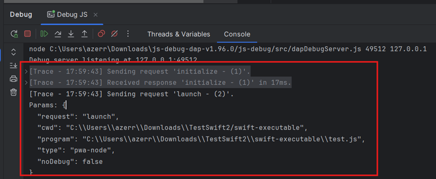

you need to select `Trace` with `verbose`.

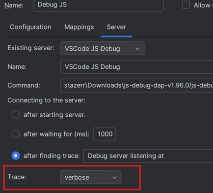

## DAP settings

You can `create/remove/update` DAP servers with `Debug Adapter Protocol` entry:

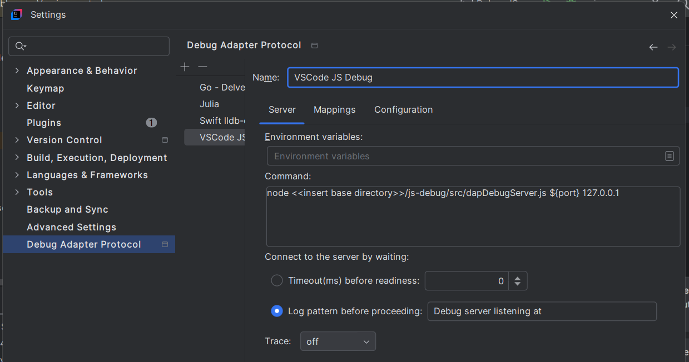

## Templates

LSP4IJ provides DAP templates that allow to initialize a given DAP server very quickly:

- [CodeLLDB](./user-defined-dap/codelldb.md) which allows you to debug `Rust`,`Swift`, etc. files.
- [Go Delve DAP server](./user-defined-dap/go-delve.md) which allows you to debug `Go` files.
- [Julia DAP server](./user-defined-dap/julia.md) which allows you to debug `Julia` files.
- [Perl DAP server](./user-defined-dap/perl-dap.md) which allows you to debug `Perl` files. 
- [Python Debugpy DAP server](./user-defined-dap/python-debugpy.md) which allows you to debug `Python` files.
- [Ruby rdbg DAP server](./user-defined-dap/ruby-rdbg.md) which allows you to debug `Ruby` files.
- [Swift DAP Server](./user-defined-dap/swift-lldb.md) which allows you to debug `Swift` files.
- [VSCode JS Debug DAP Server](./user-defined-dap/vscode-js-debug.md) which allows you to debug `JavaScript/TypeScript` files.