# Debug Adapter Protocol

LSP4IJ provides [Debug Adapter Protocol](https://microsoft.github.io/debug-adapter-protocol/) support. 
You can read [the DAP Support overview](./DAPSupport.md), describing which DAP features are implemented, and how.
If you need to customize the DAP support you can [register your DAP server with extension point](./DeveloperGuide.md).

The DAP support is available with the `Debug Adapter Protocol` run/debug configuration type:

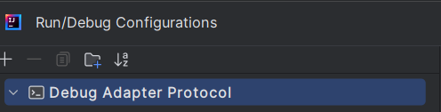

After configuring the [DAP configuration type](#dap-configuration-type), you can debug your file.

Here is an example with `JavaScript debugging`, which uses the [VSCode JS Debug DAP server](./user-defined-dap/vscode-js-debug.md):

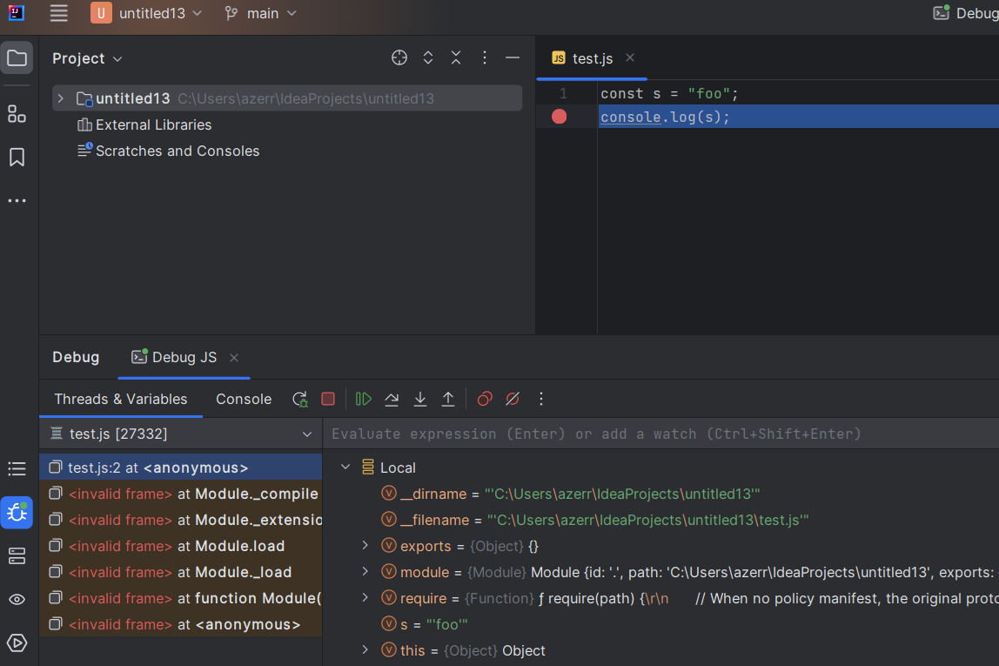

## DAP Configuration Type:

To configure debugging with DAP, you need to fill in:

### Server tab

The `Server` tab to specify the DAP server:

  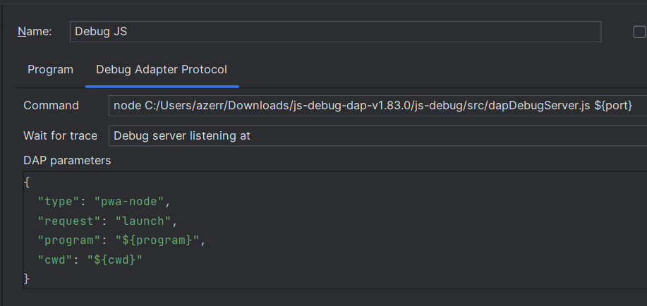

- `Command`: the command which starts the DAP server. It can take `${port}`, see
  [LSP4IJ placeholders](#lsp4ij-placeholders).
- The environment variables of the DAP server's process.
- `Connect to the server by waiting:` `Timeout(ms) before readiness`, the time the client waits before it connects, or
  `Log pattern before proceeding`, a text which the DAP server writes once it is ready.

The client connects to the DAP server with a socket when it knows a port: the port of `${port}` in the command, the one
which the log pattern finds in the output of the DAP server, or, to attach, the `Port` of the `Attach` tab of the
`Configuration` tab. Otherwise it talks to the DAP server over the standard input and output of its process.

### Mappings tab

The `Mappings` tab to specify the files which can be debugged to allow adding/removing breakpoints:

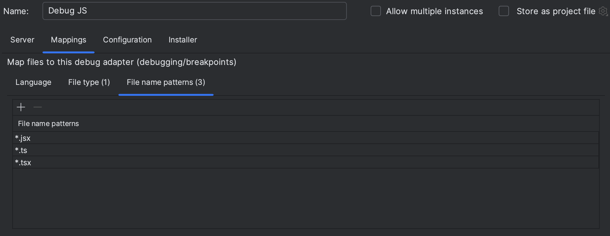

The mappings also decide which native line breakpoints are forwarded to the DAP server, see
[Forwarding native line breakpoints](#forwarding-native-line-breakpoints).

A file matches when one of the mappings applies to it. There are three kinds of mappings:

- `Language`: an [IntelliJ Language](https://plugins.jetbrains.com/docs/intellij/custom-language-support.html).
- `File type`: an [IntelliJ File type](https://www.jetbrains.com/help/idea/creating-and-registering-file-types.html).
  It only applies when your IDE knows this file type, which depends on the IDE and its plugins.
  A file type your IDE doesn't know is shown as `(Unknown)`.
- `File name patterns`: patterns for the file name, such as `*.go` or `go.mod`. They work in every IDE.

### Configuration tab

The `Configuration` tab to specify the working directory and the file you want to run/debug:

  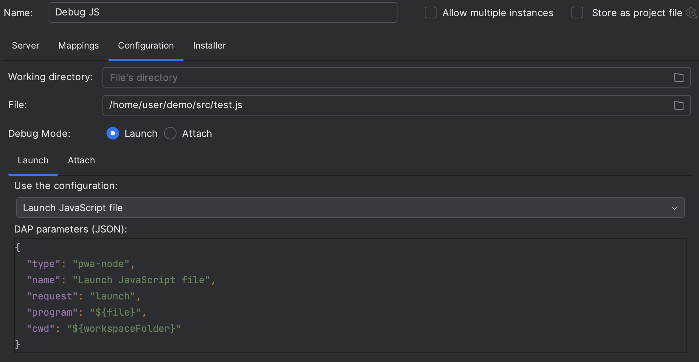

The working directory is the one of the debug adapter's process. Since IntelliJ 2025.1, a plugin can set up the environment
of a process for its working directory (the `commandLineEnvCustomizer` extension point), as the
[mise](https://mise.jdx.dev/) plugin does from a `mise.toml`, or a [direnv](https://direnv.net/) plugin from an `.envrc`.
The debug adapter's process gets that environment when it starts, and LSP4IJ looks up the debug adapter's command in its
`PATH`, so that the tools which the directory selects, such as its version of `node`, are the ones that run.

> [!NOTE]
> - **The working directory selects the environment**: a configuration created from a file keeps the project's directory. For a file in a directory that selects other tools, such as a subdirectory with its own `mise.toml`, set the working directory to that directory. It is also the `${workspaceFolder}` of the launch configuration.
> - **The debug adapter runs with them too**: its own command, such as `node`, is the directory's. A project pinned to a version that the debug adapter doesn't support can keep it from starting.
> - **Precedence**: the directory's environment is applied when the process starts, after the environment variables of the run configuration, so it wins over a variable that both set.
> - **Windows**: with a working directory, a debug adapter's command without its extension, such as `node` or `npx`, is looked up with the extensions in `PATHEXT`, as Windows does, so that the directory's `node.exe` or `npx.cmd` starts.
> - **Tools not bundled**: LSP4IJ doesn't bundle mise or direnv. Install the tool and its IntelliJ plugin. The mise plugin customizes the processes of other plugins only with its `useMiseInAllCommandLines` setting, which is off by default.
> - **IntelliJ 2024.x** has no such extension point, so the environment is as before. The command is looked up as described above, also with the extensions in `PATHEXT` on Windows.

### Installer tab

The `Installer` tab holds the JSON of the [installer](../UserDefinedLanguageServerTemplate.md#installer-descriptor) of
the DAP server, as its [template](#templates) gives it. Before the first debug session of the DAP server in each IDE
session, LSP4IJ runs the `check` of the installer, and its `run` if the check fails, in a console, and then starts the
debug session (see [When the installer runs](../UserDefinedLanguageServerTemplate.md#when-the-installer-runs)). The
`Installer` tab of the debug session has the links `Check Installation`, `Run Installation` and
`Check / Run Installation`, which run the installer again.

### IntelliJ macro expansion

You can use [built-in IntelliJ macros](https://www.jetbrains.com/help/idea/built-in-macros.html) in DAP configuration parameters. This allows you to reference project and file paths without hardcoding absolute paths.

For example, you can use `$PROJECT_DIR$` to reference the root of the project:

```json
{
  "program": "$PROJECT_DIR$/src/main.js"
}
```

You can also use `$FilePath$` to reference the path of the currently selected editor file:

```json
{
  "program": "$FilePath$"
}
```

Here are some useful standard built-in macros that you can use:

- `$WORKSPACE_DIR$`: The path to the workspace where the current project belongs. The workspace is the root of the open file hierarchy and can include multiple projects.
- `$PROJECT_DIR$`: The root of the project.
- `$USER_HOME$`: The user's home directory.
- `$FilePath$`: The path of the currently selected editor file.

Macro expansion is applied to string values in DAP parameters, including values nested inside objects and arrays.

### LSP4IJ placeholders

Next to the IntelliJ macros, LSP4IJ replaces placeholders of its own:

- `${port}`, in the `Command` of the `Server` tab: a free port, which LSP4IJ chooses as it starts the DAP server. The
  client then connects to the server on that port, on `127.0.0.1` or `::1`, so a DAP server which listens on
  `localhost` is reached either way.
- `${address}` and `${port}`, in the `Log pattern before proceeding` of the `Server` tab, as in
  `DAP server listening at: ${address}:${port}`: the client connects to the address and the port that the DAP server
  writes in their place (see the [Go Delve example](./user-defined-dap/go-delve.md)).
- `${file}`, in the `DAP parameters (JSON)` of the `Configuration` tab: the `File` of that tab, the one to run or
  debug.
- `${workspaceFolder}`, in the `DAP parameters (JSON)`: the `Working directory` of the `Configuration` tab. For a
  configuration created from a file, that is the project's directory (see the note above), not the folder of the
  file.

For example:

```json
{
  "program": "${file}",
  "cwd": "${workspaceFolder}"
}
```


## Breakpoints

### Adding breakpoint

When a file can be debugged using a DAP server specified in the [Mappings tab](#mappings-tab), a breakpoint can be added.

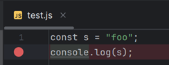

### Forwarding native line breakpoints

For a mapped file, LSP4IJ contributes its own `DAP Breakpoint` type. However, when the file's language
already has its own debugger (for example the bundled JavaScript or Python debugger), the IDE may
create that debugger's native line breakpoint in the gutter instead of a `DAP Breakpoint`.

While a DAP session is running, LSP4IJ forwards native line breakpoints in files that match the
[Mappings tab](#mappings-tab) to the DAP server, so they are hit like a `DAP Breakpoint`:

- There is nothing to configure, and you don't need to add a second breakpoint on the same line.
- The breakpoint keeps its native type in the gutter.
- The language's own debugger is not affected outside a DAP session.

When a `DAP Breakpoint` and a native line breakpoint are on the same line, only the `DAP Breakpoint` is
sent to the DAP server. The native breakpoint is shown as ignored for this debug session.

### Verify breakpoint

When the DAP server starts, breakpoints are sent to it, and it responds with the status of those breakpoints — 
whether they are validated or not.

For example, when the DAP server [VSCode JS Debug](./user-defined-dap/vscode-js-debug.md) starts, it invalidates all breakpoints.:

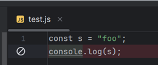

When the program starts, it checks and validates the breakpoints.

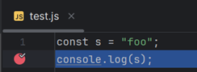

### Conditional breakpoint

Conditional breakpoints are also supported. Here is an example of a conditional breakpoint written in JavaScript:

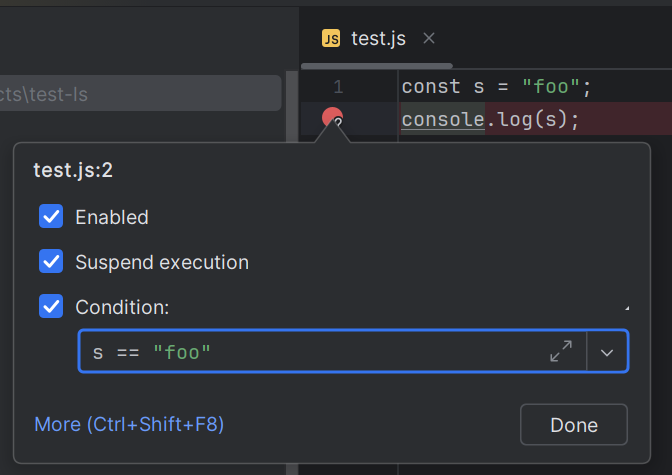

### Hit condition

A breakpoint also has a `Hit condition`, in the `Breakpoints` dialog (`Run | View Breakpoints...`), which the DAP server
reads, such as `3` or `>= 3`, to stop only at some hits of the breakpoint. It is sent to the DAP server with the
breakpoint; a DAP server which doesn't support hit conditions (`supportsHitConditionalBreakpoints`) ignores it.

### Logpoint

A breakpoint whose `Suspend` option is unchecked logs instead of stopping. Its `"Breakpoint hit" message` and
`Evaluate and log` expression are sent to the DAP server as a
[logpoint](https://microsoft.github.io/debug-adapter-protocol//specification.html#Types_SourceBreakpoint), whose message
the DAP server writes to the console without stopping the program; the expression is evaluated by the DAP server.
A DAP server which doesn't support logpoints stops at it: LSP4IJ then evaluates the expression in the stopped frame,
logs it, and resumes the program. A breakpoint which suspends logs its expression when it stops.

### Function breakpoints

When the DAP server supports
[function breakpoints](https://microsoft.github.io/debug-adapter-protocol//specification.html#Requests_SetFunctionBreakpoints)
(`supportsFunctionBreakpoints`), a breakpoint can be set on a function by its name rather than on a line. In the
`Breakpoints` dialog (`Run | View Breakpoints...`), click `+`, choose `DAP Function Breakpoint`, and enter the name of
the function as the DAP server names it, such as `main` or `Point.move`.

A function breakpoint has the `Condition`, `Suspend` and logging options of a line breakpoint, and a `Hit condition`,
which the DAP server reads, such as `3` or `>= 3`; its name and hit condition can be changed in the dialog. The enabled
function breakpoints are sent to the DAP server when the debug session starts, and all of them again whenever one is
added, changed or removed. The dialog shows each as verified or not, as the DAP server answers. When the DAP server
names the function breakpoint where the program stopped (`hitBreakpointIds` of its `stopped` event), the program stops
at it as at a line breakpoint. A DAP function breakpoint has no log message, so one whose `Suspend` option is unchecked
stops, and LSP4IJ logs and resumes the program.

### Data breakpoints

When the DAP server supports
[data breakpoints](https://microsoft.github.io/debug-adapter-protocol//specification.html#Requests_SetDataBreakpoints)
(`supportsDataBreakpoints`), a breakpoint can stop the program when a value changes rather than at a line. While the
program is stopped, right-click a variable in the `Variables` or `Watches` view and choose `Break on Value Change`.
LSP4IJ asks the DAP server which data the variable is
([dataBreakpointInfo](https://microsoft.github.io/debug-adapter-protocol//specification.html#Requests_DataBreakpointInfo)),
by the variable's name and its container. When the DAP server can't watch it, the debug tool window shows the reason
which the DAP server gives, and no breakpoint is added. Otherwise a `DAP Data Breakpoint` is added, named as the DAP
server describes the data, such as `Counter.count`; it stops at writes when the DAP server offers them, and at the
first access type which it offers otherwise.

A data breakpoint has the `Condition`, `Suspend` and logging options of a line breakpoint, and a `Hit condition`, which
the DAP server reads; the hit condition can be changed in the `Breakpoints` dialog. The enabled data breakpoints are
sent to the DAP server which named their data, all of them again whenever one is added, changed or removed, and the
dialog shows each as verified or not, as the DAP server answers. When the DAP server names the data breakpoint where the
program stopped (`hitBreakpointIds` of its `stopped` event), the program stops at it, and the `description` of the
`stopped` event, which says what changed, such as `Counter.count changed from 0 to 2`, is shown where it stopped.

The DAP server says whether the data of a data breakpoint stays the same in a later debug session (`canPersist`). When
it doesn't, as for most DAP servers, the data breakpoint is removed when its debug session ends, so that it is neither
saved with the project nor sent to a later debug session. When it does, the data breakpoint is kept, and sent to the
later debug sessions of the same DAP server.

### Exception breakpoint

Some DAP servers support exception breakpoints. If so, you must first run the configuration process, 
which starts the DAP server and retrieves the list of available exception breakpoints. 
This list is accessible through the `Exception Breakpoints` menu:

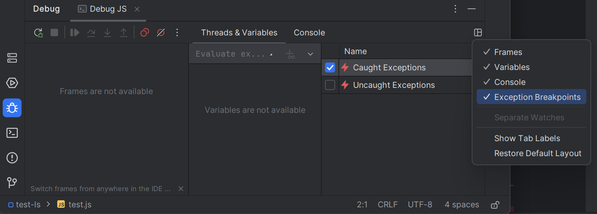

The first time, the selected exception breakpoints 
are based on the default configuration provided by the DAP server.

You can then select or deselect the exception breakpoints you want to use.

An exception breakpoint which the DAP server allows to be conditional (`supportsCondition`) can be given a condition
in the `Condition` column, such as the exception types to stop at; until then, the column shows what the DAP server
says the condition means. The condition is sent with the
[exception filter options](https://microsoft.github.io/debug-adapter-protocol//specification.html#Types_ExceptionFilterOptions)
when the DAP server supports them (`supportsExceptionFilterOptions`), and kept with the selected exception breakpoints.

Take a sample JavaScript file containing an error:

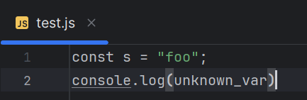

In this example, no breakpoints are defined. 
However, when you start the DAP server, it stops at the line with the line error:

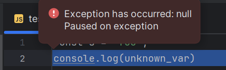

This happens because `Caught Exceptions` is selected.

Where the program stops at an exception, an error hint shows the exception. When the DAP server supports the
[ExceptionInfo](https://microsoft.github.io/debug-adapter-protocol//specification.html#Requests_ExceptionInfo) request
(`supportsExceptionInfoRequest`), the hint shows the exception's id, or its type name when it has no id, its
description, and the first 10 lines of its stack trace. Otherwise, or when the DAP server doesn't answer within a
second, the hint shows the `text` and `description` of the `stopped` event.

###  Smart Step Into

[Smart Step Into](https://www.jetbrains.com/help/idea/stepping-through-the-program.html#smart-step-into) is available
if the DAP server supports [StepInTargets](https://microsoft.github.io/debug-adapter-protocol//specification.html#Requests_StepInTargets).

When you're stopped at a breakpoint on a line with multiple function calls, press **Shift+F7** (or select **Smart Step Into** from the debug menu).
A popup will appear showing all available functions you can step into. 
Use the arrow keys to navigate between functions, and press **Enter** to step into the selected one.
You can also click directly on a function name in the editor.

For example, on this line:
```python
result = multiply(add(x, y), subtract(x, y))
```

Smart Step Into will let you choose between `multiply`, `add`, and `subtract`.

The feature also handles duplicate function names on the same line correctly. For instance:
```python
result = add(1, 2) + add(3, 4)
```

Each `add` call will be highlighted separately, allowing you to step into the specific occurrence you want.

Here's a demo with [Python Debugpy](./user-defined-dap/python-debugpy.md) which supports [StepInTargets](https://microsoft.github.io/debug-adapter-protocol//specification.html#Requests_StepInTargets):

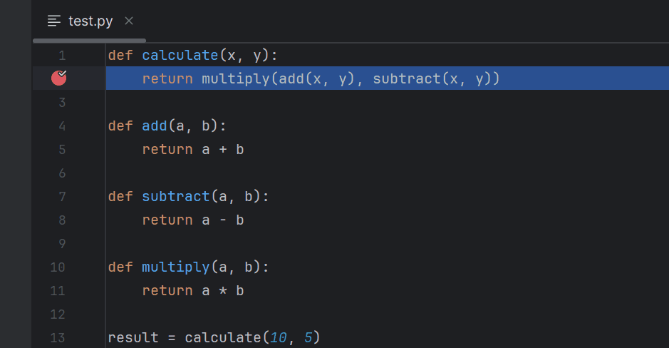

### Step only the current thread

A step resumes every thread of the program while the stepping thread runs to its next stop. When the DAP server
supports single thread execution requests (`supportsSingleThreadExecutionRequests`), the settings of the debug
session's toolbar have `Step Only the Current Thread`, as the Java debugger's `Resume only the current thread`
option. When it is selected, `Step Over`, `Step Into`, `Smart Step Into` and `Step Out` send
[singleThread](https://microsoft.github.io/debug-adapter-protocol//specification.html#Requests_Next), so the DAP server
resumes only the thread that steps while the other threads stay stopped, as the `Threads` tab shows. `Resume Program`
still resumes every thread. The choice holds for the debug session.

### Step back and reverse continue

When the DAP server supports running the program backwards (`supportsStepBack`), the debug session's toolbar has
`Step Back` and `Reverse Continue` after `Step Out`, and so does the `Run | Debugging Actions` menu. While the program
is stopped, [Step Back](https://microsoft.github.io/debug-adapter-protocol//specification.html#Requests_StepBack) steps
the current thread back, and
[Reverse Continue](https://microsoft.github.io/debug-adapter-protocol//specification.html#Requests_ReverseContinue)
runs the program backwards until it stops, such as at a breakpoint. `Step Back` steps by instruction while the
disassembly is shown, and both resume only the current thread when `Step Only the Current Thread` is selected, as the
other steps do. They have no default shortcut: you can assign one in `Settings | Keymap`.

A DAP server may announce the capability only once the program runs, as CodeLLDB does for a launch configuration with
`"reverseDebugging": true`, and Delve when its backend is [rr](https://rr-project.org/), which records programs on
Linux. rdbg, the Ruby debugger, steps back once `record on` is typed in the Debug console. When the DAP server refuses,
the console shows why, and the program stays stopped where it was.

### Terminate a thread

When the DAP server supports the
[terminateThreads](https://microsoft.github.io/debug-adapter-protocol//specification.html#Requests_TerminateThreads)
request (`supportsTerminateThreadsRequest`), the context menu of the debug session's `Threads` tab has
`Terminate Thread`, which asks the DAP server to terminate the selected threads:

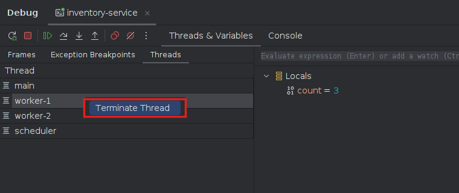

The DAP server then reports each thread that ended, which the tab shows as `exited`:

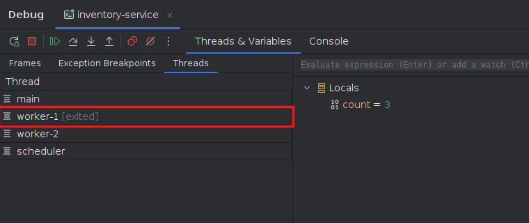

The context menu of the `Frames` view has `Terminate Thread` too, which terminates the thread of the selected frame.

The `Threads` tab shows the threads of the DAP session that stopped last, which can be a child session that the DAP
server started with
[startDebugging](https://microsoft.github.io/debug-adapter-protocol//specification.html#Reverse_Requests_StartDebugging),
and `Terminate Thread` terminates them in that session. For a DAP server which doesn't support the request, as
debugpy, vscode-js-debug and Delve don't, the menu item isn't shown.

Each row of the `Threads` tab shows whether its thread is `running`, `stopped` or `exited`, with its icon, as the DAP
server's [stopped](https://microsoft.github.io/debug-adapter-protocol//specification.html#Events_Stopped),
[continued](https://microsoft.github.io/debug-adapter-protocol//specification.html#Events_Continued) and
[thread](https://microsoft.github.io/debug-adapter-protocol//specification.html#Events_Thread) events and the
session's resumes and steps say. When the DAP server stops a thread without `allThreadsStopped`, the other threads
stay as they were, running until it says otherwise, as in VS Code. When a thread other than the one where the session
is suspended continues alone (`allThreadsContinued: false`), the session stays suspended, and the `Frames` view shows
`Frames not available: the thread is running` for that thread instead of the frames of its stop. When that thread was
selected, the selection moves to the top frame of the thread where the session is suspended, which the `Variables`
view, the execution point, `Step` and `Resume` then follow.

## Reset Frame

When the DAP server supports the
[RestartFrame](https://microsoft.github.io/debug-adapter-protocol//specification.html#Requests_RestartFrame) request
(`supportsRestartFrame`), **Reset Frame** restarts the execution of a stack frame while the program is stopped. It is
available in the context menu of the `Frames` view, with the icon shown when hovering a frame, and in the
`Run | Debugging Actions` menu, for each frame that the DAP server doesn't mark as one that can't be restarted
(`canRestart` set to `false`).

The program runs until the DAP server sends a
[stopped](https://microsoft.github.io/debug-adapter-protocol//specification.html#Events_Stopped) event with the reason
`restart`, which stops it in the restarted frame. When the DAP server can't restart the frame, the console shows why,
and the program stays stopped where it was.

## Inline value

The values of the variables are displayed inline, but a DAP server gives only their values, not their positions.

When a language server of the stopped file supports
[textDocument/inlineValue](https://microsoft.github.io/language-server-protocol/specifications/lsp/3.17/specification/#textDocument_inlineValue)
(`inlineValueProvider`), LSP4IJ asks it where the variables are, up to the stopped line, and shows the value of each
variable that it names at the last line where it names it, before or on the stopped line (see
[implementation details](../LSPSupport.md#inline-value)).

Otherwise, and for the variables that the language server doesn't name, LSP4IJ uses the syntax highlighting information
from the editor (TextMate or others), which is not perfect.

The debugger computes inline values only for the variables it shows, so the group of the frame's local variables (the
scope that the DAP server presents as `locals`, or else its first scope) is expanded when the frame is shown.

Here a de demo with JavaScript:

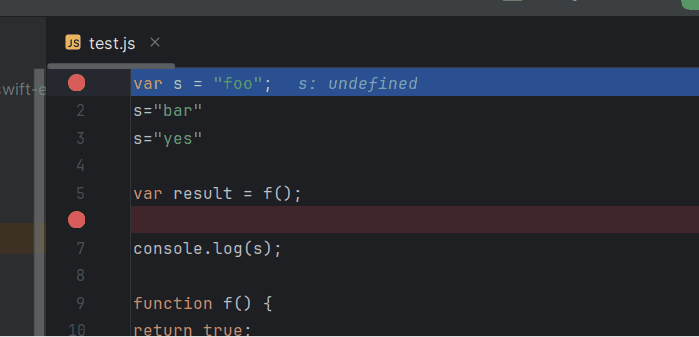

## Evaluate expression

Evaluate expression is available by consuming the [Evaluate request](https://microsoft.github.io/debug-adapter-protocol//specification.html#Requests_Evaluate) 

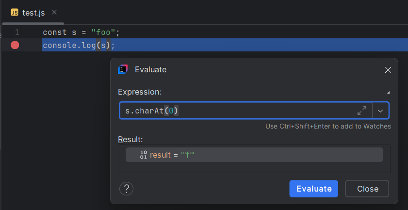

### Completion

If debug adapter [supports the `completions` request](https://microsoft.github.io/debug-adapter-protocol//specification.html#Types_Capabilities),
completion should be available in the expression editor by consuming the
[Completion request](https://microsoft.github.io/debug-adapter-protocol//specification.html#Requests_Completions):

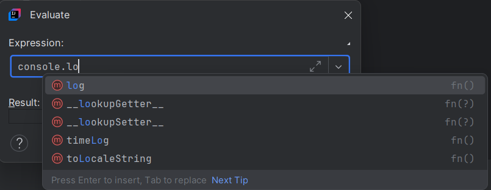

### Debug console

A line typed in the debug session's `Console` is sent to the DAP server as an
[Evaluate request](https://microsoft.github.io/debug-adapter-protocol//specification.html#Requests_Evaluate) with the
context `repl`, as VS Code's Debug Console sends it: in the selected stack frame when the program is stopped, and
without a frame when it runs. The console prints its result, or the DAP server's error. The lines are sent one after
the other, in the order they were typed, an empty line too, so that a DAP server which takes the program's input over
the debug connection can take each line as the program's input while it runs.

## Hexadecimal values

When the DAP server supports value formatting (`supportsValueFormattingOptions`), the context menu of the Variables and
Watches views has `Show Values as Hexadecimal`, which asks the DAP server for numbers in hexadecimal
([ValueFormat](https://microsoft.github.io/debug-adapter-protocol//specification.html#Types_ValueFormat)) in the
variables, evaluations and set values of the debug session, and shows the values again.

## Large variables

A variable with more than 100 indexed children, such as a large array, whose
[Variable](https://microsoft.github.io/debug-adapter-protocol//specification.html#Types_Variable) says how many it has
(`indexedVariables`), shows its first 100 and a `...` node with how many more there are. Opening the node asks the
DAP server for the next 100 ([`variables`](https://microsoft.github.io/debug-adapter-protocol//specification.html#Requests_Variables)
with `filter` `indexed`, `start` and `count`), so a large variable is read a page at a time. Its named children, when
it says it has any (`namedVariables`), are asked for first. As DAP specifies, a page with fewer children than asked for
is the last one, as when an array has shrunk since the DAP server described it.

## Lazy variables

A variable which the DAP server marks as lazy
([presentationHint.lazy](https://microsoft.github.io/debug-adapter-protocol//specification.html#Types_VariablePresentationHint)),
such as a property computed by a getter, is shown with a `Show value` link instead of its value, since getting the value
may run code. Clicking the link asks the DAP server for the value, which then replaces the link and can be expanded.

## Jump to value source

When the DAP server gives a value the location of its source
([valueLocationReference](https://microsoft.github.io/debug-adapter-protocol//specification.html#Types_Variable)), such
as the definition of the function which a variable holds, as vscode-js-debug does for a function and lldb-dap for a
function pointer, the context menu of the Variables and Watches views has `Jump to Value Source`. It asks the DAP server
where that is, with the [Locations request](https://microsoft.github.io/debug-adapter-protocol//specification.html#Requests_Locations),
and opens the source at the line and column of the answer: a source with a path in its file, and one with a
`sourceReference` in the text that the DAP server gives for it, read-only. VS Code shows such a value as a link.

The result of an expression, as `Evaluate Expression` shows it, and a value set with `Set Value...`, have the location
which the DAP server gives with them. `Jump to Value Source` is shown only for a value with a location, and is enabled
while the program is suspended, since the DAP server's reference is valid only until the program resumes. When the DAP
server answers with an error or without a location, or the file of the location isn't found, a notification says so.

`Jump to Source` on a variable opens its declaration when the DAP server gives the variable the location of its
declaration ([declarationLocationReference](https://microsoft.github.io/debug-adapter-protocol//specification.html#Types_Variable)),
as lldb-dap does: it asks the DAP server where that is, with the Locations request, and opens the source at the line
and column of the answer, as `Jump to Value Source` does. DAP gives a declaration to a variable only, not to the result
of an expression. For a variable without one, when the DAP server answers with an error or without a location, or not
within 3 seconds, and when the program has run since the variable was shown, `Jump to Source` goes, as before, to where
the name of the variable is found in the file of its stack frame, up to the frame's line. The
[inline values](#inline-value) are always shown there, never at the declarations.

## Set value

If debug adapter [supports setting a variable to a value](https://microsoft.github.io/debug-adapter-protocol//specification.html#Types_Capabilities),
the `Set Value...` contextual menu should be available: 

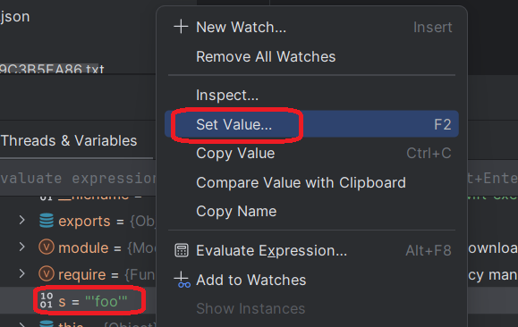

You should edit the variable:

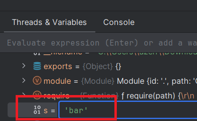

the edit apply will consume the
[SetVariable request](https://microsoft.github.io/debug-adapter-protocol//specification.html#Requests_SetVariable):

The result of an expression, as `Evaluate Expression` and the value popup of an expression in the editor show it, has
no container for the SetVariable request to name. When the debug adapter supports the
[SetExpression request](https://microsoft.github.io/debug-adapter-protocol//specification.html#Requests_SetExpression)
(`supportsSetExpression`), `Set Value...` assigns the new value to the expression with it; otherwise `Set Value...`
isn't available for the result. The variables inside the result are set as any other variable.

When the debug adapter supports the SetExpression request but not the SetVariable request, a variable is set with the
SetExpression request, which assigns the new value to the expression that the debug adapter gives for the variable
(`evaluateName`); a variable without one doesn't offer `Set Value...`. A [lazy variable](#lazy-variables) is assigned to
the `evaluateName` of its value once it is shown, if that has one. When the debug adapter supports both requests,
variables are set with the SetVariable request, as in VS Code.

A variable or the result of an expression which the debug adapter marks as read-only (the `readOnly` attribute of its
[presentationHint](https://microsoft.github.io/debug-adapter-protocol//specification.html#Types_VariablePresentationHint))
doesn't offer `Set Value...`. Neither does the result of an expression which the debug adapter marks as lazy (`lazy`),
as VS Code treats a lazy value as read-only: the result is shown with the placeholder value which the debug adapter
gives, and the variable inside it, which gives the value, can be set.

`Set Value...` says why it doesn't set a value which it offers when:
* the program has run since the value was shown, as a result in `Evaluate Expression` once a step has started: the
  value belongs to a stack frame whose id the debug adapter may give to another frame when the program stops again.
  Evaluate the expression again to set it.
* the debug adapter marked the value as read-only since it was shown, as the value of a lazy variable once it is shown,
  or no longer supports setting it.

The Watches view doesn't offer `Set Value...`: there, editing a watch changes its expression.

## Debugged process

When the DAP server tells which process it debugs, with the
[process](https://microsoft.github.io/debug-adapter-protocol//specification.html#Events_Process) event, as debugpy,
lldb-dap, Delve, netcoredbg and GDB do, the `Console` tab shows it on a line of its own: its name, usually the path of
the program, and as far as the event gives them, its PID, `remote` when it doesn't run on the DAP server's computer,
and whether the DAP server launched it or attached to it.

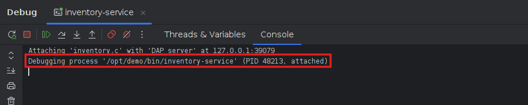

In launch mode the process of the debug session is the DAP server's own, so this line is where the program's PID
shows, to attach a profiler to it or to find it in a list of processes. The line of a child session, which the DAP
server starts with
[startDebugging](https://microsoft.github.io/debug-adapter-protocol//specification.html#Reverse_Requests_StartDebugging),
ends with the name of that session.

## Loaded sources and modules

When the DAP server reports the sources it has loaded (`supportsLoadedSourcesRequest`), the debug tab gets a
`Loaded Sources` tab the first time it reports any. It lists each source with its path, as the
[loadedSources](https://microsoft.github.io/debug-adapter-protocol//specification.html#Requests_LoadedSources) request
gives them at the first stop, and as the
[loadedSource](https://microsoft.github.io/debug-adapter-protocol//specification.html#Events_LoadedSource) event adds,
changes and removes them. Double-clicking a source, or Enter, opens it: a source with a path in its file, and one with
a `sourceReference` in the text that the DAP server gives for it, read-only.

When the DAP server reports its modules (`supportsModulesRequest`), a `Modules` tab lists each module's name, version
and path, and whether it is user code, as the
[modules](https://microsoft.github.io/debug-adapter-protocol//specification.html#Requests_Modules) request gives them at
the first stop and the [module](https://microsoft.github.io/debug-adapter-protocol//specification.html#Events_Module) event
updates them.

## Run In Terminal

If the DAP server supports the [Run In Terminal](https://microsoft.github.io/debug-adapter-protocol/specification.html#Reverse_Requests_RunInTerminal) request, **LSP4IJ** can handle it automatically.  
This feature allows launching a debug session in either the `integrated terminal` or an `external terminal`.

Most DAP servers let you choose which terminal to use through the `console` field in the launch parameters:

- `"console": "integratedTerminal"` → Use the IDE's integrated terminal
- `"console": "externalTerminal"` → Open a separate external terminal window

The [VS Code JS Debug](./user-defined-dap/vscode-js-debug.md) adapter supports `Run In Terminal`. Below are two sample configurations:

### Integrated terminal

Here a sample with VSCode JS Debug and `integratedTerminal`:

```json
{
  "type": "pwa-node",
  "name": "Launch JavaScript file",
  "request": "launch",
  "program": "${file}",
  "cwd": "${workspaceFolder}",
  "console": "integratedTerminal"
}
```

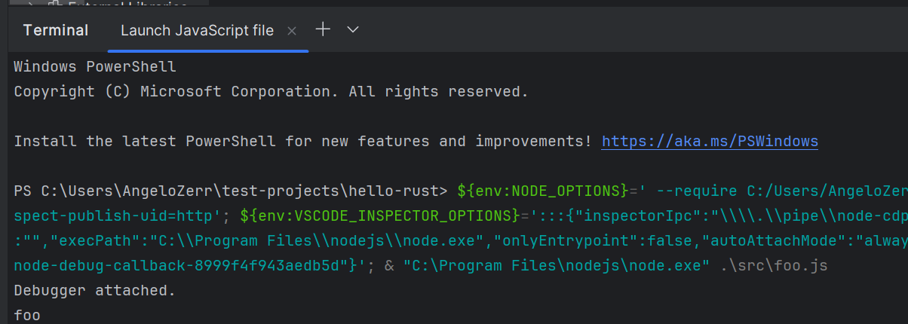

### External terminal

Here a sample with VSCode JS Debug and `externalTerminal`:

```json
{
  "type": "pwa-node",
  "name": "Launch JavaScript file",
  "request": "launch",
  "program": "${file}",
  "cwd": "${workspaceFolder}",
  "console": "externalTerminal"
}
```

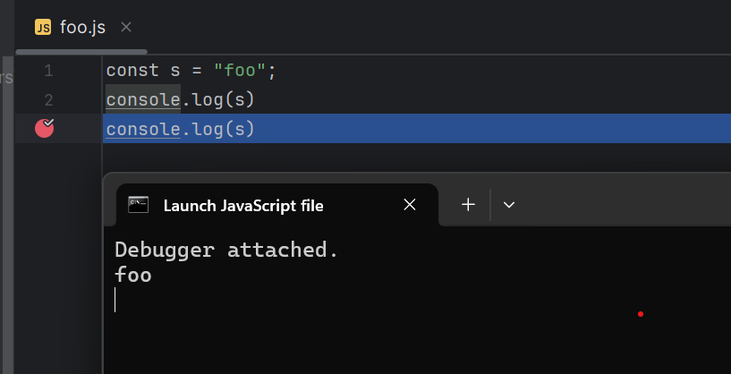

The `externalTerminal` is supported on **Windows** and **Linux**, but **not on macOS**.

## Disassemble

If the DAP server [supports disassembly](https://microsoft.github.io/debug-adapter-protocol//specification.html#Requests_Disassemble), open the Disassembly view from the stack trace context menu: `Open Disassembly View`.

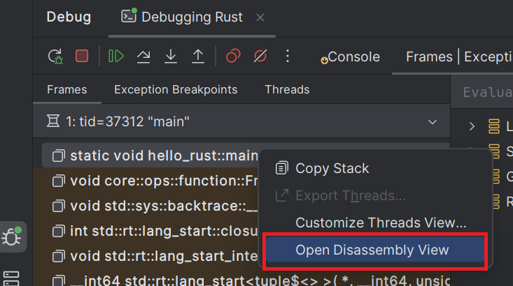

The Disassembly view shows the instructions for the current stack frame. You can add breakpoints and step through instructions one by one.

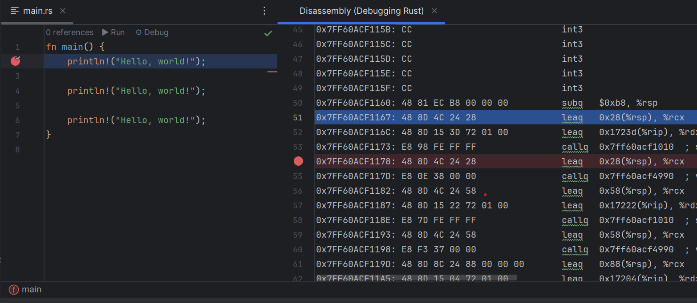

You can switch between source files and the Disassembly view at any time to continue step-by-step debugging.

Example: using [CodeLLDB](./user-defined-dap/codelldb.md) to debug a Rust executable built with `cargo build`.

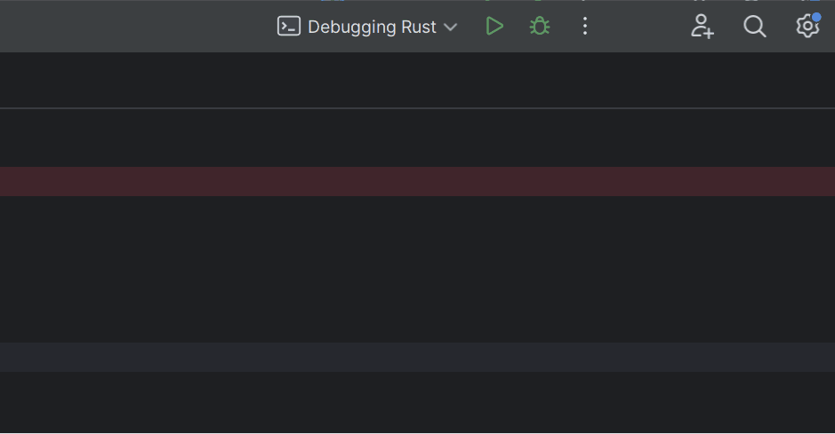

## Contextual Menu

Click on right button open existing / new DAP run configuration:

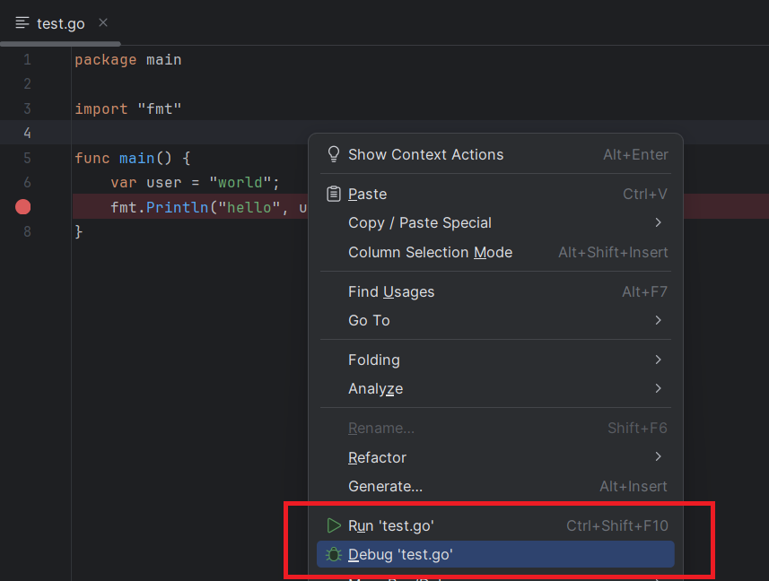

## DAP server traces

If you wish to show DAP request/response traces when you will debug:

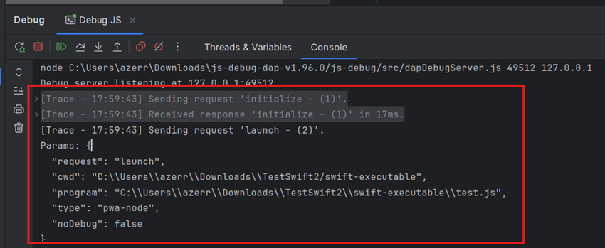

you need to select `Trace` with `verbose`.

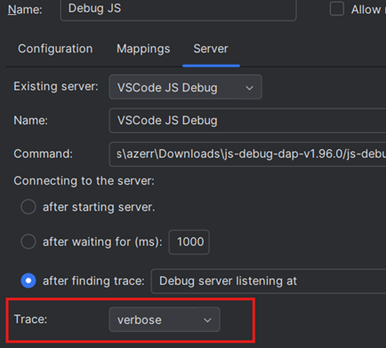

## DAP settings

You can `create/remove/update` DAP servers with the `Build, Execution, Deployment | Debugger | Debug Adapter Protocol` settings page:

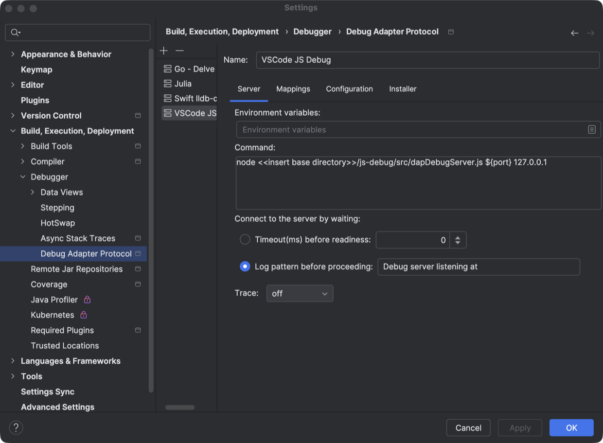

## Templates

LSP4IJ provides DAP templates that allow to initialize a given DAP server very quickly:

- [CodeLLDB](./user-defined-dap/codelldb.md) which allows you to debug `Rust`,`Swift`, etc. files.
- [Docker: Dockerfile Build Debugging](./user-defined-dap/buildx-dockerfile.md) which allows you to debug the build of a
  `Dockerfile`.
- [Erlang edb DAP server](./user-defined-dap/erlang-edb.md) which allows you to debug `Erlang` files.
- [Go Delve DAP server](./user-defined-dap/go-delve.md) which allows you to debug `Go` files.
- [Julia DAP server](./user-defined-dap/julia.md) which allows you to debug `Julia` files.
- [Perl DAP server](./user-defined-dap/perl-dap.md) which allows you to debug `Perl` files. 
- [Python Debugpy DAP server](./user-defined-dap/python-debugpy.md) which allows you to debug `Python` files.
- [Ruby rdbg DAP server](./user-defined-dap/ruby-rdbg.md) which allows you to debug `Ruby` files.
- [Swift DAP Server](./user-defined-dap/swift-lldb.md) which allows you to debug `Swift` files.
- [VSCode JS Debug DAP Server](./user-defined-dap/vscode-js-debug.md) which allows you to debug `JavaScript/TypeScript` files.

To create a DAP server from a template, click `Choose template...` in the `New Debug Adapter Server` dialog, which the
`+` of the [DAP settings](#dap-settings) and the `create a new server.` link of the [Server tab](#server-tab) open.

### Template descriptor

A DAP template is a folder in
[`templates/dap`](https://github.com/redhat-developer/lsp4ij/tree/main/src/main/resources/templates/dap) with these
files, of which only `template.json` is required:

- `template.json`: the DAP server, its command and its file mappings.
- `installer.json`: the [installer](../UserDefinedLanguageServerTemplate.md#installer-descriptor) of the DAP server.
- each file whose name starts with `launch.` or `attach.`, such as `launch.json` or `attach.tcp.json`: a launch or an
  attach configuration, the `DAP parameters (JSON)` of the `Configuration` tab, named by its `name`. The tab offers
  them in `Use the configuration:`, and fills the first launch and the first attach configuration. A template with
  attach configurations only selects the `Attach` debug mode.

The [Go Delve template](https://github.com/redhat-developer/lsp4ij/tree/main/src/main/resources/templates/dap/go-delve)
has these fields in its `template.json`:

```json
{
  "id": "go-delve",
  "name": "Go - Delve",
  "launch": {
    "default": "dlv dap"
  },
  "debugServerReadyPattern": "DAP server listening at: ${address}:${port}",
  "attach": {
    "port": "$port"
  }
}
```

| Field                     | Value                                                                                                                                                                                                       | Default                                                                                |
|---------------------------|-------------------------------------------------------------------------------------------------------------------------------------------------------------------------------------------------------------|----------------------------------------------------------------------------------------|
| `id`                      | the id of the template                                                                                                                                                                                      | none                                                                                   |
| `name`                    | the name of the DAP server                                                                                                                                                                                  | none                                                                                   |
| `url`                     | the page of the instructions, which the `Server` tab links                                                                                                                                                  | `https://github.com/redhat-developer/lsp4ij/tree/main/docs/dap/user-defined-dap/<id>.md` |
| `dev`                     | `true` lists the template only when the IDE runs with `idea.plugin.in.sandbox.mode`                                                                                                                         | `false`                                                                                |
| `launch`                  | the `Command` of the DAP server, by OS: `windows`, `mac`, `unix` (Linux and other Unix systems), and `default` for an OS without one                                                                         | none, as for a DAP server which LSP4IJ only attaches to                                |
| `env`                     | the environment variables, read only with a `launch`: `variables`, an object of names and values, and `includeSystemEnvironmentVariables`, `true` to pass the IDE's environment variables too               | `includeSystemEnvironmentVariables` is `false` when `env` doesn't set it               |
| `connectTimeout`          | the `Timeout(ms) before readiness`: above 0, the client waits this many milliseconds before it connects                                                                                                     | 0                                                                                      |
| `debugServerReadyPattern` | the `Log pattern before proceeding`, used when `connectTimeout` isn't above 0. It can take `${address}` and `${port}`, see [LSP4IJ placeholders](#lsp4ij-placeholders)                                    | none                                                                                   |
| `attach`                  | the `address` and the `port` to which an attach connects: a value, or `$` and the path of a value in the attach configuration, as `$port`, or `$connect.host` in the Python Debugpy template               | none                                                                                   |
| `fileTypeMappings`        | the files of the DAP server, as in a [language server template](../UserDefinedLanguageServerTemplate.md#fields)                                                                                            | none                                                                                   |
| `languageMappings`        | the files of the DAP server by IntelliJ language, as in a language server template                                                                                                                          | none                                                                                   |
