# Go - Delve

To debug `Go` files, you can use the [Delve](https://github.com/go-delve/delve) DAP server.

Let’s debug the following `test.go` file:

```go
package main

import "fmt"

func main() {
    var user = "world";
    fmt.Println("hello", user);
}
```

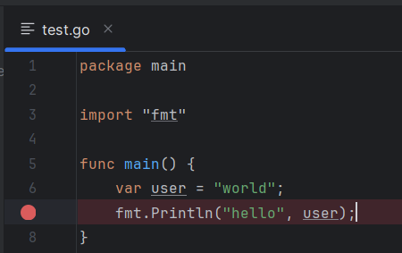
 
## Configure DAP server

1. [Install Go](https://go.dev/doc/install). The installer of the template installs Delve when the DAP server starts
   and `dlv` can't be run, with `go install github.com/go-delve/delve/cmd/dlv@latest`. `go install` puts `dlv` in the
   `bin` folder of your Go path (`go env GOPATH`, `$HOME/go` by default), which must be on the PATH of your IDE.
   You can also [install Delve](https://github.com/go-delve/delve/tree/master/Documentation/installation#installation)
   yourself.

2. Once Delve is installed, by you or by the installer at the first debug run, you should have the `dlv` command
   available (close and reopen your IDE to make sure that it finds the `dlv` command).

If you open a terminal and run the following command once Delve is installed:

```
dlv dap
```

You should see in the terminal traces like this:

```
DAP server listening at: 127.0.0.1:60732
```

3. Create a DAP Run/Debug configuration:

   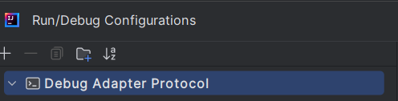

4. In the `Server` tab, click on `create a new server`:

   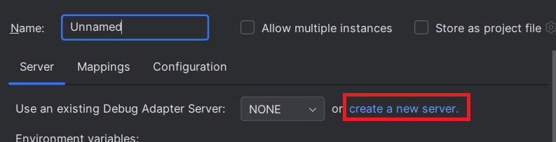

5. It opens a new dialog to create DAP server: click `Choose template...` and select the `Go - Delve` template:
   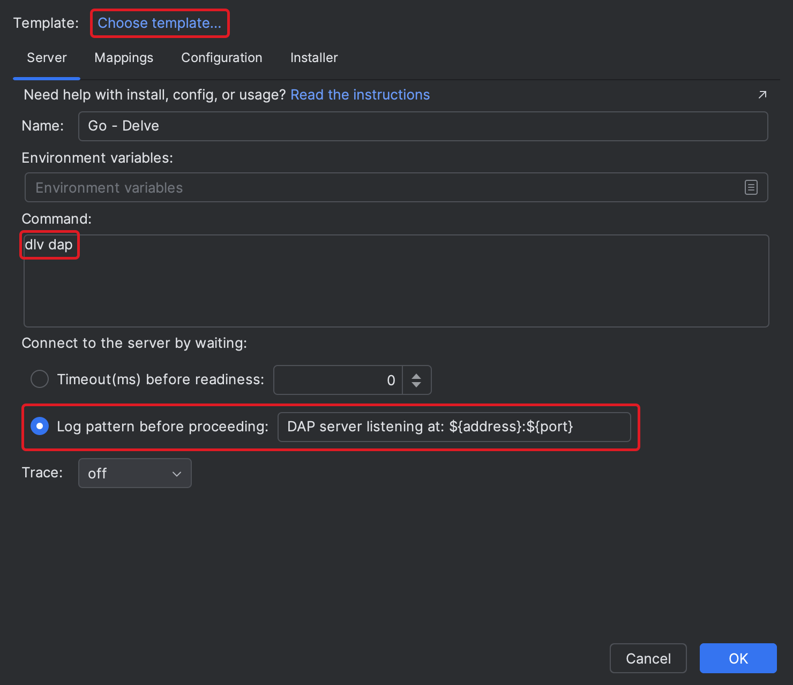

6. After clicking on `OK` button, it will select the new server and pre-fill configurations:

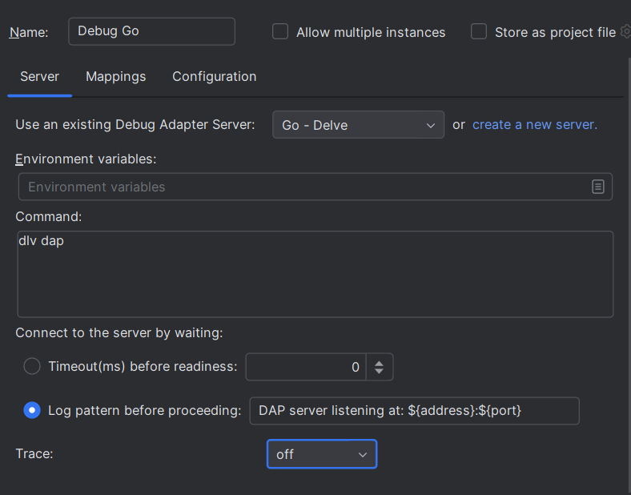

This will automatically populate:

 * the server `name`
 * the `command` which starts the DAP server which should look like this:

```
dlv dap
```

 * the `Connect to the server by waiting` option is set to `Log pattern before proceeding` with:

```
DAP server listening at: ${address}:${port}
```

This means the DAP (Debug Adapter Protocol) client will connect to the DAP server when this trace appears in the console:

```
dlv dap
DAP server listening at: 127.0.0.1:60732
```

Here `${port}` will be extracted and client will connect to the `60732` port.

5. Enable DAP server traces

If you wish to show DAP request/response traces when you will debug:

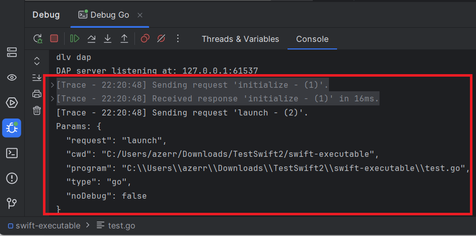

you need to select `Trace` with `verbose`.

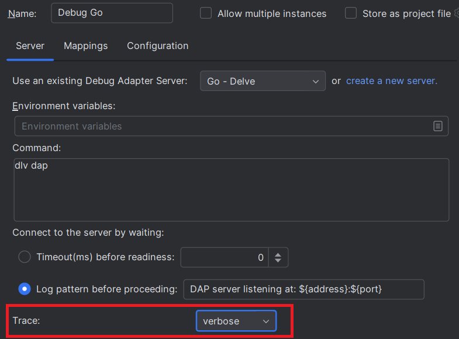

## Configure file mappings

To allows settings breakpoints to Go files, you need configure mappings in the `Mappings` tab.
As you have selected `Go - Delve` server, it will automatically populate the file mappings like this:

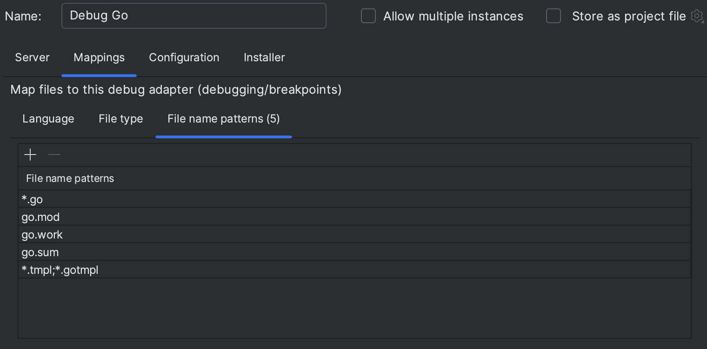

## Configure the Go file to run/debug

1. Fill in the `Configuration` tab:

- the `working directory`, or leave it empty: the debug adapter then runs in the directory of the file
- the path to the `test.go` file.

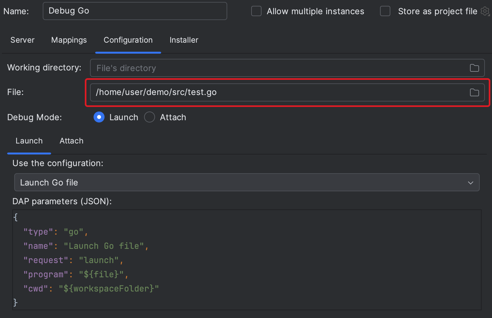

2. Select `Launch` as `Debug mode`.
3. The DAP parameters of the launch should look like this:

```json
{
   "type": "go",
   "name": "Launch Go file",
   "request": "launch",
   "program": "${file}",
   "cwd": "${workspaceFolder}"
}
```

When the run configuration starts:

- `${workspaceFolder}` will be replaced with the working directory you specified, or the project's directory without one.
- `${file}` will be replaced with the full path to `test.go`.

## Set Breakpoint

After applying the run configuration, you should set a breakpoint to files which matches file mappings.
Set a breakpoint in the `test.go` file:


## Debugging

You can start the run configuration in either Run or Debug mode. Once started, you should see DAP traces in the console:

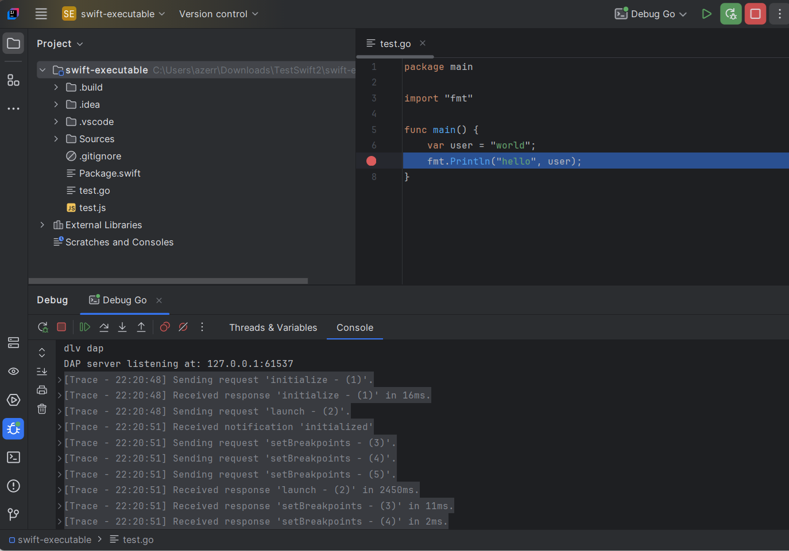

You will also see `Threads` and `Variables`:

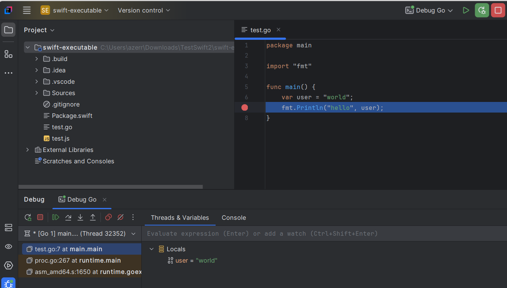

## Language Support

If you need language support for Go (completion, validation, etc) you can [configure the Go Language Server](../../user-defined-ls/gopls.md)

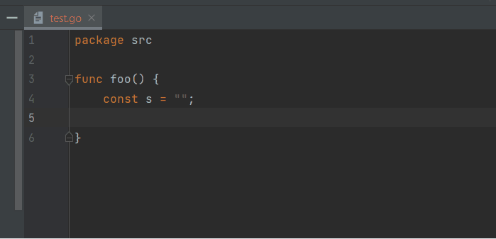
