# Ruby (rdbg) DAP server

To debug [Ruby](https://www.ruby-lang.org/) files, you can use the [Ruby rdbg](https://github.com/ruby/debug) DAP server.

Let’s debug the following `hello.rb` file:

```ruby
def main
  user = "hello world"
  puts user
end

if __FILE__ == $0
  main
end
```

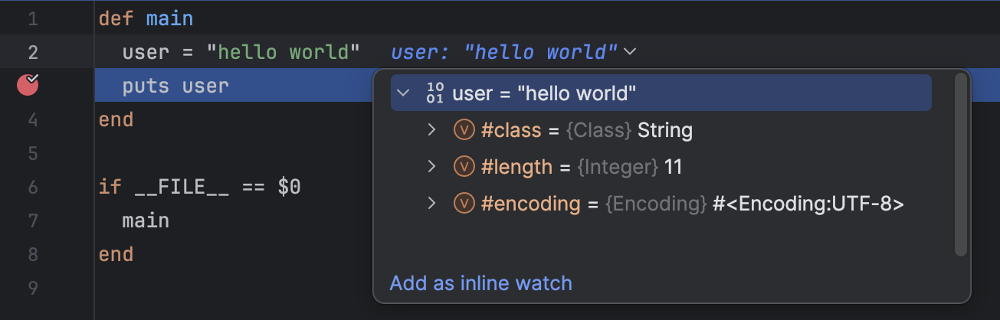

## Configure DAP server

1. [install Ruby](https://www.ruby-lang.org/en/documentation/installation/). 
After that open a terminal and type `ruby -v` to check Ruby is installed correctly. 

2. Use `gem install debug` to install the required `debug gem`, before you start your program with `rdbg` as
   [below](#configure-the-ruby-file-to-rundebug-with-attach). The installer of the template runs this command too when
   `rdbg` is missing, but only when a debug session starts, which is after you started your program with `rdbg`. It
   needs `gem` on the PATH of your IDE.

3. Create a test file named `hello.rb` with a simple Ruby script that includes a `main()` function printing `"hello world"`

```ruby
def main
  user = "hello world"
  puts user
end

if __FILE__ == $0
  main
end
```

4. Create a DAP Run/Debug configuration:

   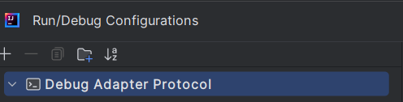

5. In the `Server` tab, click on `create a new server`:

   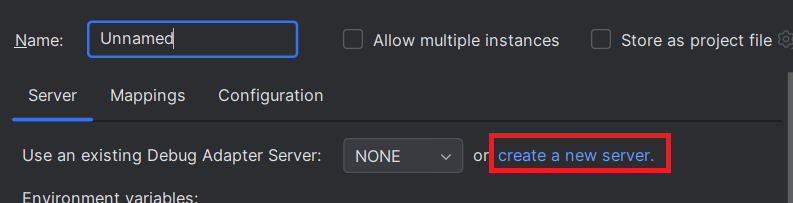

6. It opens a new dialog to create DAP server: click `Choose template...` and select the `Ruby Debug` template:
   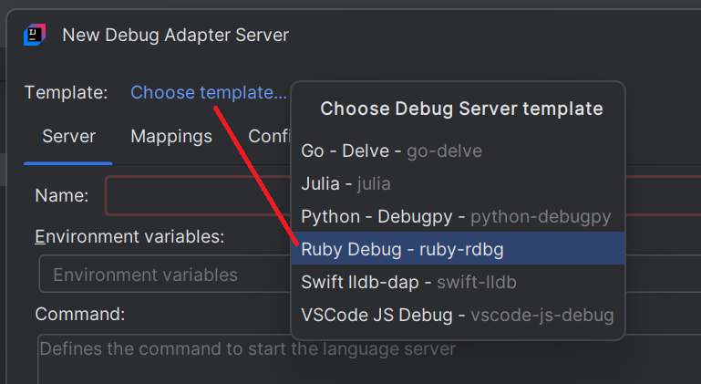

7. After clicking on `OK` button, it will select the new server and pre-fill configurations:

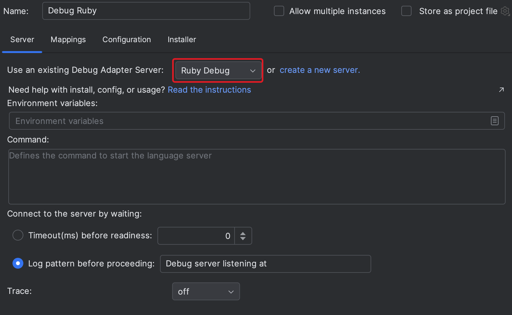

As [Ruby rdbg](https://github.com/ruby/debug) DAP server is consumed with [attach request](#configure-the-ruby-file-to-rundebug-with-attach),
the command is empty.

8. Enable DAP server traces

If you wish to show DAP request/response traces when you will debug, you need to select `Trace` with `verbose`.

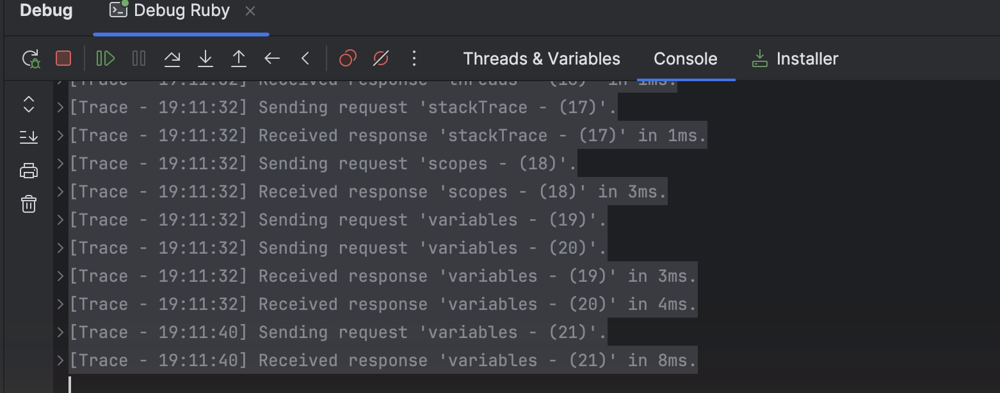

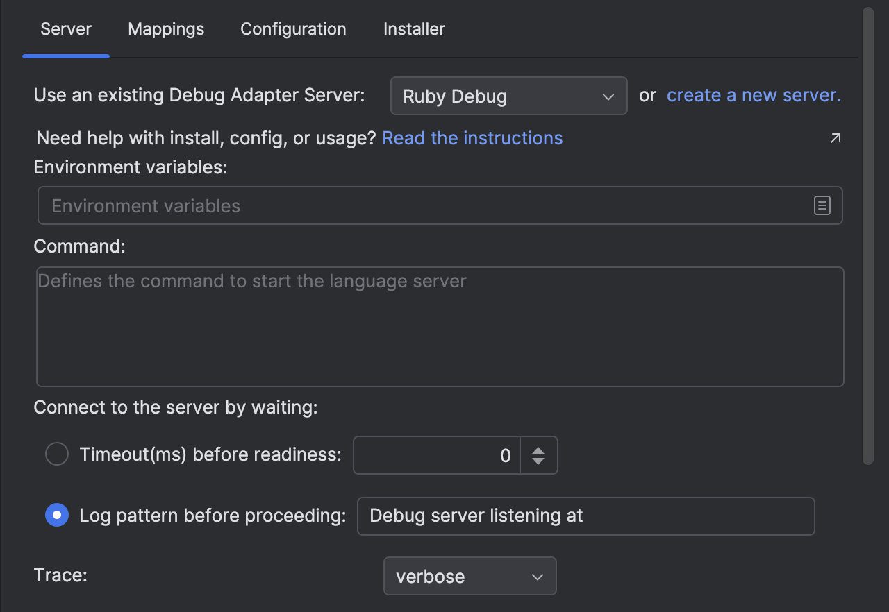

## Configure file mappings

To allows settings breakpoints to Ruby files, you need configure mappings in the `Mappings` tab.
As you have selected `Ruby Debug` server, it will automatically populate the file mappings like this:

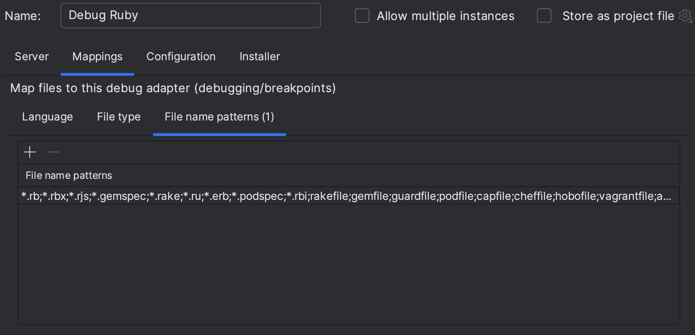

## Configure the Ruby file to run/debug with attach

As you have selected `Ruby Debug` server, it will automatically populate the `Attach` configuration like this:

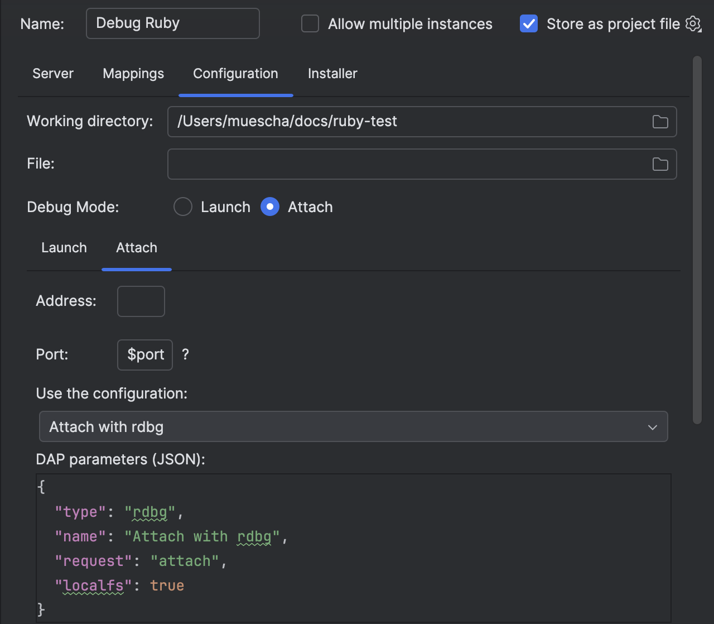

1. Select `Attach` as `Debug mode`: the template also has a launch configuration, so the dialog opens on `Launch`.
2. The DAP parameters of the launch should look like this:

```json
{
  "type": "rdbg",
  "name": "Attach with rdbg",
  "request": "attach"
}
```

`Port input` is pre-filled with `$port`, which means that the `port` of the JSON configuration is used as the port.
The configuration of the template has no `port`, so add the port of `rdbg` to it, `"port": 12345` for the command
below. You can see on the right of the inputs the real value of the address and port.

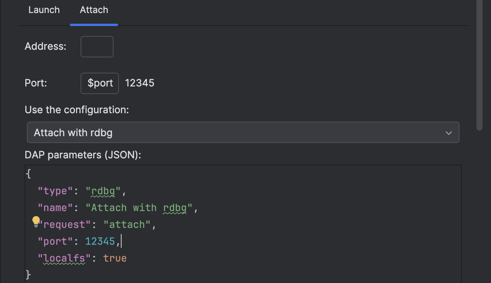

If you don't want to use JSON configuration, you can fill directly the real value.

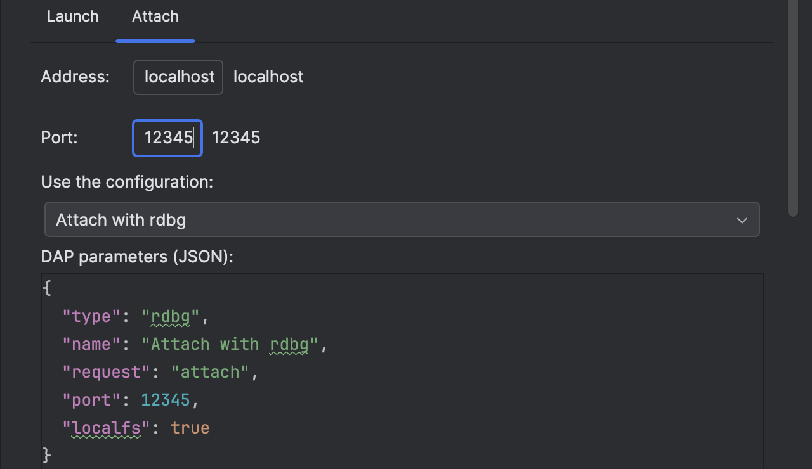

## Set Breakpoint

After applying the run configuration, you should set a breakpoint to files which matches file mappings.
Set a breakpoint in the `hello.rb` file.


## Start Ruby program in a Terminal

Open an `IntelliJ Terminal` (or other terminal), navigate to the directory containing your test file
and execute the following command to start the debug server:

```
rdbg --open --port 12345 hello.rb
```

This will make the script wait for a debugger to attach.

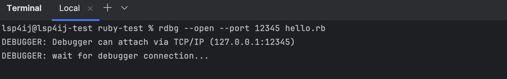

## Debugging

Before starting the configuration, check that your address and port are correct.

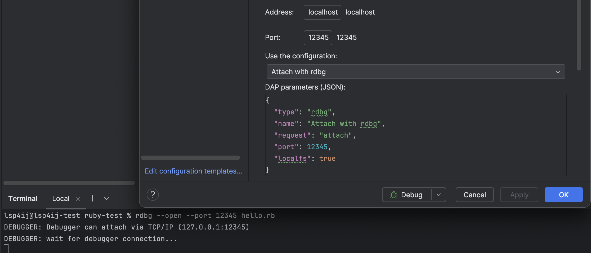

You can start the run configuration in either Run or Debug mode. Once started, you should see DAP traces in the console.


You will also see `Threads` and `Variables`.

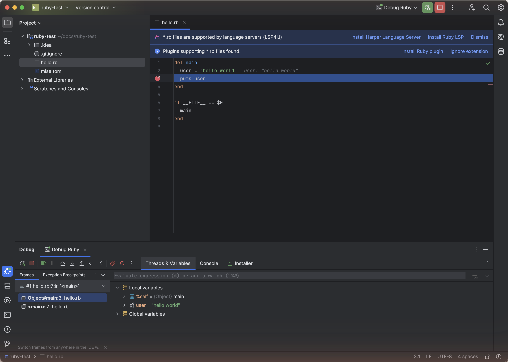

As [rdbg](https://github.com/ruby/debug) supports completion, you can use it while debugging:

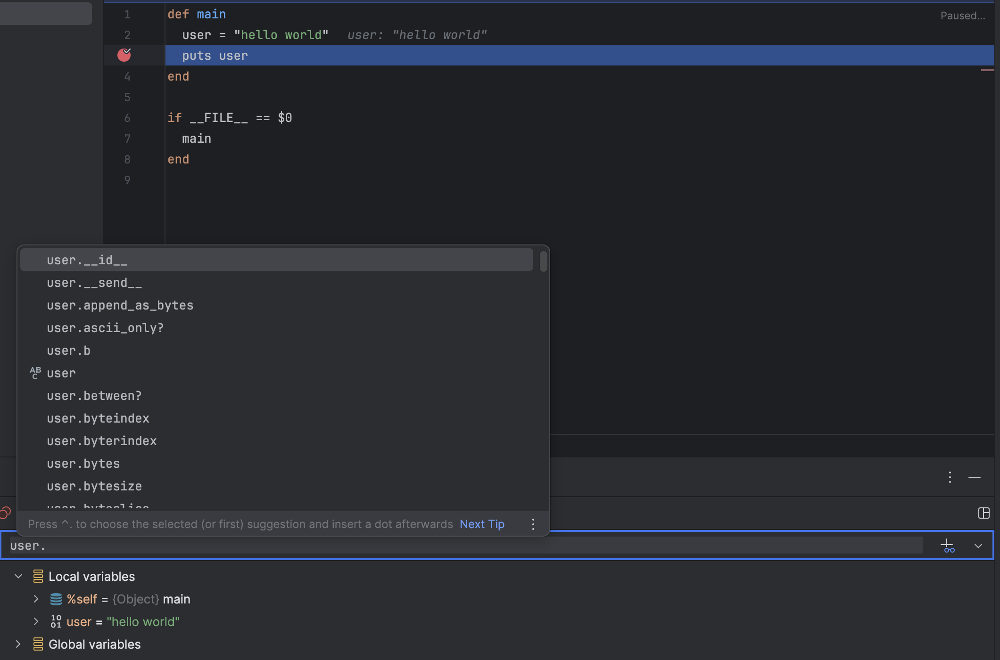
