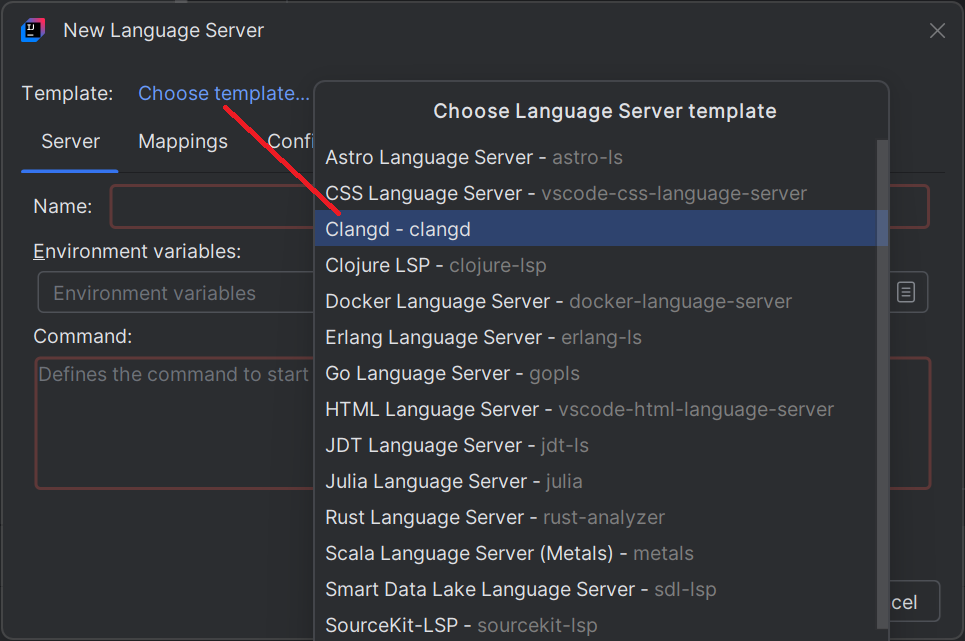

# Clangd

## Install the language server

1. **Open the New Language Server Dialog**. This can usually be found under the IDE settings related to Language Server Protocol (LSP). For more information, refer to the [New Language Server Dialog documentation](../UserDefinedLanguageServer.md#new-language-server-dialog).

2. **Select `Clangd` as the template** from the available options.
   This will populate the command field with a default command, `clangd`. When a `*.c`, `*.h` (etc) file is opened the
   first time, the installer downloads the asset of the latest [clangd snapshot](https://github.com/clangd/clangd/releases)
   for your OS, extracts it into a `clangd_snapshot_<date>` folder of `$USER_HOME$/.lsp4ij/lsp`, and sets the command to
   its `bin/clangd` executable (`bin/clangd.exe` on Windows). Then `*.c`, `*.h` support should be available.

   To install clangd yourself, see [Getting started](https://clangd.llvm.org/installation), keep the command `clangd`
   if `clangd` is on your PATH, and empty the `Installer` tab before you click **OK**, so that LSP4IJ doesn't install
   the server.

   
