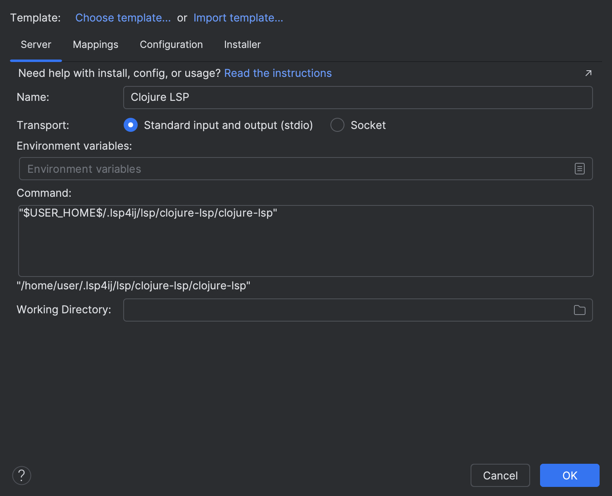
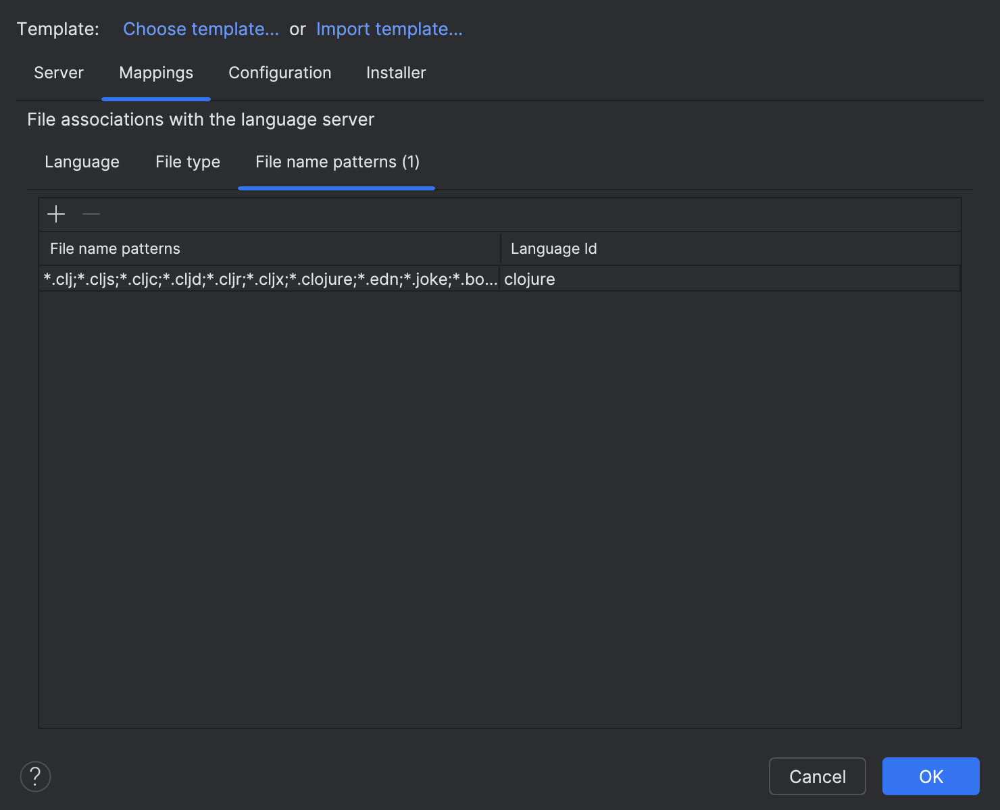
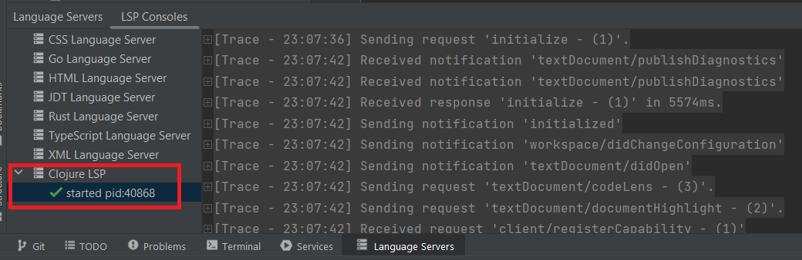

There is already the [clojure-lsp-intellij](https://github.com/clojure-lsp/clojure-lsp-intellij) dedicated plugin that fully integrates with lsp4ij and [Clojure LSP](https://clojure-lsp.io) providing more features, make sure to check it out first.

In case you want to integrate manually, follow these steps: 

1. **Open the New Language Server Dialog**. This can usually be found under the IDE settings related to Language Server Protocol (LSP). For more information, refer to the [New Language Server Dialog documentation](../UserDefinedLanguageServer.md#new-language-server-dialog).

2. **Select Clojure LSP as the template** from the available options. This will populate the command field with
   `"$USER_HOME$/.lsp4ij/lsp/clojure-lsp/clojure-lsp"` (`clojure-lsp.exe` on Windows), where the installer of the
   template puts Clojure LSP.

   

3. **Optional**: You may also customize the mappings section according to your preferences.

   

4. **Click OK** to apply the changes. You should now have Clojure language support enabled in your IDE, with the Clojure LSP integrated.

   

The first time the server starts, the installer downloads the `clojure-lsp-native-<os>-<arch>.zip` asset of the latest
[Clojure LSP release](https://github.com/clojure-lsp/clojure-lsp/releases) and extracts it into
`$USER_HOME$/.lsp4ij/lsp/clojure-lsp`.

To install Clojure LSP yourself, download the asset for your OS from the
[Clojure LSP releases page](https://github.com/clojure-lsp/clojure-lsp/releases) and extract it, set the command to the
extracted `clojure-lsp` executable (`clojure-lsp.exe` on Windows), and empty the `Installer` tab before you click
**OK**, so that LSP4IJ doesn't install the server.
