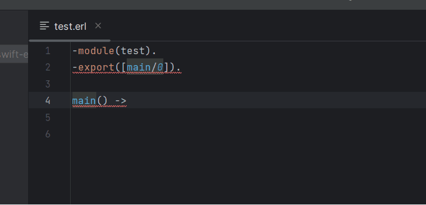
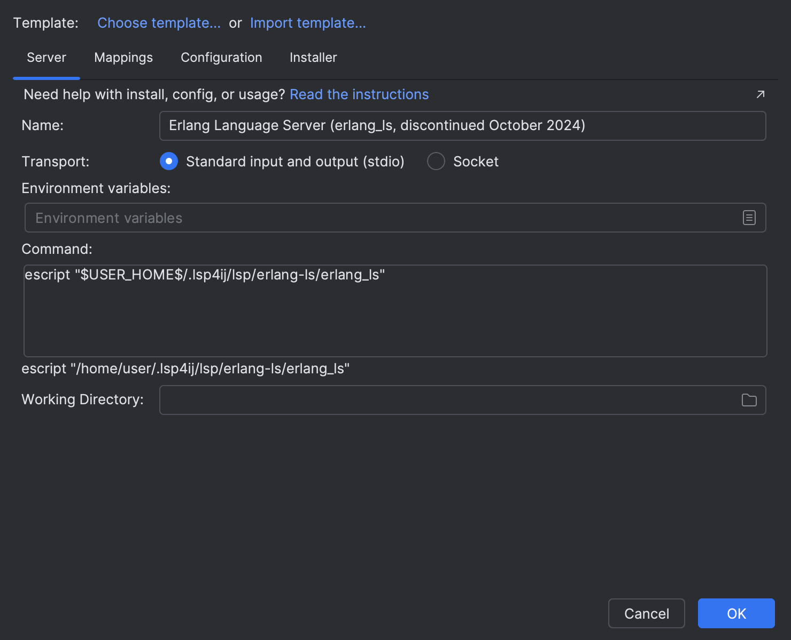
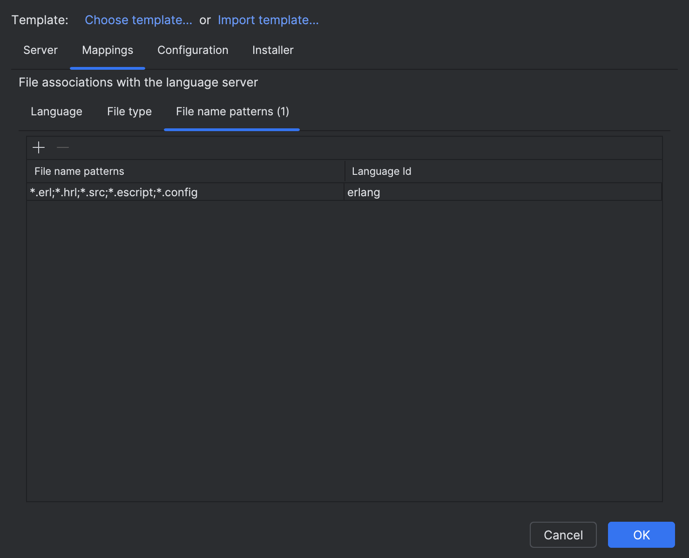
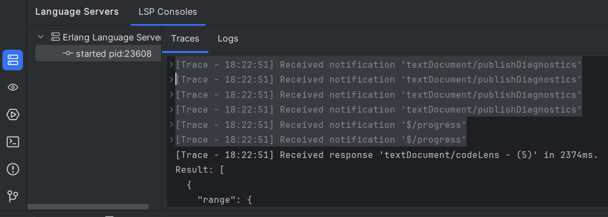
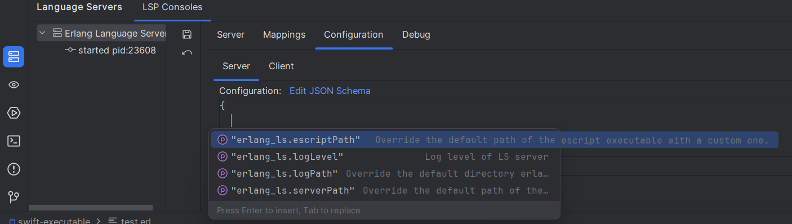

# Erlang Language Server

To enable [Erlang](https://www.erlang.org/) language support in your IDE, you can integrate [Erlang Language Server](https://github.com/erlang-ls/erlang_ls) by following these steps:



## Install the language server

1. [Download Erlang/OTP](https://www.erlang.org/downloads).

2. When the language server starts, the installer of the template downloads the `erlang_ls` escript of the latest
[Erlang LS release](https://github.com/erlang-ls/erlang_ls/releases) into `$USER_HOME$/.lsp4ij/lsp/erlang-ls`,
unless it is already there. On Linux and macOS, it takes the build for Erlang/OTP 27, which runs on OTP 27 to 29; on
Windows, the only build, for OTP 26, which runs on OTP 26 to 28. The command starts it from there:

```
escript "$USER_HOME$/.lsp4ij/lsp/erlang-ls/erlang_ls"
```

If you use an `erlang_ls` built for another Erlang/OTP version, or put it somewhere else, change its path in the command.

3. **Open the New Language Server Dialog**. This can usually be found under the IDE settings related to Language Server Protocol (LSP). For more information, refer to the [New Language Server Dialog documentation](../UserDefinedLanguageServer.md#new-language-server-dialog).

4. **Select Erlang Language Server as the template** from the available options.
   
   

6. **Optional**: You may also customize the mappings section according to your preferences.

   

7. **Click OK** to apply the changes. You should now have [Erlang](https://www.erlang.org/) language support enabled in your IDE:

   

You could also configure server (you should have completion which will help you to configure server):

