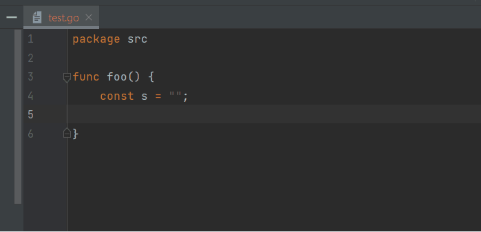
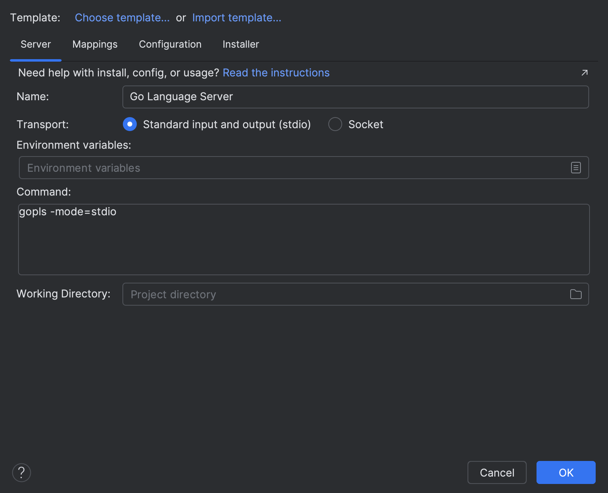
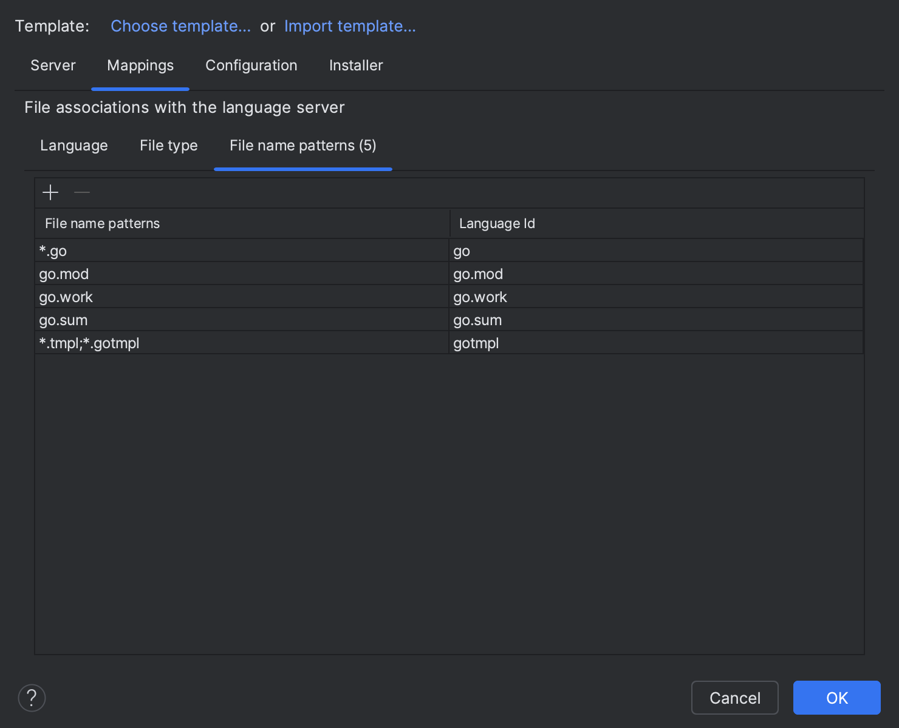
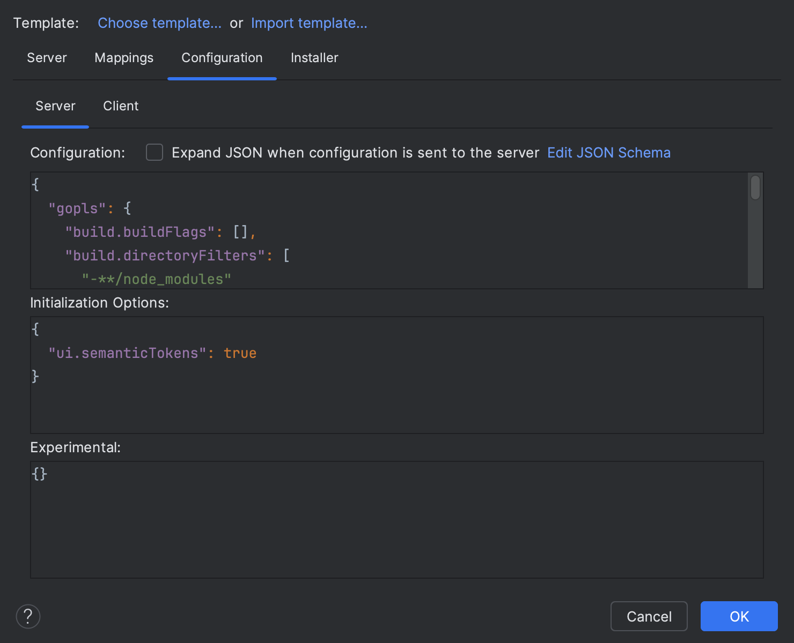
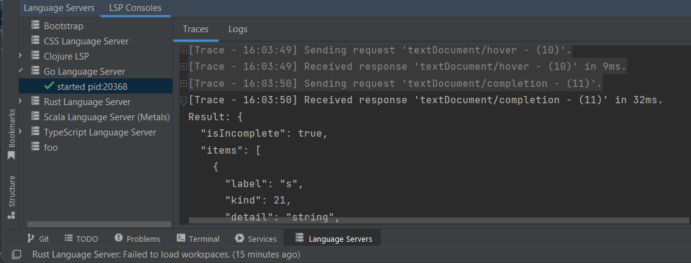
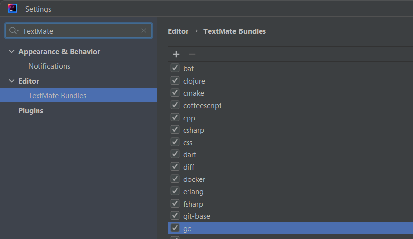
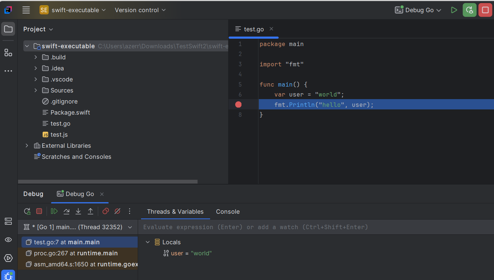

# Go Language Server

You can use the [Go language server](https://pkg.go.dev/golang.org/x/tools/gopls) to benefit from `Go` support:

## Install the language server

1. **Install Go**: [Download and install Go](https://go.dev/doc/install), and close and reopen your IDE so that it
   finds `go` in the updated PATH.

   The installer of the template installs the Go language server **gopls** the first time the server starts, with:

   **go install golang.org/x/tools/gopls@latest**

   If `go` isn't found, it shows a message with a link to install Go. `go install` puts `gopls` in the `bin` folder of
   your Go path (`go env GOPATH`, `$HOME/go` by default), which must be on the PATH of your IDE. Otherwise, set the
   command to the full path of `gopls`.

   To install gopls yourself, [read the "Installation" section](https://pkg.go.dev/golang.org/x/tools/gopls#section-readme),
   or run the same `go install` command in a terminal.

2. **Open the New Language Server Dialog**. This can usually be found under the IDE settings related to Language Server Protocol (LSP). For more information, refer to the [New Language Server Dialog documentation](../UserDefinedLanguageServer.md#new-language-server-dialog).

3. **Select Go Language Server as the template** from the available options.
   This will populate the command field with the default command `gopls -mode=stdio`.

   

5. **Optional**: You may also customize the mappings section:

   

   or configuration section according to your preferences.

   

6. **Click OK** to apply the changes. You should now have Go language support enabled in your IDE, with the [Go language server](https://pkg.go.dev/golang.org/x/tools/gopls) integrated, 
   and you should see the language server in the [LSP console](../UserGuide.md#lsp-console):

   

## Syntax coloration

The demo uses the [Go TextMate grammar](https://github.com/golang/vscode-go/tree/master/extension/syntaxes) 
that you can configure in IntelliJ via the `Editor / TextMate Bundles` settings.

You need to clone https://github.com/golang/vscode-go/tree/master/extension and reference this folder 
(which contains the [package.json](https://github.com/golang/vscode-go/blob/540e146da867f42298ccdac782e4e163fec16b0d/extension/package.json#L172))
to benefit from syntax coloration and language configuration (matching brackets, etc).

## Debugging

If you need to Run/Debug Go program, you can [configure the Go DAP server](../dap/user-defined-dap/go-delve.md).

