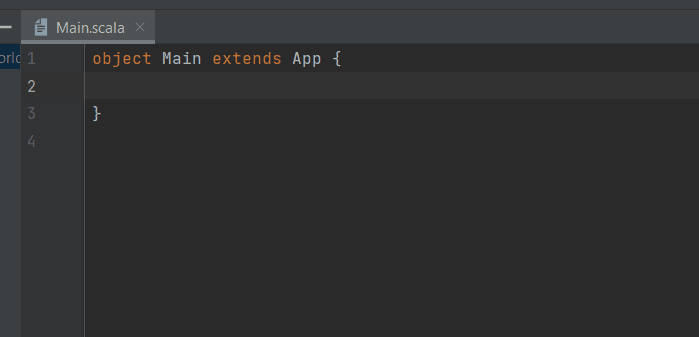
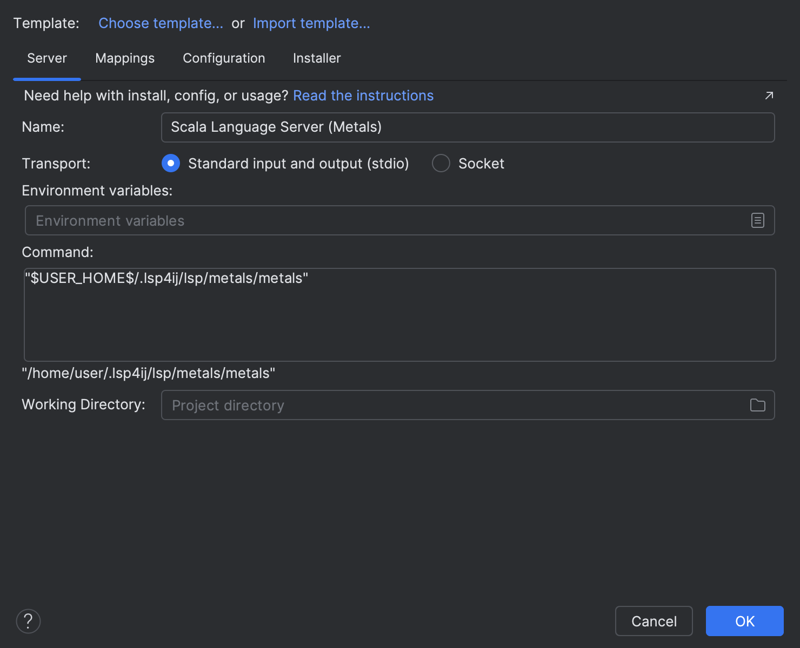
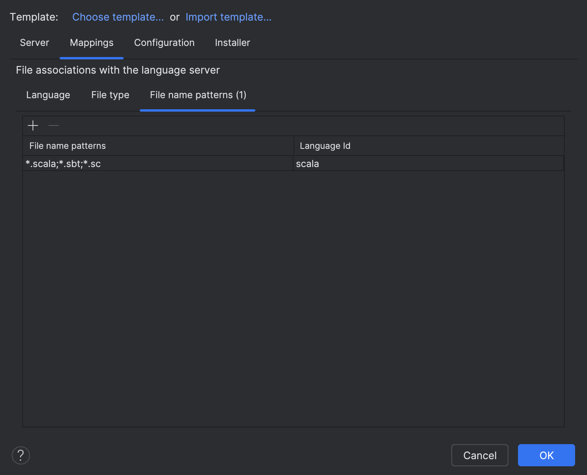
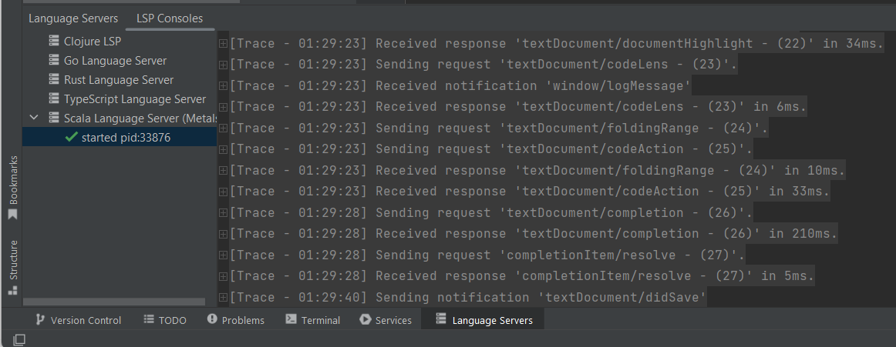

To enable Scala language support in your IDE, you can integrate [Scala Language Server (Metals)](https://scalameta.org/metals/) by following these steps:

1. Install [Coursier](https://get-coursier.io/docs/cli-installation), and make sure its `cs` or `coursier` command is
   on your PATH: `cs setup` installs `cs`, `brew install coursier` installs `coursier`, and
   `brew install coursier/formulas/coursier` installs both. Close and reopen your IDE if you changed the PATH.

2. **Open the New Language Server Dialog**. This can usually be found under the IDE settings related to Language Server Protocol (LSP). For more information, refer to the [New Language Server Dialog documentation](../UserDefinedLanguageServer.md#new-language-server-dialog).

3. **Select Scala Language Server (Metals) as the template** from the available options.
   This will populate the command field with `"$USER_HOME$/.lsp4ij/lsp/metals/metals"` (`metals.bat` on Windows),
   where the installer of the template puts Metals.
   
   

4. **Optional**: You may also customize the mappings section according to your preferences.

   

5. **Click OK** to apply the changes. The first time the server starts, the installer runs
   `cs install metals --install-dir .` in `$USER_HOME$/.lsp4ij/lsp/metals`, or `coursier install metals --install-dir .`
   without `cs`, which creates the `metals` launcher there (`metals.bat` on Windows). You should now have Scala
   language support enabled in your IDE, with the Metals integrated.

   

To install Metals yourself, read [How to start Metals?](https://scalameta.org/metals/docs/integrations/new-editor#starting-the-server),
set the command to the launcher you created, and empty the `Installer` tab before you click **OK**, so that LSP4IJ
doesn't install the server.
