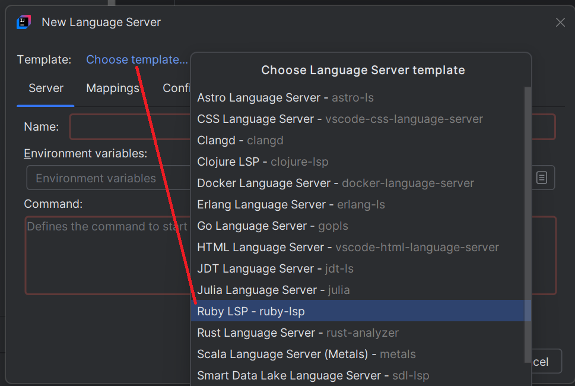

# Ruby LSP

## Install the language server

1. **Open the New Language Server Dialog**. This can usually be found under the IDE settings related to Language Server Protocol (LSP). For more information, refer to the [New Language Server Dialog documentation](../UserDefinedLanguageServer.md#new-language-server-dialog).

2. **Select `Ruby LSP` as the template** from the available options.
   This will populate the command field with a default command, `ruby-lsp` (`cmd /C ruby-lsp` on Windows). When a Ruby
   file is opened the first time, the installer runs `gem install ruby-lsp`, and Ruby support should be available.
   You need [Ruby](https://www.ruby-lang.org/en/documentation/installation/), with `gem`, on your PATH. `gem install`
   puts `ruby-lsp` in the executable folder of your gems (see `gem environment`), which must be on the PATH of your
   IDE. Otherwise, set the command in the `Server` tab to the full path of `ruby-lsp`.

   To install the server yourself, run `gem install ruby-lsp` in a terminal.

   
