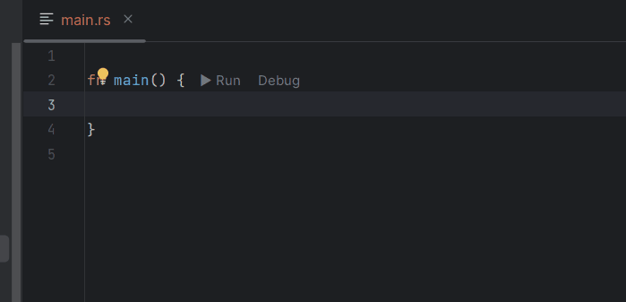
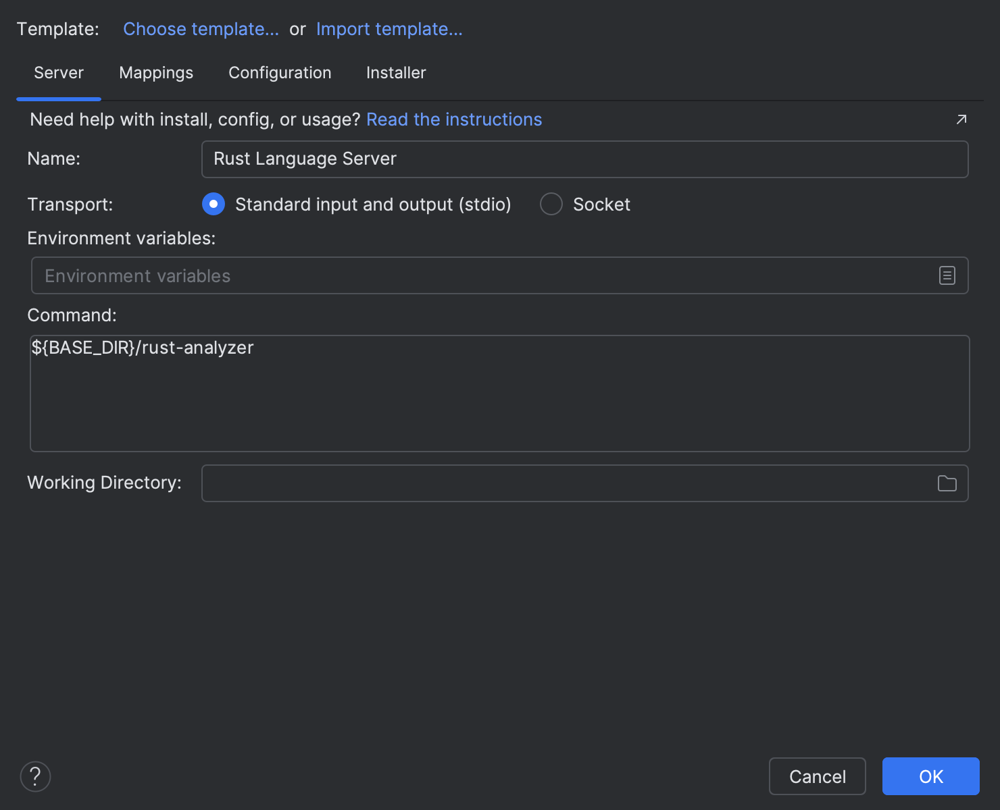
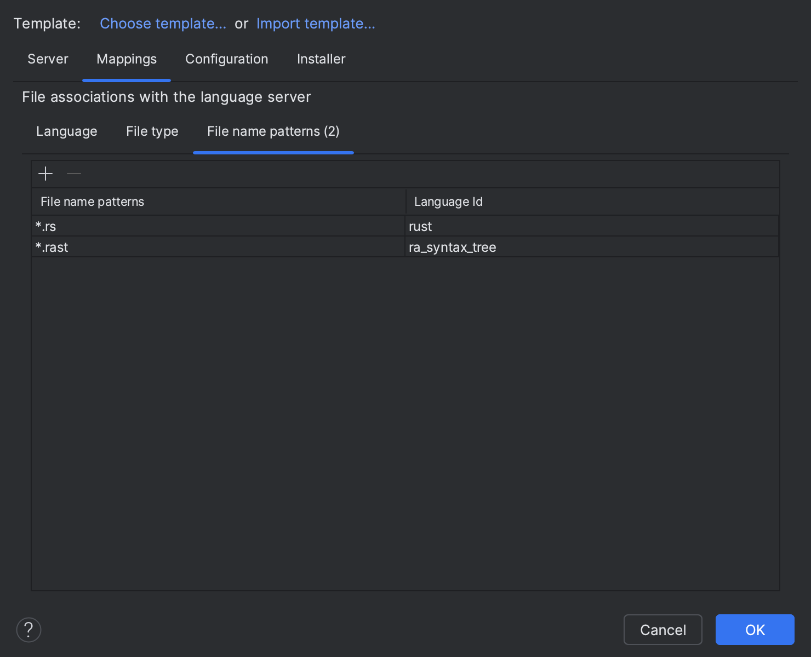
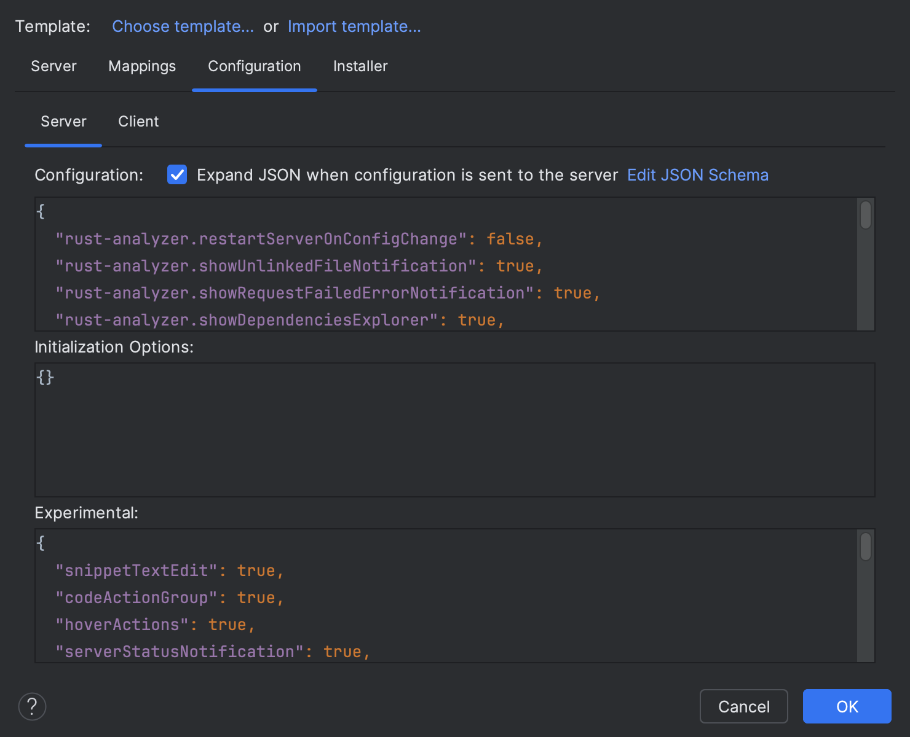
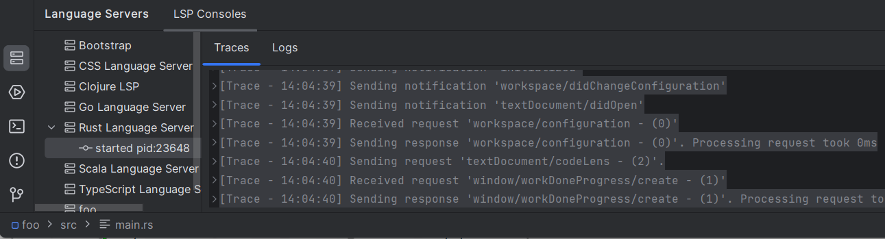
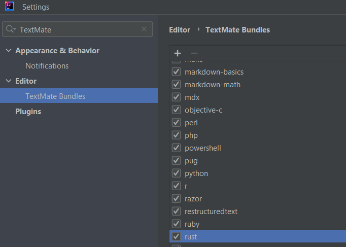

# Rust Language Server

You can use [Rust Analyzer](https://rust-analyzer.github.io/) to benefit from `Rust` support:

## Install the language server

1. **Open the New Language Server Dialog**. This can usually be found under the IDE settings related to Language Server Protocol (LSP). For more information, refer to the [New Language Server Dialog documentation](../UserDefinedLanguageServer.md#new-language-server-dialog).

2. **Select Rust Language Server as the template** from the available options.
   This will populate the command field with a default command:

    * `${BASE_DIR}/rust-analyzer.exe` for Windows OS.
    * `${BASE_DIR}/rust-analyzer` for other OS.

   

   The first time the server starts, the installer of the template downloads the asset of the latest
   [rust-analyzer release](https://github.com/rust-lang/rust-analyzer/releases) for your OS and architecture into
   `$USER_HOME$/.lsp4ij/lsp/rust-analyzer`, and sets the command to the executable, as
   `"$USER_HOME$/.lsp4ij/lsp/rust-analyzer/rust-analyzer-x86_64-unknown-linux-gnu"` on Linux x64 or
   `"$USER_HOME$/.lsp4ij/lsp/rust-analyzer/rust-analyzer.exe"` on Windows.

   To install rust-analyzer yourself, [download the rust-analyzer language server binary](https://rust-analyzer.github.io/manual.html#rust-analyzer-language-server-binary),
   set the command to it, and empty the `Installer` tab before you click **OK**, so that LSP4IJ doesn't install the
   server.

3. **Optional**: You may also customize the mappings section:

   

   or configuration section according to your preferences.

   

4. **Click OK** to apply the changes. You should now have Rust language support enabled in your IDE, with the [Rust language server](https://rust-analyzer.github.io/) integrated,
   and you should see the language server in the [LSP console](../UserGuide.md#lsp-console):

   
 
## Syntax coloration

LSP4IJ supports [`textDocument/semanticTokens`](https://microsoft.github.io/language-server-protocol/specifications/lsp/3.17/specification/#textDocument_semanticTokens).
See [Semantic Tokens support](../UserGuide.md#semantic-tokens-support) for color settings and the Semantic Tokens Inspector.

You can also add the [Rust TextMate grammar](https://github.com/microsoft/vscode/blob/main/extensions/rust/syntaxes/rust.tmLanguage.json)
in IntelliJ via the `Editor / TextMate Bundles` settings:

Clone https://github.com/microsoft/vscode and reference this folder
(which contains the [package.json](https://github.com/microsoft/vscode/tree/main/extensions/rust))
for extra syntax coloration and language configuration (matching brackets, etc).
