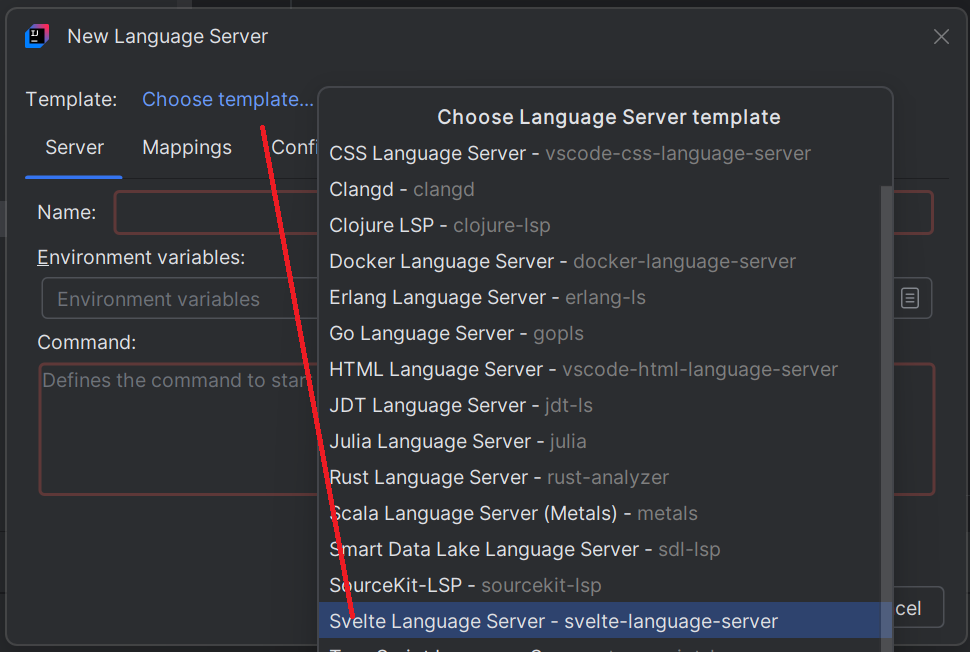

# Svelte Language Server

https://svelte.dev/

## Install the language server

1. **Open the New Language Server Dialog**. This can usually be found under the IDE settings related to Language Server Protocol (LSP). For more information, refer to the [New Language Server Dialog documentation](../UserDefinedLanguageServer.md#new-language-server-dialog).

2. **Select `Svelte Language Server` as the template** from the available options.
   This will populate the command field with a default command, `svelteserver --stdio` (`svelteserver.cmd --stdio` on
   Windows). When a `.svelte` file is opened the first time, the installer installs the `svelte-language-server` npm
   package into `$USER_HOME$/.lsp4ij/lsp/svelte-language-server` with `npm install`, and sets the command to
   `"$USER_HOME$/.lsp4ij/lsp/svelte-language-server/node_modules/.bin/svelteserver" --stdio` (`svelteserver.cmd` on
   Windows). Then Svelte support should be available. You need [Node.js](https://nodejs.org/en/download), with `npm`,
   on your PATH.

   To install the server yourself, run `npm install -g svelte-language-server`, keep the command of the template, and
   empty the `Installer` tab before you click **OK**, so that LSP4IJ doesn't install the server.

   
