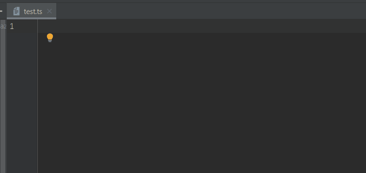
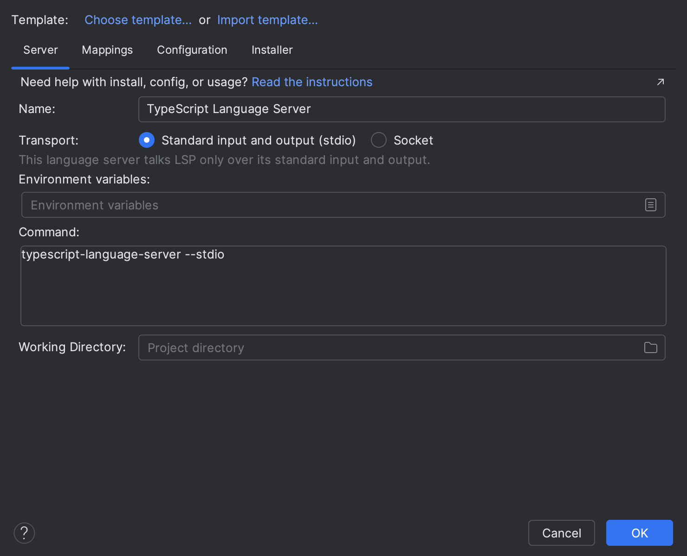
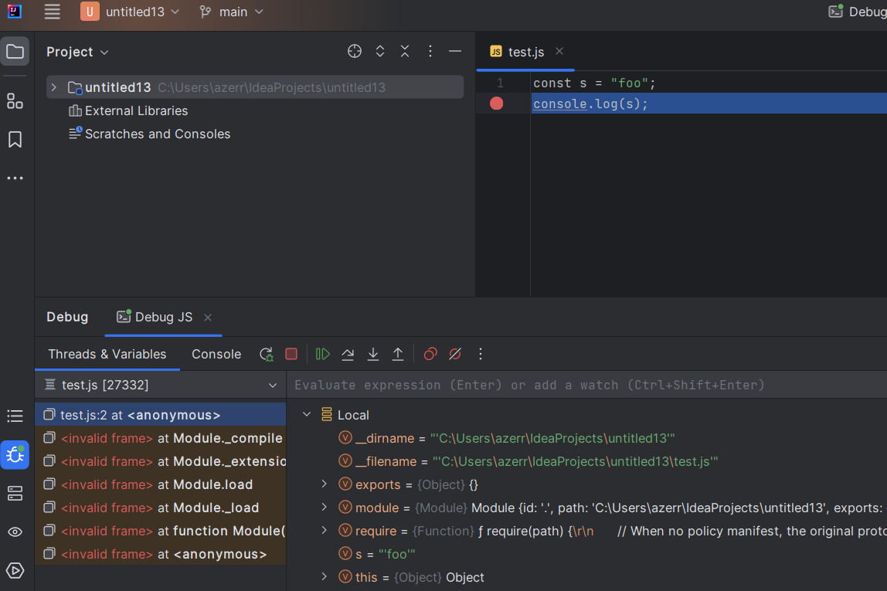

# TypeScript Language Server

You can use the [TypeScript language server](https://github.com/typescript-language-server/typescript-language-server) to benefit from `TypeScript`, `React` and `JavaScript` support:

## Install the language server

* [Install Node.js](https://nodejs.org/en/download), with `npm`.
* Create the TypeScript Language Server with the [language server template](../UserDefinedLanguageServer.md#using-template):

The first time the server starts, the installer of the template installs, with
`npm install typescript-language-server typescript --force`, into `$USER_HOME$/.lsp4ij/lsp/typescript-language-server`:

* [TypeScript language server](https://github.com/typescript-language-server/typescript-language-server). This project
  delegates the LSP operations (completion, diagnostics, etc) to the **tsserver** from [TypeScript](https://github.com/microsoft/TypeScript)
  which doesn't support LSP.
* [TypeScript](https://github.com/microsoft/TypeScript) which hosts the **tsserver**.

It then sets the command to
`"$USER_HOME$/.lsp4ij/lsp/typescript-language-server/node_modules/.bin/typescript-language-server" --stdio`
(`typescript-language-server.cmd` on Windows).

The server talks LSP over its standard input and output only (`--stdio`), so the template lists only `stdio` in its
transports.

To install the server yourself, [read the "Installing" section](https://github.com/typescript-language-server/typescript-language-server?tab=readme-ov-file#installing),
basically, open a terminal and execute **npm install -g typescript-language-server typescript**. As the command adds
**typescript-language-server** to your OS PATH, close and reopen your IDE to update this PATH. Keep the command of the
template, `typescript-language-server --stdio` (`cmd /C typescript-language-server.cmd --stdio` on Windows), and empty
the `Installer` tab before you click **OK**, so that LSP4IJ doesn't install the server.

## Debugging

If you need to Run/Debug JavaScript/TypeScript program, you can [configure the VSCode JS Debug DAP server](../dap/user-defined-dap/vscode-js-debug.md).

