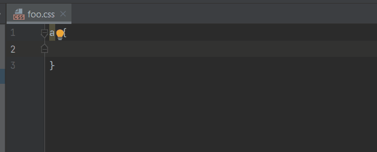
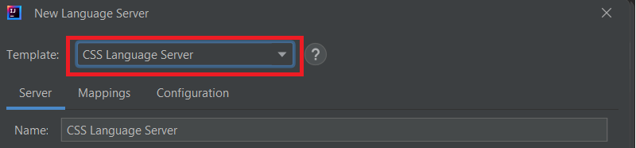

# CSS Language Server

You can leverage the [Visual Studio Code CSS Language Server](https://github.com/microsoft/vscode-css-languageservice) to enhance your development experience with support for `CSS`, `LESS`, and `SCSS`.

You can use it by following these instructions:
* [Install Node.js](https://nodejs.org/en/download)
* Create the CSS Language Server with the [language server template](../UserDefinedLanguageServer.md#using-template):

The first time the language server starts, its installer checks whether the command works, and if not, installs
[vscode-langservers-extracted](https://github.com/hrsh7th/vscode-langservers-extracted), which has the CSS language
server, with `npm install vscode-langservers-extracted --force`. After that, only the `Reinstall` action runs it. The
command starts the CSS language server where the installer puts it:
> **$USER_HOME$/.lsp4ij/lsp/vscode-langservers-extracted/node_modules/vscode-langservers-extracted/lib/css-language-server/node/cssServerMain.js**

The [ESLint Language Server](./vscode-eslint-language-server.md) template installs the same package into the same
folder.

If you installed vscode-langservers-extracted somewhere else, change the path of **cssServerMain.js** in the command
text field.

The server talks LSP over its standard input and output (`--stdio`), or over a socket: set `Transport` to `Socket`
with `Start the language server, it connects to LSP4IJ`, and LSP4IJ replaces `--stdio` with `--socket=${port}` in the
command. See [Transport](../UserDefinedLanguageServer.md#transport).
